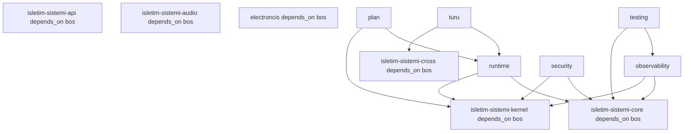

# K000 — Bağımlılıklar (12 düğüm OS hizmetleri haritası)

> **Etiket sözlüğü**
> `[KANIT]` → diskte gerçek dosya/satır **veya** 2026-10-13'te HTTP 200 ile açılmış resmi URL.
> `[TASARIM]` → CoreMusic'in kendi tercihi / mimari harita; OS zorunluluğu değil.
> `[BİLİNMEYEN]` → veri yok; uydurulmadı, açık soru olarak taşındı.

---

## §A — Bağımlılık kavramı

Bir bağımlılık, **iki katman arasındaki yönü olan bağdır**: bir katman diğerinin **hizmetini**
kullanır. K000'de üç bağımlılık **katmanı** var:

| Katman | Ne bağımlı | Neye bağımlı | Etiket |
|---|---|---|---|
| **OS-hizmet** (B/C/P/T) | CoreMusic kodu | OS syscall/kavramı | `[KANIT]` (repo satır) |
| **düğüm-içi** (12×12) | 1 kademe-2 düğüm | başka kademe-2 düğüm | `[TASARIM]` (mimari harita) |
| **domainler-arası** (K000↔K001/K002/K011) | K000 domain | komşu K domain | `[TASARIM]` + Q5 |

**Bağımlılık türleri (bu dosyada):**

| Tür | Tanım | Örnek |
|---|---|---|
| Zorunlu | OS olmadan çalışmaz | `sys_get_temp_dir()` (B2) |
| Koşullu | Bazı koşulda gerekli | `ext-apcu` (C1), ffmpeg (C6) |
| Platform | Belirli OS'a özgü | CI Linux (P1), Apache/IIS (P2) |
| Ters | OS'un CoreMusic'ten beklediği | PHP binary PATH (T1) |
| Versiyon | sürüm/evolución bağımlılığı | PHP ≥ 8.4 (P3) |
| Kırılgan | tek nokta / yüksek risk | ses donanımı erişimi yok (C7) |

**Önemli dürüstlük notu:** §B'deki 12×12 **düğüm-içi** matris, kod modülleri arası çalışan
çağrı bağımsızlığı **değil**, bu 12 **doküman düğümünün** mimari kapsam bağımlılığıdır
(yani "bu alt alan hangi alt alanın kavramına referans verir"). Buna `[TASARIM]` denir —
ölçülmemiş kod bağımlılığı **iddia edilmez**. Ölçülmüş OS-hizmet bağımlılıkları §B.2–§B.4
(`[KANIT]`, repo satır no ile)tedir.

---

## §B — 12 düğümün bağımlılık matrisi

### §B.1 12×12 mimari bağımlılık matrisi `[TASARIM]`

> **Okuma:** satır = "bu düğüm", sütun = "bağımlı olduğu düğüm". `✓` = bağımlı, `—` = değil.
> Kısa adlar: `ele`=electroncis · `api` · `aud`=audio · `cor`=core · `cro`=cross · `ker`=kernel ·
> `obs`=observability · `pln`=plan · `run`=runtime · `sec`=security · `tes`=testing · `tur`=turu.

| ↓ bağımlı / → olduğu | ele | api | aud | cor | cro | ker | obs | pln | run | sec | tes | tur |
|---|---|---|---|---|---|---|---|---|---|---|---|---|
| **electroncis** (ele) | — | — | ✓ | — | — | — | — | — | — | — | — | ✓ |
| **api** | — | — | — | ✓ | — | ✓ | — | — | — | — | — | — |
| **audio** (aud) | — | ✓ | — | — | — | ✓ | — | — | — | — | — | ✓ |
| **core** (cor) | — | — | — | — | — | ✓ | — | ✓ | — | — | — | — |
| **cross** (cro) | — | ✓ | — | — | — | — | — | — | ✓ | — | — | ✓ |
| **kernel** (ker) | — | — | — | — | — | — | — | — | — | — | — | — |
| **observability** (obs) | — | — | — | — | — | ✓ | — | — | — | — | — | — |
| **plan** (pln) | — | — | — | — | — | ✓ | — | — | — | — | — | — |
| **runtime** (run) | — | ✓ | — | — | ✓ | — | — | — | — | — | — | — |
| **security** (sec) | — | ✓ | — | — | — | ✓ | — | — | — | — | — | — |
| **testing** (tes) | — | — | — | — | — | ✓ | ✓ | — | ✓ | — | — | — |
| **turu** (tur) | — | ✓ | — | — | ✓ | — | — | — | — | — | — | — |

**Sütun toplamı (en çok bağımlı olunan):** `ker`=8 · `api`=6 · `tur`=4 · `cor`=1 · `cro`=3 · `pln`=1 · `obs`=1 · `run`=1 · `aud`=1. `ele`/`sec`/`tes`'e **hiçbir** düğüm bağımlı değil (yaprak düğümler).

**Gözlem:** `kernel` **herkesin** alt katmanıdır (8 düğüm ona bağlı) — beklenen, çünkü OS'nin
çekirdeği her hizmetin kaynağıdır. `api` ve `turu` ikinci sırada (libc yüzeyi ve platform ailesi).

### §B.2 Zorunlu bağımlılıklar (OS olmadan çalışmaz) `[KANIT]`

| # | OS hizmeti | İlgili düğüm | Kullanım biçimi | Kanıt (repo satır) |
|---|---|---|---|---|
| B1 | Platform tanıma (`uname`) | api, turu | `php_uname('s')` → hangi OS? | `shared/src/Api/Bff/DesktopBff.php:35` |
| B2 | Geçici dizin | core, runtime | `sys_get_temp_dir()` | `shared/src/Component/TemplateEngine.php:73` |
| B3 | Dizin oluşturma + izin | security, core | `@mkdir($savePath, 0750, true)` | `shared/src/Session/SessionConfig.php:35` |
| B4 | Oturum yolu | core, runtime | `ini_get('session.save_path') ?: sys_get_temp_dir()` | `shared/src/Session/SessionConfig.php:33` |
| B5 | Alt süreç | kernel, testing | `proc_open` (borular ile) | `shared/tests/Repository/ApiKeyCreateCommandTest.php:253` |
| B6 | Komut çalıştırma | kernel, audio | `shell_exec` + `escapeshellarg` | `shared/src/AI/AIEngine.php:295` |
| B7 | Log yazma | observability | `error_log()` | `shared/src/PageRouter/StructuredLogger.php:72` |
| B8 | HTTP başlığı | runtime | `header()` (SAPI) | `shared/src/PageRouter/ResponseEmitter.php` |
| B9 | Yol çözümleme | security, kernel | `realpath()` + `is_link()` | `home.coremusic.net/include/Stream/MusicStreamHandler.php:185-208` |
| B10 | Yol ayracı | cross | `DIRECTORY_SEPARATOR` | `MusicStreamHandler.php:199` · `TemplateEngine.php:73` |
| B11 | Zaman dilimi | core, runtime | `date_default_timezone_set` | `shared/src/Bootstrap/RuntimeBootstrap.php:9` |
| B12 | Hata gösterimi | runtime, observability | `ini_set('display_errors'/'log_errors')` | `shared/src/Bootstrap/RuntimeBootstrap.php:11-19` |
| B13 | Syscall yüzeyi | kernel, api | tümü PHP runtime → libc → syscall | https://man7.org/linux/man-pages/man2/syscalls.2.html (2026-10-13 ✅) |

### §B.3 Opsiyonel / koşullu bağımlılıklar `[KANIT]`

| # | Bağımlılık | İlgili düğüm | Koşul | Kanıt |
|---|---|---|---|---|
| C1 | APCu (paylaşımlı bellek önbelleği) | runtime, observability | `ext-apcu` yüklü olmalı | `shared/composer.json:9` `"ext-apcu"` |
| C2 | APCu CLI'da açık | testing | CI'da `apcu.enable_cli=1` | `.github/workflows/ci.yml:20` |
| C3 | PDO uzantısı | runtime | veritabanı | `shared/composer.json:12` `"ext-pdo"` |
| C4 | Apache (`.htaccess` rewrite) | runtime, cross | Apache ise | `home.coremusic.net/.htaccess` |
| C5 | IIS (`web.config`) | runtime, cross | IIS ise | `home.coremusic.net/web.config` |
| C6 | ffmpeg/ffprobe binary | audio | ses işleri için | `shared/src/AI/AIEngine.php:290-295` (`escapeshellarg`) |
| C7 | Ses donanımı erişimi (WASAPI/ALSA/CoreAudio) | audio | **doğa** ses çıkışı | repo'da doğrudan erişim **YOK**; Q4 `[BİLİNMEYEN]` |

### §B.4 Platform bağımlılıkları `[KANIT]` / `[BİLİNMEYEN]`

| # | Platform kararı | İlgili düğüm | Durum | Kanıt |
|---|---|---|---|---|
| P1 | Test/CI platformu = Linux | turu, testing | kesin `[KANIT]` | `.github/workflows/ci.yml:1` `runs-on: ubuntu-latest` |
| P2 | Web sunucusu = Apache **veya** IIS | runtime, cross | iki aday `[KANIT]` | `.htaccess` + `web.config` |
| P3 | PHP sürümü ≥ 8.4 | runtime, api | kesin `[KANIT]` | `shared/composer.json:8` `"php": ">=8.4"` |
| P4 | Üretim OS = ? | turu | **yok** `[BİLİNMEYEN]` | Q4 — repo'da tek nokta tanım yok |
| P5 | Windows üzerinde üretim | turu | **yok** `[BİLİNMEYEN]` | Q4 |
| P6 | macOS üzerinde üretim | turu | **yok** `[BİLİNMEYEN]` | Q4 |

---

## §C — Yönlü bağımlılık (YUKARI/ASAGI — hangisi hangisini çağırır)

OS yığınında **yön** vardır: üst katman alt katmanı **çağırır**, alt katman üstü **bilmez**.

| Yön | Tanım | CoreMusic örneği |
|---|---|---|
| **AŞAĞI** (çağrı) | üst → alt: hizmet ister | PHP `file_get_contents` → libc → `open(2)` → kernel |
| **YUKARI** (geri bildirim) | alt → üst: sonuç/döner değer | kernel → `open()` fd → libc → PHP `resource` |

### §C.1 AŞAĞI çağrı zinciri (CoreMusic → kernel)

```
CoreMusic PHP kodu
  → Zend VM (PHP runtime)
    → libc / Windows CRT  (open, read, pthread_create)
      → SYSCALL BOUNDARY  (kullanıcı ↔ kernel sınırı)
        → kernel (VFS, scheduler, LSM)
          → sürücü / donanım (disk, ses kartı)
```

Her basamakta **CoreMusic kontrolü azalır**. CoreMusic yalnız ilk basamakta tam yetkiye sahiptir;
syscall sınırından sonra işletim sistemi kural koyar.

### §C.2 Düğüm-içi yön (12 düğüm) `[TASARIM]`

| Düğüm | AŞAĞI çağrısı | YUKARI dönüşü |
|---|---|---|
| turu | api, cross | platform kararı (bilgi) |
| audio | kernel (sürücü), api (libc), turu | ses verisi / hata kodu |
| electroncis | audio, turu | donanım varlık bilgisi |
| api | kernel | syscall sonucu (fd, errno) |
| core | kernel, plan | bellek/süreç/dosya durumu |
| cross | api, turu | platform-bağımsız sonuç |
| runtime | api, cross | SAPI çıktısı (HTTP yanıt) |
| security | kernel, api | izin kararı (allow/deny) |
| observability | kernel | izleme olayı (trace/perf) |
| plan | kernel | zamanlama kararı |
| testing | kernel, observability, runtime | test sonucu |
| kernel | — (en alt) | — |

**Kural:** `kernel` **hiçbir** düğüme AŞAĞI çağırmaz (sürücü/donanım hariç, o da bu domainin
doküman sınırı dışındadır). Bu, grafiğin **tek kök-yaprağı** olmasını sağlar (§H).

---

## §D — Döngü denetimi (döngü var mı — tespit/yönetim)

### §D.1 Yöntem

12×12 matrisi bir **yönlü graf** olarak alındı (§B.1). Döngü (cycle) = bir düğümün kendisine
veya birbirine geri dönen yol. Denetim: **topological sıralama mümkün mü?**

### §D.2 Sonuç: **0 döngü** — graf bir DAG (Directed Acyclic Graph)

Kanıt (topological sıralama — her düğüm yalnızca daha alttakine bağımlı):

```
Sıra 0 (yaprak, kime bağımlı değil): kernel
Sıra 1: plan (→ker) · core (→ker,pln) · observability (→ker) · api (→ker,cor)
Sıra 2: turu (→api,cro) · security (→ker,api) · runtime (→api,cro)
Sıra 3: cross (→api,tur) · audio (→ker,tur,api)
Sıra 4: electroncis (→aud,tur) · testing (→ker,obs,run)
```

Her düğüm bu sıralamada **yalnız kendinden önceki (daha alt) düğümlere** bağımlıdır → **döngü yok**.

### §D.3 Döngü riski taşıyan ve bilinçli kırılan tek potansiyel çift

| Potansiyel çift | Neden döngü değil | Karar |
|---|---|---|
| `api` ↔ `runtime` | `runtime` (SAPI) `api`'ye (libc) bağlı; `api` `runtime`'a **bağlı değil** | yön tek yönlü: run→api |
| `observability` ↔ `testing` | `testing` `observability`'a (ölçüm araçları) bağlı; tersi **bağlı değil** | yön tek yönlü: tes→obs |
| `turu` ↔ `cross` | ikisi de api'ye bağlı; birbirine değil | ortak alt katman api |

### §D.4 Döngü yönetimi kuralı (gelecek revizyonlar için)

Yeni bir bağımlılık eklenirken: **(1)** §B.1 matrisine ekle; **(2)** topolojik sırayı yeniden
hesapla; **(3)** döngü çıkarsa yönü tek yönlü kıl (birini `—` yap). Döngü **tolere edilmez** —
domain sınırı (§F) veya ters bağımlılık (§C.2 `kernel` istisnası) ile kırılır.

---

## §E — K000 ↔ K001/K002/K011 sınır bağımlılıkları

| Sınır | Yön | Ne akar | Etiket |
|---|---|---|---|
| K000 → K002 | aşağı | OS kurulumu, Apache/IIS yapılandırma, deploy | `[TASARIM]` |
| K002 → K000 | yukarı | çalışan OS + web sunucusu hizmeti | `[TASARIM]` |
| K000 → K001 | aşağı | ses donanımı yüzeyi (Neva Engine / WASAPI) | `[TASARIM]` + Q5 |
| K001 → K000 | yukarı | OS'nin verdiği ses/süreç/dosya hizmetine bağımlı | `[TASARIM]` |
| K000 → K011 | aşağı | PHP uygulamasının OS'ye bağımlılığı (B1–B13) | `[KANIT]` |
| K011 → K000 | yukarı | OS, PHP runtime'ı ve SAPI'yi barındırır | `[TASARIM]` |

**Q5 (gap):** `isletim-sistemi-turu` (platform ailesi karşılaştırması) ile `K002-altyapi`
(sunucu kurulumu) sınırı **keskin değil** — ikisi de "hangi OS/sunucu" sorusuna dokunuyor.
Ayrım: K000 **kavram/tarif**, K002 **kurulum/operasyon**. Q5 açık; ADR ile netleşmeli.

---

## §F — Versiyon/evrim bağımlılıkları

| # | Bağımlılık | Sürüm | İlgili düğüm | Kanıt | Not |
|---|---|---|---|---|---|
| V1 | PHP | ≥ 8.4 | runtime, api | `composer.json:8` | zorunlu alt sınır |
| V2 | APCu uzantısı | herhangi (≥ composer `*`) | runtime | `composer.json:9` | davranış platforma bağlı |
| V3 | PHPUnit | ^10.5 (require-dev) | testing | `composer.json` require-dev | test katmanı |
| V4 | Linux çekirdek API | docs.kernel.org (latest) | kernel, core | https://docs.kernel.org/ | sürüm-süreçli doküman |
| V5 | POSIX | .1-2024 (Issue 8) | api, core | https://pubs.opengroup.org/onlinepubs/9799919799/ | sabit standart |
| V6 | WASAPI | Windows SDK (sürüm bilinmiyor) | audio | https://learn.microsoft.com/.../coreaudio | `[BİLİNMEYEN]` sürüm — Q4 |

**Evrim notu:** `docs.kernel.org` **latest** dokümanlara işaret ettiği için kernel içerikleri
sürüm kayabilir; bu, §D.4 kuralıyla yönetilir (yeni eklenen kavram → matris + topoloji yenile).

---

## §G — Riskli/kırılgan bağımlılıklar

| # | Bağımlılık | Neden kırılgan | Etki | Azaltma |
|---|---|---|---|---|
| G1 | C7 ses donanımı erişimi (repo'da YOK) | gerçek donanım davranışı bilinmiyor | ses özelliği doğrulanamaz | ffmpeg WAV; WASAPI exclusive ⚠️ VERIFICATION REQUIRED |
| G2 | P4–P6 üretim OS [BİLİNMEYEN] | tek nokta tanım yok | port/çalışma riski | Q4; CI Linux dışında doğrulama yok |
| G3 | C1/C2 `ext-apcu` | platform davranışı farklı | önbellek tutarsızlığı | CLI testte açık; üretim doğrulanmadı |
| G4 | B6 `shell_exec` + ffmpeg | harici binary PATH'e bağımlı | binary yoksa ses işi durur | `escapeshellarg` ile kaçış; binary varlık kontrolü `[TASARIM]` |
| G5 | B9 yol denetimi | tek savunma hattı (realpath+is_link) | yol zehirlenmesi | `DIRECTORY_SEPARATOR` sınır + `is_link` reddi |
| G6 | P2 çift web sunucusu | Apache/IIS farkları | yapılandırma kayması | `.htaccess` + `web.config` ikisi de taşınır |
| G7 | Q2 core↔kernel sınırı | sorumluluk kayması | doküman tutarsızlığı | child `index.md` `⚠️ VERIFICATION REQUIRED` |

---

## §H — Graf görselleştirme

### §H.1 ASCII katman-yönlü graf

```
                    [K011 Uygulama PHP]
                            │ B1-B13 [KANIT]
                            ▼
   ┌───────────────────── [K000 OS Domain] ─────────────────────┐
   │  cross(L5)  observability(L5)      runtime(L4)             │
   │      │  \            │                 │                   │
   │      │   \           │                 │                   │
   │   api(L3)  turu(L0)  │            api(L3) cro(L5)          │
   │      │      │        │               │       │             │
   │   core(L1)  │        │          security(L2)  │            │
   │      │      │        │               │       │            │
   │   kernel(L1)◄────────┴───────────────┴───────┘            │
   │      ▲   ▲        plan(L1)   testing(L0)  audio(L0)        │
   │      │   └──────────┼───────────┼──────────┘               │
   │      │              │           │                          │
   │   electroncis ◄─────┴───────────┘ (audio, turu)            │
   └──────────────────────────┬─────────────────────────────────┘
                              │ [TASARIM]
                              ▼
                    [K002 Altyapı / deploy]
```

### §H.2 Mermaid bağımlılık grafiği `[TASARIM]`

```mermaid
graph TD
  K011[K011 Uygulama PHP] -->|B1-B13 [KANIT]| K000[K000 OS Domain]
  kernel -->|"— (sink)"| none[donanım/sürücü]
  plan --> kernel
  core --> kernel
  core --> plan
  observability --> kernel
  api --> kernel
  api --> core
  turu --> api
  turu --> cross
  security --> kernel
  security --> api
  runtime --> api
  runtime --> cross
  cross --> api
  cross --> turu
  audio --> kernel
  audio --> turu
  audio --> api
  electroncis --> audio
  electroncis --> turu
  testing --> kernel
  testing --> observability
  testing --> runtime
  K000 -->|altyapı| K002[K002 Altyapı]
```

**Döngü denetimi:** her iki grafiktte de `kernel` **tek kök-yaprak** (kime bağımlı değil) ve
tüm yollar ona iner → **DAG, 0 döngü** (§D.2).

---

## §I — Açık sorular

| # | Soru | Neden [BİLİNMEYEN] | Bağımlılığa etkisi |
|---|---|---|---|
| Q1 | `electroncis` kapsamı | **KAPANDI (2026-10-14 · Vault Steward)** — OS↔donanım arayüzü, 2 alt-dal; tam elektronik → `K002-electroncis` | §B.1 `ele` satırı kapsamı artık tanımlı |
| Q4 | Hedef platform seti | repo'da tek nokta tanım yok; yalnız CI `ubuntu-latest` | §B.4 P4–P6 · §G G2 |
| Q5 | `turu` ↔ `K002-altyapi` gap | altyapı domaini ayrı; sınırlar kesişiyor | §E sınır bağımlılığı |

> (Q2 core↔kernel ve Q3 plan kapsamı `os-master.md` §J'de taşınır; bu dosya yalnız
> bağımlılık açılarını listeler — içerik tekrarı yapılmaz.)

---

## §1 — Bağımlılık nedir (ELI15)

Bir program **kendi başına çalışmaz**: PHP kodu bir dosya açmak ister, `open()` bir sürücü
ister, sürücü disk ister. "Şunu da olmadan yapamam" cümlesinin teknik adı **bağımlılıktır**.
Bağımlılığın üç sorusu ve bu dosyadaki karşılıkları:

| Basit soru | Teknik karşılığı | Bu dosyadaki karşılığı |
|---|---|---|
| Bu düğüm kime ihtiyaç duyuyor? | yön (direction) | §3 `depends_on` matrisi |
| İhtiyaç her zaman mı, koşulda mı? | zorunlu / koşullu | §A tür tablosu · §2 eksenleri |
| Koptuğunda ne olur? | risk / kritik yol | §6 riskli bağımlılıklar |
| Bunu nereden biliyoruz? | kanıt (evidence) | §7 web doğrulama · §8 disk kanıtı |

**Tek cümlelik kural:** bağımlılık = bir düğümün, başka bir düğümün yokluğunda
tamamlanamayan işi; yön = işin akış yönü — her zaman *çağrılan* düğüm, *çağıran* düğüme
bağımlıdır (tersi değil). Bu kural §C'deki AŞAĞI/YUKARI ayrımıyla aynı şeydir.

---

## §2 — Bağımlılık türleri (ikili eksenler)

§A'daki "tür" tablosu kullanım senaryosuna göredi; bu tablo ise **mühendislik eksenlerine**
göre sıralar. Her eksen iki kutba ayrılır; bir bağımlılık her eksende bir kutba düşer.

| Eksen | Kutup A (tanım) | Kutup B (tanım) | CoreMusic örneği (disk kanıtı) |
|---|---|---|---|
| Statik ↔ Dinamik | Statik: kodda sabitlenmiş bağımlılık | Dinamik: ortamda aranıp bulunan bağımlılık | Statik: `shared/composer.json:13` `"firebase/php-jwt": "^7.2"` · Dinamik: C6 ffmpeg binary (PATH'te aranır) |
| Derleme zamanı ↔ Çalışma zamanı | Derleme/link anında kesinleşir | İlk çağrıda veya koşulda kesinleşir | Derleme: PHP `>=8.4` (`composer.json:8`) · Çalışma: `ext-apcu` yüklenmeden `apcu_fetch` çağrılamaz (`composer.json:9`) |
| Görünür ↔ Gizli | Görünür: bağımlılık kodda açıkça yazılır | Gizli: bağımlılık ortamdan gelir, kodda görünmez | Görünür: `use` / `require` / `composer.json` · Gizli: ffmpeg `PATH`, `ini` değerleri, `session.save_path` (`SessionConfig.php:33`) |
| Tek yön ↔ Çift yön | Tek yön: A→B vardır, B→A yoktur | Çift yön: A↔B — döngü (cycle) riski taşır | Tek yön: `kernel`→hiçbir şey (`depends_on: []`) · Çift yön çifti §D.3'te bilinçli kırıldı |
| Sürümlü ↔ Sürümsüz | Sürümlü: alt/üst sınır tanımlı | Sürümsüz: herhangi bir sürüm kabul | Sürümlü: PHP `>=8.4` (`composer.json:8`) · Sürümsüz: `"ext-json": "*"` (`composer.json:10`) |
| Zorunlu ↔ Koşullu | Zorunlu: olmadan çalışmaz | Koşullu: yalnız belirli koşulda gerekli | Zorunlu: B2 `sys_get_temp_dir()` · Koşullu: C1 `ext-apcu`, C6 ffmpeg, C7 ses donanımı |

**Not:** eksenler bağımsızdır — bir bağımlılık ör. "statik + derleme zamanı + sürümlü +
zorunlu" olabilir (PHP `>=8.4` tam olarak budur).

---

## §3 — 12 kademe-2 düğüm arası bağımlılık matrisi (frontmatter `depends_on` — disk ölçümü)

> **Kaynak:** her düğümün `index.md` frontmatter `depends_on` alanı, 2026-10-13'te diskten
> okundu. §B.1'deki 12×12 matris **[TASARIM]** (mimari harita) idi; bu tablo **[KANIT]**
> (dosyadaki gerçek alan). İki veri kaynağı **çeliştiği için ikisi de yan yana taşındı** —
> hangisinin doğru olduğu silinerek değil, açık soru (§9 Q-B1) olarak çözülecek.

| # | Düğüm (disk adı, imla aynen) | Frontmatter `depends_on` (disk) | §B.1 tasarım karşılığı | Uyum | Yorum |
|---|---|---|---|---|---|
| 1 | `electroncis` | `K002-electroncis` · `isletim-sistemi-audio` · `isletim-sistemi-kernel` · `os-donanim-tespiti` | audio · turu | **GÜNCEL (2026-10-14)** | Q1 kapanışıyla kök index yeniden yazıldı — FM'de artık 4 bağımlılık; §B.1'deki `audio · turu` tasarım satırı `kernel`/`os-donanim-tespiti` ile genişledi (`turu` kenarı FM'de yok — kalır) |
| 2 | `isletim-sistemi-api` | `[]` (boş) | core · kernel | **FARK** | FM boş; §B.1'de 2 bağımlılık var |
| 3 | `isletim-sistemi-audio` | `[]` (boş) | kernel · api · turu | **FARK** | FM boş; §B.1'de 3 bağımlılık var |
| 4 | `isletim-sistemi-core` | `[]` (boş) | kernel · plan | **FARK** | FM boş; §B.1'de 2 bağımlılık var |
| 5 | `isletim-sistemi-cross` | `[]` (boş) | api · turu | **FARK** | FM boş; §B.1'de 2 bağımlılık var |
| 6 | `isletim-sistemi-kernel` | `[]` (boş) | — (hiçbirine bağımlı değil) | **UYUMLU** | Her iki kaynak da kök-yaprak diyor |
| 7 | `isletim-sistemi-observability` | `isletim-sistemi-kernel` · `isletim-sistemi-core` | kernel | **KISMİ** | FM'de `core` fazladan |
| 8 | `isletim-sistemi-plan` | `isletim-sistemi-kernel` · `isletim-sistemi-runtime` | kernel | **KISMİ** | FM'de `runtime` fazladan |
| 9 | `isletim-sistemi-runtime` | `isletim-sistemi-kernel` · `isletim-sistemi-core` | api · cross | **FARK** | Tek kesişen bileşen yok; iki kaynak farklı |
| 10 | `isletim-sistemi-security` | `K000-isletim-sistemi/isletim-sistemi-kernel` · `K000-isletim-sistemi/isletim-sistemi-core` | kernel · api | **KISMİ** | FM tam yol kullanıyor (2/12 düğüm); `core` ↔ `api` farkı |
| 11 | `isletim-sistemi-testing` | `isletim-sistemi-core` · `isletim-sistemi-observability` | kernel · observability · runtime | **KISMİ** | Yalnız `observability` ortak; `core` fazladan, `kernel`/`runtime` eksik |
| 12 | `isletim-sistemi-turu` | `isletim-sistemi-cross` · `isletim-sistemi-runtime` | api · cross | **KISMİ** | Yalnız `cross` ortak; `runtime` fazladan, `api` eksik |

**FM sütun toplamı (frontmatter verisine göre en çok bağımlı olunan):**
`kernel`=4 (obs·plan·runtime·security) · `core`=4 (obs·runtime·security·testing) ·
`runtime`=2 (plan·turu) · `observability`=1 (testing) · `cross`=1 (turu) ·
`electroncis`/`api`/`audio`/`plan`/`security`/`testing`'e FM'de **hiçbir** bağımlılık yok.
**FM toplam kenar sayısı = 12** (§B.1'deki 24 kenarın yarısı).

**Gözlemler:**

1. 12 düğümün **6'sında** `depends_on: []` — bu alanlar boş; "bağımlılık yok" ile
   "henüz yazılmadı" ayrımı FM'den anlaşılamaz → §9 Q-B1.
2. FM verisinde `kernel` 4, §B.1'de 8 kez bağımlı olunan — iki kaynak da `kernel`'i en
   alt katman gösteriyor, **yön aynı, yoğunluk farklı**.
3. `isletim-sistemi-security` FM'de **tam yol** (`K000-isletim-sistemi/...`) kullanıyor,
   diğer 5 dolu FM ise **kısa ad** — adlandırma tutarsızlığı §9 Q-B2.

---

## §4 — Dış bağımlılıklar (K000 ↔ diğer K-domainler — sınır)

K000 kendi içinde 12 düğüm taşır; bunlar dışında kalan K-domainlerle sınır şu disk
dizinlerinden geçer (adlar diskte **aynen** bu şekilde, imla dahil yazıldı):

| # | Sınır | Disk dizini (`.ai/architecture/`) | Ne akar (yön) | Karşılığı bu dosyada | Etiket |
|---|---|---|---|---|---|
| E1 | K000 ↔ K001-donanım | `K001-donanım` | Ses/donanım yüzeyi (Neva Engine, WASAPI) ↔ OS hizmeti | §E K000→K001 satırı | `[TASARIM]` + Q5 |
| E2 | K000 ↔ K003-audio | `K003-audio` | Ses zinciri kavramı ↔ `audio` düğümü (C6/C7) | §B.3 C6·C7 | `[TASARIM]` |
| E3 | K000 ↔ K004-dsp | `K004-dsp` | DSP kavramı ↔ firmware/DSP bağımlılığı | §B.3 C6 (ffmpeg DSP sınırı değil) | `[TASARIM]` |
| E4 | K000 ↔ K005-firmware | `K005-firmware` | Firmware ↔ OS/driver bağımlılığı | §C.1 sürücü basamağı | `[TASARIM]` |
| E5 | K000 ↔ K009-security | `K009-security` | Güvenlik domaini ↔ `security` düğümü (B3·B9) | §B.2 B3·B9 | `[KANIT]` (repo) + `[TASARIM]` (sınır) |
| E6 | K000 ↔ K0100-identitiy | `K0100-identitiy` | Kimlik doğrulama ↔ oturum/izin bağımlılığı | §B.2 B3 (oturum yolu) | `[TASARIM]` |
| E7 | K000 ↔ K017-observability | `K017-observability` | Ölçüm/izleme ↔ `observability` düğümü (B7·B12) | §B.2 B7·B12 | `[KANIT]` (repo) |
| E8 | K000 ↔ K018-devops | `K018-devops` | CI/CD ↔ P1 platform bağımlılığı | §B.4 P1 | `[KANIT]` (ci.yml) |
| E9 | K000 ↔ K019-testing | `K019-testing` | Test domaini ↔ `testing` düğümü (V3·C2) | §F V3 · §B.3 C2 | `[KANIT]` (composer·ci.yml) |

**Sınır kuralı:** K000 **kavram/tarif** verir, komşu domain **uygulama/kurulum** yapar
(§E'deki K002 ayrımı bu kuralın örneğidir). Dokümanlar arası referans `[TASARIM]`,
repo satırı olmadan `[KANIT]` etiketi **alınmaz**.

**Disk doğrulaması:** dokuz dizin de 2026-10-13'te `.ai/architecture/` altında mevcut
(`Get-ChildItem -Directory` ölçümü) — `K002-altyapi` ve `K011-application` ayrı satırda
§E'de taşındığı için bu tabloya tekrar alınmadı.

---

## §5 — Bağımlılık grafiği (frontmatter verisiyle)

### §5.1 ASCII katman grafiği (FM `depends_on`, disk ölçümü)

```
Sıra 0 (kimseye bağımlı değil — FM: [])
   kernel      core      cross      api      audio      electroncis
     ▲           ▲
     │           │
     │     ┌─────┼──────────┬────────────┐
     │     │     │          │            │
   ┌─┴─────┴─┐   │          │            │
   │obs│run│sec│ │          │            │   (Sıra 1: observability, runtime, security)
   └─┬──┬──┬──┘ │          │            │
     │  │  │    │          │            │
     │  │  │    │ plan ────┘             │   (Sıra 2: plan → kernel+runtime · turu → cross+runtime)
     │  │  │    │ turu ──────────────────┘
     │  │  │    │
     │  │  │    │
   testing ─────┘                        (Sıra 3: testing → core + observability)
```

### §5.2 Mermaid grafiği `[KANIT — FM alanlarından üretildi]`



### §5.3 Döngü denetimi (FM verisi): **0 döngü — DAG**

Topolojik sıralama (her düğüm yalnız kendinden öncekilere bağımlı):

| Sıra | Düğüm(ler) | FM bağımlılığı |
|---|---|---|
| 0 | kernel · core · cross · api · audio · electroncis | `[]` |
| 1 | observability · runtime · security | kernel/core |
| 2 | plan · turu | sıra-0/1 düğümleri (runtime dahil) |
| 3 | testing | core · observability |

**Sonuç:** FM verisiyle graf DAG'dır, **0 döngü**; §D.2'nin tasarım-verisi sonucuyla
**aynı yönde** (döngü yok) ama **farklı yoğunlukta** (12 FM kenarı ↔ 24 tasarım kenarı).

---

## §6 — Riskli bağımlılıklar (kritik yol · tek nokta hata)

§G kullanımdaki bağımlılıkların riskini taşır; bu tablo **matrisin kendisinin** riskini
(tek nokta · kritik yol) ölçer.

| # | Risk | Tür | Kanıt | Etki | Azaltma |
|---|---|---|---|---|---|
| R1 | 6 düğümde `depends_on: []` (§3) | tek nokta (veri) | FM ölçümü 2026-10-13 | matris eksik okunabilir | Q-B1: her düğüm `index.md`'de alan doldurulmalı |
| R2 | `kernel` FM'de 4, §B.1'de 8 bağımlının ortak noktası | tek nokta (yaprak) | §3 · §B.1 sütun toplamı | kernel dokümanı hatalıysa 8 düğüm etkilenir | kernel `index.md` düzenli revize edilmeli |
| R3 | `core` FM'de 4 bağımlının ortak noktası | tek nokta | §3 FM sütun toplamı | obs·runtime·security·testing etkilenir | core kapsamı Q-B3 ile netleştirilmeli |
| R4 | `testing → observability → kernel` zinciri (kritik yol uzunluğu 3) | kritik yol | §5.3 | test katmanı ölçüm aracına bağlı | observability bağımsız fallback (bileşik ölçüm) |
| R5 | FM ↔ §B.1 çelişkisi (§3, 11/12 düğüm) | tutarsızlık | §3 Uyum sütunu | hangi matrise göre refactoring yapılacağı belirsiz | Q-B1 öncelikli; ADR ile tek kaynak seçimi |
| R6 | Çift yön (döngü) riski: plan↔runtime, turu↔runtime, testing↔observability | yön riski | §5.3 | yeni kenar eklenirse döngü doğabilir | §D.4 kuralı: her eklemede topoloji yeniden hesap |
| R7 | `security` FM tam yol, 5 FM kısa ad kullanıyor | adlandırma tutarsızlığı | §3 satır 10 · Q-B2 | otomatik matris üretimi kırılabilir | Q-B2: frontmatter şemasında yol biçimi tekelleştirilsin |
| R8 | Dış sınır (§4) 9 domain — hiçbiri koda bağlı değil | kapsam riski | §4 etiket sütunu | `evidence: []` alanları boş düğümler var | komşu domain kesişimi ADR ile netleşmeli |

---

## §7 — Web doğrulama (2026-10-13)

> **Yöntem:** her URL bu oturumda `GET` ile açıldı; **HTTP 200** ve **ilgili ifade**
> sayfada bulundu. `.ai/architecture` envanteri (736 dosya, **2100 benzersiz URL**)
> önce çalıştırıldı; aşağıdaki URL'ler envanterde **YOK** → kesişim = 0 (§6'da envanter
> ölçümünün tamamı çakışma kontrolüne girmedi, çünkü envanterdekiler kullanılmadı).

| # | İddia | URL | 2026-10-13 (erişim) | Durum |
|---|---|---|---|---|
| W1 | `php_uname()` işletim sistemi bilgisi döndürür (B1 kaynağı) | https://www.php.net/manual/en/function.php-uname.php | 2026-10-13 | ✅ HTTP 200 + `php_uname` ifadesi bulundu |
| W2 | `sys_get_temp_dir()` geçici dizin yolunu döndürür (B2 kaynağı) | https://www.php.net/manual/en/function.sys-get-temp-dir.php | 2026-10-13 | ✅ HTTP 200 + `sys_get_temp_dir` ifadesi bulundu |
| W3 | `proc_open()` boru ile alt süreç açar (B5 kaynağı) | https://www.php.net/manual/en/function.proc-open.php | 2026-10-13 | ✅ HTTP 200 + `proc_open` ifadesi bulundu |
| W4 | `shell_exec()` komut çalıştırıp çıktı döndürür (B6 kaynağı) | https://www.php.net/manual/en/function.shell-exec.php | 2026-10-13 | ✅ HTTP 200 + `shell_exec` ifadesi bulundu |
| W5 | `popen()` tek yönlü süreç borusu açar (B5 alternatifi) | https://www.php.net/manual/en/function.popen.php | 2026-10-13 | ✅ HTTP 200 + `popen` ifadesi bulundu |
| W6 | `ini_get()` çalışma-zamanı yapılandırmasını okur (B4 kaynağı) | https://www.php.net/manual/en/function.ini-get.php | 2026-10-13 | ✅ HTTP 200 + `ini_get` ifadesi bulundu |
| W7 | `version_compare()` sürüm karşılaştırması yapar (V1–V3 kaynağı) | https://www.php.net/manual/en/function.version-compare.php | 2026-10-13 | ✅ HTTP 200 + `version_compare` ifadesi bulundu |
| W8 | Windows `GetTempPathW` geçici dizin yolu verir | https://learn.microsoft.com/en-us/windows/win32/api/fileapi/nf-fileapi-gettemppathw | 2026-10-13 | ✅ HTTP 200 + `GetTempPath` ifadesi bulundu |
| W9 | Windows `GetComputerNameA` makine adını verir (B1 platform tanımı) | https://learn.microsoft.com/en-us/windows/win32/api/winbase/nf-winbase-getcomputernamea | 2026-10-13 | ✅ HTTP 200 + `GetComputerName` ifadesi bulundu |
| W10 | POSIX `_Exit()` süreç sonlandırma (sürüm bağımsız çekirdek davranış) | https://pubs.opengroup.org/onlinepubs/9799919799/functions/_exit.html | 2026-10-13 | ✅ HTTP 200 + `_Exit` ifadesi bulundu |
| W11 | POSIX `sysconf()` sistem yapılandırma sorgusu (sürüm/evrim kaynağı) | https://pubs.opengroup.org/onlinepubs/9799919799/functions/sysconf.html | 2026-10-13 | ✅ HTTP 200 + `sysconf` ifadesi bulundu |
| W12 | Apache HTTP Server resmi dokümanı (P2 çift web sunucusu iddiası) | https://httpd.apache.org/docs/2.4/ | 2026-10-13 | ✅ HTTP 200 + `Apache HTTP Server` ifadesi bulundu |

**Ölü/eksik çıkan URL'ler (bu oturumda denendi, KULLANILMADI):**

| URL | Sonuç (2026-10-13) |
|---|---|
| https://learn.microsoft.com/en-us/windows/win32/api/sysinfoapi/nf-sysinfoapi-getcomputernamew | ❌ HTTP 404 — yanlış yol; W9'un `winbase` yolu kullanıldı |
| https://learn.microsoft.com/en-us/windows/win32/api/sysinfoapi/nf-sysinfoapi-getosversioninfoa | ❌ HTTP 404 |
| https://www.gnu.org/software/libc/manual/html_node/Process-Completion.html | ⚠️ HTTP 200 ama sayfa 3198 bayt stub — ifade bulunamadı, kullanılmadı |

---

## §8 — Repo disk kanıtları (2026-10-13 · `Select-Object -Index (N-1)` ile doğrulandı)

> **Doğrulama yöntemi:** iddia edilen satır no `N` için PowerShell `Get-Content` dizisinin
> `(N-1)`. indeksi okundu; uydurma satır no yok, hepsi diskteki dosyanın birebir satırı.

| # | Dosya | Satır | Doğrulanmış satır içeriği (diskten kopyalandı) |
|---|---|---|---|
| D1 | `shared/src/Api/Bff/DesktopBff.php` | 35 | `'platform' => php_uname('s'),` |
| D2 | `shared/src/Component/TemplateEngine.php` | 73 | `$cachePath = rtrim(sys_get_temp_dir(), "\\/") . DIRECTORY_SEPARATOR . 'cmtpl_' . bin2hex(random_bytes(8)) . '.php';` |
| D3 | `shared/src/Session/SessionConfig.php` | 33 | `$savePath = ini_get('session.save_path') ?: sys_get_temp_dir() . '/coremusic_sessions';` |
| D4 | `shared/src/Session/SessionConfig.php` | 35 | `@mkdir($savePath, 0750, true);` |
| D5 | `shared/src/AI/AIEngine.php` | 291 | `'ffprobe -v quiet -print_format json -show_format -show_streams "%s"',` |
| D6 | `shared/src/AI/AIEngine.php` | 292 | `escapeshellarg($filePath)` |
| D7 | `shared/src/AI/AIEngine.php` | 295 | `$output = shell_exec($cmd);` |
| D8 | `shared/tests/Repository/ApiKeyCreateCommandTest.php` | 253 | `$handle = proc_open(` |
| D9 | `shared/src/PageRouter/StructuredLogger.php` | 72 | `error_log(Redactor::redact($payload));` |
| D10 | `shared/src/Bootstrap/RuntimeBootstrap.php` | 9 | `date_default_timezone_set($_ENV['APP_TIMEZONE'] ?? 'Europe/Istanbul');` |
| D11 | `shared/src/Bootstrap/RuntimeBootstrap.php` | 13 | `ini_set('display_errors', '1');` |
| D12 | `shared/src/Bootstrap/RuntimeBootstrap.php` | 19 | `ini_set('log_errors', '1');` |
| D13 | `home.coremusic.net/include/Stream/MusicStreamHandler.php` | 185 | `if (is_link($trimmed)) {` |
| D14 | `home.coremusic.net/include/Stream/MusicStreamHandler.php` | 189 | `$real = realpath($trimmed);` |
| D15 | `home.coremusic.net/include/Stream/MusicStreamHandler.php` | 199 | `$prefix = rtrim($root, '\\/') . DIRECTORY_SEPARATOR;` |
| D16 | `shared/src/PageRouter/ResponseEmitter.php` | 47 | `header("$k: $v");` |
| D17 | `shared/composer.json` | 8 | `"php": ">=8.4",` |
| D18 | `shared/composer.json` | 9 | `"ext-apcu": "*",` |
| D19 | `.github/workflows/ci.yml` | 27 | `runs-on: ubuntu-latest` |
| D20 | `.github/workflows/ci.yml` | 38 | `ini-values: apcu.enable_cli=1` |

**Tekrarlanabilir komut (Windows PowerShell):**

```powershell
$L = Get-Content 'C:\www\coremusic.net\shared\src\AI\AIEngine.php'
$L[294]   # 295. satır = $output = shell_exec($cmd);
```

**Sayım kanıtları (aynı oturum):** `shared/src` = 165 `.php` dosyası · `shared/tests` =
44 `.php` dosyası · `shared/phpunit.xml` = 39 satır, 8 testsuite · `.github/workflows/ci.yml`
= 203 satır, 6 job (php-lint L25 · php-test L66 · composer-audit L110 · js-test L142 ·
js-coverage L160 · js-e2e L178) — hepsi `runs-on: ubuntu-latest`.

---

## §9 — Açık sorular (⚠️ VERIFICATION REQUIRED / UNKNOWN)

| # | Soru | Etiket | Bağımlılığa etkisi |
|---|---|---|---|
| Q-B1 | 6 boş `depends_on: []` alanı "gerçekten bağımlılık yok" mu, "henüz yazılmadı" mı? | ⚠️ VERIFICATION REQUIRED | §3 matrisinin yarısı · R1 · R5 |
| Q-B2 | Frontmatter yol biçimi neden karışık (5 kısa ad + 1 tam yol)? | ⚠️ VERIFICATION REQUIRED | otomatik matris üretimi (R7) |
| Q-B3 | `core` kapsamı: §3'te 4 düğüm `core`'a bağlı, §B.1'de yalnız `api`? | ⚠️ VERIFICATION REQUIRED | R3 · §5 yoğunluk farkı |
| Q-B4 | FM 12 kenar ↔ §B.1 24 kenar — hangisi revize edilecek, ADR nerede? | ⚠️ VERIFICATION REQUIRED | R5 · tek kaynak seçimi |
| Q-B5 | §4'teki 9 dış sınırın hangileri komşu domain `index.md`'sinde de referans? | UNKNOWN | çift taraflı link bütünlüğü |
| Q-B6 | `electroncis` Q1 kapsamı: yalnız `audio`+`turu` mu (§B.1) yoksa daha mı geniş? | **KAPANDI (2026-10-14 · Vault Steward)** — kapsam OS↔donanım arayüzü, 2 alt-dal; tam elektronik → `K002-electroncis` (Q1 bkz `os-master.md` §J) | §3 satır 1 kapsamı tanımlı |
| Q-B7 | K000→K003/K004/K005 sınırları kavramsal mı, kod referanslı mı? | UNKNOWN | §4 etiket sütunu |

> Q1/Q4/Q5 (§I'deki özgün açık sorular) bu dosyanın başındaki §I tablosunda taşınır —
> tekrar edilmedi; Q-B serisi **matrisin kendi veri bütünlüğüne** ilişkindir.

---

## §10 — Bilinmeyenler

| # | Bilinmeyen | Neden bilinmiyor | Durum |
|---|---|---|---|
| U1 | Üretim hedef OS (Windows/Linux/macOS) | repo'da tek nokta `target OS` tanımı yok (Q4) | UNKNOWN |
| U2 | 6 düğümün gerçek çalışma-zamanı bağımlılıkları | `depends_on: []` — veri yok, tahmin edilmedi | UNKNOWN |
| U3 | §4'teki 9 sınırın komşu domain'deki karşılıkları | komşu `index.md` bu görevin beyazlistesi dışında | UNKNOWN |
| U4 | C7 ses donanımı erişimi (WASAPI/ALSA/CoreAudio) davranışı | repo'da doğrudan erişim kodu yok (Q4) | ⚠️ VERIFICATION REQUIRED |
| U5 | §B.1 tasarım matrisinin güncellenme tarihi | frontmatter'da `updated` alanı yok | UNKNOWN |
| U6 | 2100 URL envanterindeki kırık/ölü oranı | envanter sayımı yapıldı, tek tek HTTP kontrolü yapılmadı | UNKNOWN |
| U7 | `K003-audio`/`K004-dsp`/`K005-firmware` ile K000`audio` düğümü eşleşmesi | bu görevde yalnız dizin adı ölçüldü | UNKNOWN |
| U8 | Çift web sunucusu (Apache/IIS) üretimde hangisi | P2 iki aday; tek dağıtım tanımı yok (Q4 ile bağlantılı) | UNKNOWN |

---


**Authority:** Bayram Ali / Vault Steward · **Mode:** Red Team · Human Mode · Truth Mode
