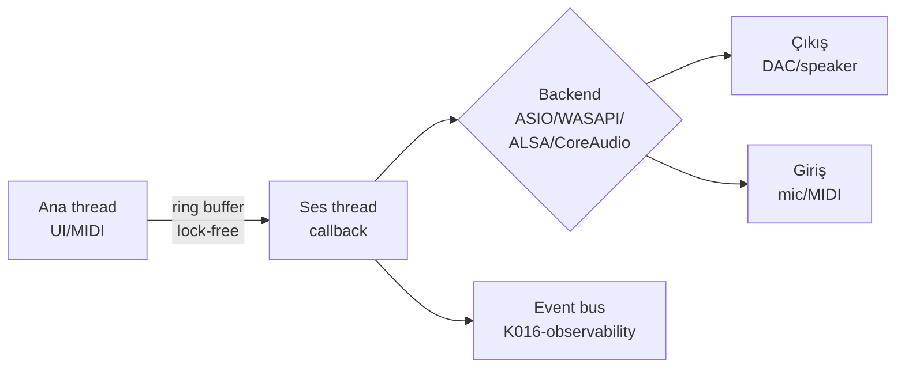

# K003-audio — Bileşenler (ses motoru API yüzeyi)

## §1 — ELI15: Bu nedir?

Bir ses motoru düşün: hoparlöre gitmeden önce sesi işleyen küçük bir fabrika.
Bu fabrikanın parçaları bu dosyada. En önemlisi **ring buffer** — müzisyen nota
basar (ana thread), ses kartı sürekli numune ister (ses thread'i). Bu ikisi asla
aynı hızda çalışmaz; ring buffer ikisi arasındaki kauçuk banttır. Sesten
sorumlu her çocuk (asio, wasapi, alsa, pipewire…) bu aynı parçaların farklı
donanıma taklididir.

## §2 — Kapsam

| Satır | İçerik |
|---|---|
| Kapsam içi | Ses motoru API yüzeyi: giriş/çıkış, ring buffer, cihaz yönetimi, durum makinesi, callback sözleşmesi, kayıt/yeniden oynatma, profil |
| Kapsam dışı | DSP algoritması (K004-dsp) · firmware (K005-firmware) · UI widget'ları (K011-ui-kit) |

## §3 — Grup eşlemesi (K005 kanonu)

12 çocuk K003 API yüzeyi (K004-dsp hariç; dil grupları `audio-dil-kapsami.md` §3-§6):

| Çocuk K | Rol | API grubu |
|---|---|---|
| K00301-dolby | Atmos/TrueHD/AC-3 kod çözme, dijital çıkış | Çıkış zinciri |
| K00302-midi | MIDI 2.0 I/O, MIDI-CI, cihaz profilleri | Giriş/USB |
| K00303-asio | ASIO driver wrapper (exclusive, bit-exact) | Backend (Windows) |
| K00304-vst | VST3/SoundWire host | Eklenti köprüsü |
| K00305-latency | Round-trip ölçümü, buffer boyutu önerisi | Zaman |
| K00306-jack | JACK/PipeWire graph routing | Backend (Linux) |
| K00307-wasapi | WASAPI exclusive + shared, MMCSS | Backend (Windows) |
| K00308-capi | CAPI (Linux ALSA sequencer köprüsü) | Giriş/USB |
| K00309-alsa | ALSA PCM + hw_params/sw_params | Backend (Linux) |
| K00310-coreaudio | CoreAudio AU + AudioToolbox (macOS) | Backend (macOS) |
| K00311-aax | Avid AAX host | Eklenti köprüsü |
| K00312-audiunit | AudioUnit (AU) v2/v3 eklentileri | Eklenti köprüsü |

## §4 — Bileşen sözleşmeleri

Her backend çocuğu şu beş sözleşmeyi uygular (bileşen = API):

| Sözleşme | Tanım | Kanıt |
|---|---|---|
| C-buf-1 | Ring buffer lock-free SPSC, `audio-master.md` §3.4 | ADR-019 |
| C-cb-1 | Callback 5-20 ms, lock-free, ayrılmış bellek (K005-firmware) | audio-master §3.4 · ADR-017 |
| C-dev-1 | Hot-plug enumeration + cihaz ID kalıcılığı (Windows) | audio-master §3.4 |
| C-st-1 | Durum makinesi: `STOPPED → STARTING → RUNNING → DRAINING → STOPPED`; hata `→ RECOVERING → RUNNING/STOPPED` | audio-master §3.4 · ADR-019 |
| C-prof-1 | Profil (Dolby/MIDI/VST…): JSON şema + sürüm + migration | audio-master §3.4 |

### Durum makinesi (C-st-1)

| Geçiş | Tetik | Sonuç |
|---|---|---|
| STOPPED → STARTING | `open(device)` | cihaz aç, buffer ayır |
| STARTING → RUNNING | ilk callback başarı | stream canlı |
| RUNNING → DRAINING | `stop(drain=true)` | buffer'ı boşalt |
| DRAINING → STOPPED | drain bitti | stream kapat |
| RUNNING → RECOVERING | device-lost (WDK/WDK) | yeniden başlat dene |
| RECOVERING → STOPPED | 3 deneme başarısız | kullanıcıya bildir |

## §5 — Bağımlılıklar (özet)

| Yön | K | Ne alıyor / veriyor |
|---|---|---|
| Gelen | K005-firmware | RT callback sözleşmesi, allocate-free kuralı |
| Gelen | K009-api | Profil şeması (audio-profiles), session snapshot |
| Giden | K004-dsp | Ses yolu üzerinden parametre (EQ/reverb send) |
| Giden | K016-observability | Event bus'a ses olayları (xrun, device-lost) |

## §6 — Kanıt ve doğrulama durumu

| İddia | Kanıt | Durum |
|---|---|---|
| 12 çocuk (K004 hariç) | `audio-master.md` §2 | ✓ Doğrulandı 2026-10-18 |
| 4 backend (ASIO/WASAPI/ALSA/CoreAudio) | `audio-master.md` §2, §6 | ✓ Doğrulandı 2026-10-18 |
| Dil grupları 4 × çocuk matrisi | `audio-dil-kapsami.md` §3-§6 | ✓ Okundu 2026-10-18 |
| Durum makinesi 5 geçiş + hata | `audio-master.md` §3.4 | ✓ Okundu 2026-10-18 |
| C++ motor kodu gerçek API'leri | repo'da C++ dosyası YOK (`*.cpp`/`*.h` = 0) | ⚠️ VERIFICATION REQUIRED — `.ai/templates/` ile üretim öncesi doğrulanacak |

## §7 — Açık sorular

| # | Soru | Sahip |
|---|---|---|
| 1 | AAI-4 (binaural engine): gerçek DSP yok — K004'te mid-side approximation, gerçek binaural (HRTF) ne zaman? | K004-dsp |
| 2 | AAI-9: Windows cihaz ID kalıcılığı — `IAudioDeviceId` API'si üretimde var mı? | K003-audio |

**Authority:** Bayram Ali / Vault Steward · **Mode:** Red Team · Human Mode · Truth Mode
