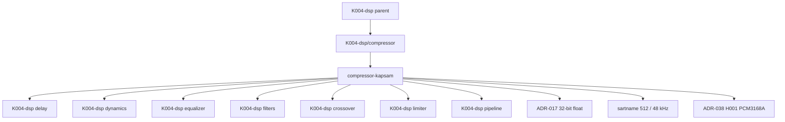

# compressor — Kademe-2 Kapsam Kaydı

> **Node:** `K004-dsp/compressor/compressor-kapsam` · **Type:** module · **Status:** draft · **Group:** mimari
> **Üst düğüm:** `K004-dsp/compressor` · **Bağımlı:** `K004-dsp` (domain)
> **Disk durumu:** K004-dsp düğümü **PLANNED** — repoda C++/DSP motoru (engine/ dizini) yoktur.
> Bu dosya yalnızca **kapsam sözleşmesidir**; çalışan DSP kodu, ölçüm sonucu veya doğrulanmış gecikme değeri içermez.

## §A Kapsam

### A.1 Rol (ELI15)

Compressor (sıkıştırıcı), ses zincirinin **dinamik süreç (dynamics processing)** katmanında çalışır:
gelen sinyalin belirlenen bir **threshold** eşiğini aşan kısımlarını, tanımlı bir **ratio** oranında
kısarak sesin yüksek ve düşük bölümleri arasındaki farkı daraltır. Amaç, sinyalin zirve seviyesini
**clip** (klipsleme) noktasından uzakta tutarken sessiz detayların duyulabilirliğini korumaktur.

Kısaca: compressor bir **kazanç (gain) karar mekanizmasıdır** — sesi sürekli olarak yeniden ölçekler.
Bu karar; sinyalin anlık seviyesini ölçen bir **detector**, kararı yumuşatan bir **attack/release
zarf (envelope)** ve uygulayan bir **gain computer** üçlüsü ile verilir.

Kapsül cümlesi: *"Compressor, sesi kırpmez; sesi, önceden anlaşılmış bir kurala göre
**ses seviyesi bağımsız** hale getirmek için döner."*

### A.2 Kapsam içi (in-scope)

| # | Kalem | Açıklama | Olgunluk | Kanıt durumu |
|---|---|---|---|---|
| A2-1 | Threshold tanımı | Sıkıştırmanın başlayacağı seviye eşiği (dBFS cinsinden) | PLANNED | Değer **UNKNOWN** — sartnamede sabitlenmemiştir |
| A2-2 | Ratio tanımı | Eşiği aşan kısım için giriş/çıkış eğimi (ör. N:1) | PLANNED | Değer **UNKNOWN** |
| A2-3 | Attack süresi | Eşik aşımında kazancın düşme hızı | PLANNED | Değer **UNKNOWN** |
| A2-4 | Release süresi | Eşik altına dönüşte kazancın toparlanma hızı | PLANNED | Değer **UNKNOWN** |
| A2-5 | Detector devresi | Seviye ölçümü: peak / RMS / dual-rectifier | PLANNED | Seçim **UNKNOWN** |
| A2-6 | Gain bilgisayarı | Detector çıktısını dB uzayında kazanç değerine çeviren çekirdek | PLANNED | Algoritma **UNKNOWN** |
| A2-7 | Gain zarfı (gain envelope) | Attack/release integratörünün zarf davranışı | PLANNED | Şekil **UNKNOWN** |
| A2-8 | Makeup gain | Kaybedilen ortalama seviyenin geri verilmesi | PLANNED | Değer **UNKNOWN** |
| A2-9 | Soft-knee / hard-knee | Eşik çevresi geçiş yumuşaklığı | PLANNED | Seçim **UNKNOWN** |
| A2-10 | Stereo linked mode | İki kanalın tek bir kazanç kararı ile sürülmesi | PLANNED | Davranış **UNKNOWN** |
| A2-11 | Gr göstergesi (gain reduction) | Uygulanan kazanç azaltımının ölçülmesi | PLANNED | Ölçüm yöntemi **UNKNOWN** |
| A2-12 | Sıfır tahsis (zero-allocation) | Audio callback içinde malloc/new yasağı | FROZEN | Kural kök AGENTS.md §1 |
| A2-13 | Lock-free durum geçişi | Audio thread üzerinde mutex/lock_guard yasağı | FROZEN | Kural kök AGENTS.md §2 |
| A2-14 | `noexcept` callback | Ses geri çağrılarının istisna fırlatmaması | FROZEN | Kural kök AGENTS.md §3 |
| A2-15 | `alignas(64)` tamponlar | Cache-line hizalama (64 bayt) | FROZEN | Kural kök AGENTS.md §5 |
| A2-16 | 32-bit float veri | Ses verisinin temsil biçimi | FROZEN | ADR-017 |
| A2-17 | 512 örnek / 48 kHz | Buffer boyutu ve örneklem frekansı | FROZEN | sartname — ölçüm PLANNED |
| A2-18 | ASIO Exclusive Lock | Cihaz üzerinde tek uygulama hakkı | FROZEN | Kural kök AGENTS.md §9 |

### A.3 Kapsam dışı (out-of-scope)

| # | Kalem | Neden kapsam dışı | İlgili düğüm |
|---|---|---|---|
| A3-1 | Limiter (braking / brickwall) | Ayrı alt-modül; sıkıştırıcı ile hiyerarşi sorusu **Q3** açık | K004-dsp/limiter |
| A3-2 | Noise gate | Kapı (gate) mantığı ayrı dinamik süreçtir | K004-dsp/dynamics |
| A3-3 | Equalizer bant katsayıları | Frekans domaini ayrımı EQ modülünün işidir | K004-dsp/equalizer |
| A3-4 | Crossover bölme filtreleri | Filtre topolojisi crossover modülünün işidir | K004-dsp/crossover |
| A3-5 | Reverb / uzamsal işleme | Ayrı alt-modüllerdir | K004-dsp/reverb · K004-dsp/spatial-audio |
| A3-6 | Loudness normalizasyonu (LUFS) | Ölçüm ve yayın standardı ayrı modüldür | K004-dsp/measurement |
| A3-7 | DSP zinciri birleştirme (graph/pipeline) | Yönlendirme katmanı pipeline modülündedir | K004-dsp/pipeline |
| A3-8 | Test altyapısı ve test harness'ı | Test stratejisi ayrı modülün konusudur | K004-dsp/testing |
| A3-9 | Donanım DAC çıkışı | PCM3168A donanım tarafıdır; ADR-038 H001 | L0 donanım katmanı |
| A3-10 | DC offset koruma rölesi | Donanım koruması (0.5 V eşiği), DSP modülü değil | Koruma devresi |
| A3-11 | UI / EQ widget'ı | Sunum katmanı; repo'da mevcut ekran kodları | home.coremusic.net |
| A3-12 | OTA / firmware güncelleme | Bağımlılık bump yasağı kapsamındadır | BÖLÜM B yasak listesi |
| A3-13 | PHP backend servisleri | `*.php` dosyalarına dokunma yasağı | K000/K003 vb. |
| A3-14 | Web API route tanımları | Mevcut rotalar değişmez | api.coremusic.net |
| A3-15 | ADR yazımı / kararı | ADR yüzeyi `.ai/.decisions/**` yasağı altındadır | ADR kayıt katmanı |

### A.4 Kısıtlar, açık sorular ve web araştırması

#### A.4.1 Bağlayıcı kısıtlar (constraints)

| # | Kısıt | Kaynak | İhlal sonucu |
|---|---|---|---|
| K-1 | Audio thread üzerinde heap tahsisi yasak | kök AGENTS.md §1 | Xrun / öncüllü tahsis gecikmesi |
| K-2 | Audio thread üzerinde mutex yasağı | kök AGENTS.md §2 | Prioritevi inversion, drop |
| K-3 | Callback `noexcept` olmalı | kök AGENTS.md §3 | Terminate, cihaz kopması |
| K-4 | Derleme zamanı hesap `constexpr` | kök AGENTS.md §4 | Çalışma zamanı maliyeti |
| K-5 | Buffer `alignas(64)` | kök AGENTS.md §5 | Cache satırı çakışması |
| K-6 | Ses verisi 32-bit float | ADR-017 | Yanlış dinamik aralık temsili |
| K-7 | Buffer 512 örnek / 48 kHz | sartname | Ölçüm PLANNED — değer doğrulanmadı |
| K-8 | ASIO Exclusive Lock tek uygulama | kök AGENTS.md §9 | İkinci açılışta başarısız connect |
| K-9 | DC offset > 0.5 V → koruma rölesi | kök AGENTS.md §10 | Donanım koruması devrede |
| K-10 | PCM5122 mutlak yasak, yalnız PCM3168A | ADR-038 H001 | ADR ihlali |
| K-11 | Sürüm kanıtı yok: "JUCE 9" / "ASIO SDK 2.3.4" | kök AGENTS.md §12 | **VERIFICATION REQUIRED** |
| K-12 | Bağımlılık bump → DUR + handover | kök AGENTS.md §13 | El değiştirme zorunlu |
| K-13 | Repoda C++ motoru yok | disk ölçümü | Kod iddiası yazılmaz, **UNKNOWN** |

#### A.4.2 Açık sorular (open questions)

| Q# | Soru | Etki | Durum |
|---|---|---|---|
| Q3 | dynamics ↔ compressor ↔ limiter hiyerarşisi ve kardeş ilişkisi nedir? | Modül sınırı ve dosya yerleşimi | **AÇIK** — üst karar bekliyor |
| Q4 | measurement ↔ testing sınırı nasıl çizilir? | Doğrulama sorumluluğu | **AÇIK** — üst karar bekliyor |
| Q-C1 | Varsayılan threshold / ratio / attack / release değerleri nelerdir? | Sartname sabitleri | **UNKNOWN** — uydurma yasak |
| Q-C2 | Detector tipi (peak / RMS / hybrid) hangi ölçütle seçilecek? | Algoritma doğruluğu | **UNKNOWN** |
| Q-C3 | Soft-knee genişliği hangi dB aralığında sabitlenecek? | Geçiş eğrisi | **UNKNOWN** |
| Q-C4 | Makeup gain sabit mi, otomatik hesap mı? | Kullanıcı sözleşmesi | **UNKNOWN** |
| Q-C5 | Stereo linked mi, bağımsız kanal mı varsayılan? | Sahne (imaging) davranışı | **UNKNOWN** |
| Q-C6 | Gain reduction ölçümü hangi birimde raporlanacak? | Gösterge / UI | **UNKNOWN** |
| Q-C7 | ASIO buffer boyutu değiştirilirse compressor durumu nasıl korunacak? | Yeniden başlatma davranışı | **UNKNOWN** |

#### A.4.3 Web araştırması kayıtları (research log)

| İddia | URL | 2026-10-13 | Durum |
|---|---|---|---|
| Web Audio API, sıkıştırma işlevselliğini `DynamicsCompressorNode` adlı düğümle sunar | https://developer.mozilla.org/en-US/docs/Web/API/DynamicsCompressorNode | 2026-10-13 | HTTP 200 doğrulandı — envanter dışı |
| İstenen gereksinim düzeyi için IETF RF2119 anahtar kelimeleri (MUST / SHOULD) kullanılır | https://www.ietf.org/rfc/rfc2119.txt | 2026-10-13 | HTTP 200 doğrulandı — envanter dışı |
| ITU-R BS.1770, görsel-şiddet tabanlı loudness ölçüm algoritmasını tanımlar | https://www.itu.int/rec/R-BS.1770/en | 2026-10-13 | HTTP 200 doğrulandı — envanter dışı |

> **Not:** Bu tablo yalnızca **erişilebilirlik ve sürüm doğrulaması** kaydıdır; içeriği K004-dsp
> mimari kararı olarak **kanıtlamaz**. Sürüm iddiaları (JUCE 9 / ASIO SDK 2.3.4) için
> **VERIFICATION REQUIRED** işaretlenmiştir.

#### A.4.4 Sartname sabitleri ile ilişki

| Sabit | Değer | Kaynak | Bu modülde kullanımı | Doğrulama |
|---|---|---|---|---|
| Buffer boyutu | 512 örnek | sartname | Blok işleme birimi | ölçüm PLANNED |
| Örnekleme frekansı | 48000 Hz | sartname | Zaman sabiti dönüşümü | ölçüm PLANNED |
| Örnek biçimi | 32-bit float | ADR-017 | Detector girdisi | FROZEN |
| Hizalama | 64 bayt | kök AGENTS.md §5 | Tampon & atomik alanlar | kod incelemesi |
| Kanal düzeni | 8.1 surround | proje kapsamı | Stereo linked davranışı | **UNKNOWN** |
| DAC | PCM3168A | ADR-038 H001 | Çıkış headroom hesabı | FROZEN |
| DC koruma eşiği | 0.5 V | kök AGENTS.md §10 | Donanım katmanı | FROZEN |
| Tahsis kuralı | Yasak (audio thread) | kök AGENTS.md §1 | Tüm bileşenler | kod incelemesi |
| Kilit kuralı | Yasak (audio thread) | kök AGENTS.md §2 | B-12 parametre paylaşımı | kod incelemesi |
| Callback | `noexcept` | kök AGENTS.md §3 | Tüm geri çağrılar | kod incelemesi |

#### A.4.5 Gerçek repo kanıtları (disk)

| Kaynak | Dosya | Satır | Gözlem |
|---|---|---|---|
| `Kaynak:` | `assets.coremusic.net/js/coreplayer/coreplayer.volume.js` | L54 | `clamp` tanımı: `Math.min(1, Math.max(0, value))` — kazanç sınırlamanın JS karşılığı |
| `Kaynak:` | `assets.coremusic.net/js/coreplayer/coreplayer.volume.js` | L160 | `edgeSnap(clamp(raw))` — sınır yakınında yapışma davranışı |
| `Kaynak:` | `assets.coremusic.net/js/coreplayer/coreplayer.volume.js` | L31 | Varsayılan ses seviyesi `0.5` olarak sabitlenmiş |
| `Kaynak:` | `shared/src/AI/AIEngine.php` | L140 | Yorum satırında `PCM3168A` / `XMOS` / `AK4458` donanım zinciri anılıyor |

> Bu satırlar **gerçek repodan okunmuştur**; compressor'ın C++ karşılığı diskte **mevcut değildir**.

#### A.4.6 Kabul kriterleri (acceptance criteria)

| # | Kriter | Ölçüt | Yöntem | Durum |
|---|---|---|---|---|
| AC-1 | Blok işleme boyutu | Her çağrıda tam 512 örnek | Birim testi | PLANNED |
| AC-2 | Örnekleme frekansı | 48000 Hz sabit | Sartname kontrolü | PLANNED |
| AC-3 | Örnek biçimi | float32 | Statik tip denetimi | FROZEN |
| AC-4 | Callback imzası | `noexcept` | Derleyici denetimi | FROZEN |
| AC-5 | Tahsis denetimi | Audio thread içinde 0 tahsis | Profil ölçümü | PLANNED |
| AC-6 | Kilit denetimi | Audio thread içinde 0 mutex | Kod taraması | PLANNED |
| AC-7 | Hizalama | `alignas(64)` doğrulaması | Statik `static_assert` | FROZEN |
| AC-8 | Basitlik | Sıfır kopma (click) üretmez | Test sinyali + dinleme | PLANNED |
| AC-9 | Kararlılık | Kazanç zarfı salınım yapmaz | Sınav sinyali ölçümü | PLANNED |
| AC-10 | Karakteristik doğruluk | Giriş/çıkış eğimi hedefe uyar | Eğri ölçümü | PLANNED |
| AC-11 | GR raporu | Azaltım değeri raporlanır | Görsel okuma | PLANNED |
| AC-12 | bypass | Parametre geçersizken pas geç | Birim testi | PLANNED |
| AC-13 | Parametre aralığı | Geçersiz değer clamp'lenir | Birim testi | PLANNED |
| AC-14 | Atomik paylaşım | Torn read gözlenmez | Stres testi | PLANNED |
| AC-15 | Denormal | FLUSH_TO_ZERO etkin | Profil ölçümü | PLANNED |
| AC-16 | Exclusive Lock | İkinci uygulama başarısız olur | Bütünleşik test | PLANNED |
| AC-17 | DC koruma | 0.5 V eşiğinde röle | Donanım testi | PLANNED |
| AC-18 | Sürüm kanıtı | JUCE / ASIO sürüm belgesi | Belge araması | **VERIFICATION REQUIRED** |
| AC-19 | Ölçüm verisi | Gecikme ölçümü mevcut | Ölçüm raporu | **UNKNOWN** |
| AC-20 | Kanal davranışı | stereo linked kararı belgeli | Karar kaydı | **UNKNOWN** |

#### A.4.7 Sorumluluk matrisi (RACI özeti)

| Görev | Bu modül | dynamics | limiter | pipeline | measurement |
|---|---|---|---|---|---|
| Detector tasarımı | **R** | C | I | I | C |
| Eşik / oran kararı | **R** | C | C | I | I |
| Attack / release kararı | **R** | C | I | I | I |
| Zincir sırası | C | C | C | **R** | I |
| Brickwall sınır | C | C | **R** | C | I |
| Gain ölçümü | A | C | C | I | **R** |
| Test altyapısı | C | C | C | I | **R** |
| Donanım koruma | I | I | I | I | **R** |

> **R** = Responsible · **A** = Accountable · **C** = Consulted · **I** = Informed

## §B Bileşenler

### B.1 Bileşen envanteri

| Bileşen | Sorumluluk | Girdi | Çıktı | Hata modu |
|---|---|---|---|---|
| B-1 Detector | Sinyal seviyesini ölçmek | float32 ses örnekleri | Seviye skaları (dB) | Yanlış ölçek → erken/geç tetik |
| B-2 Detector scaler | Ölçümü dB uzayına taşımak | Doğrusal skalar | dB değeri | Log tabanı hatası → eşiğin kayması |
| B-3 Comparator | Seviyeyi eşikle karşılaştırmak | Seviye + threshold | Aşım bayrağı | Histeresis yoksa chattering |
| B-4 Gain bilgisayarı | Aşım oranını kazanç değerine çevirmek | Aşım + ratio + knee | Kazanç (dB) | Hatalı eğim → over-compression |
| B-5 Attack süzgeci | Kazancın düşme hızını sınırlamak | Hedef kazanç | Geçici kazanç | Süre sabiti yanlışsa pumping |
| B-6 Release süzgeci | Kazancın toparlanma hızını sınırlamak | Hedef kazanç | Geçici kazanç | Uzun release → obürülme (pumping) |
| B-7 Gain zarfı | Attack/release çıktısını tek zarfta birleştirmek | Süzgeç durumları | Zarf değeri | Zarf kopması → tıkırtı (click) |
| B-8 Kazanç uygulayıcı | Kazancı sinyale çarpmak | Ses + zarf | Sıkıştırılmış ses | denormals → CPU patlaması |
| B-9 Makeup gain | Ortalama seviyeyi geri kazandırmak | Sıkıştırılmış ses + kazanç | Sektör seviyesi | Aşırı makeup → clip riski |
| B-10 GR ölçer | Uygulanan azaltımı ölçmek | Hedef + uygulanan kazanç | GR (dB) | Yanlış işaret → gösterge ters |
| B-11 State deposu | Zarf durumunu saklamak | Önceki durum | Sonraki durum | Tahsis olursa K-1 ihlali |
| B-12 Parametre atomları | Thread dışı yazma / thread içi okuma | UI yazımı | Ses okuması | Torn read → yarım parametre |

### B.2 B.1 — Detector (seviye dedektörü)

**Sorumluluk:** Gelen `float32` örnek dizisini alıp tek bir seviye skaları üretmek.
**Girdi:** 512 örneklik tampon, 48 kHz, 32-bit float (ADR-017, sartname).
**Çıktı:** Kanal başına veya linklenmiş tek seviye (dB).
**Hata modu:**

- Detector tipi yanlış seçilirse (peak yerine RMS) sıkıştırma başlangıcı kayar — **Q-C2 UNKNOWN**.
- Seviye ölçeği lineer / dB karıştırılırsa threshold anlamını kaybeder.
- `constexpr` olmayan log hesabı K-4 ihlali üretir.

**Kısıt:** Tampon önceden ayrılmıştır (`alignas(64)`, K-5); tahsis yok (K-1).

### B.3 B.2 — Detector scaler

**Sorumluluk:** Doğrusal genliği dB değerine çevirmek (referans 1.0 FS = 0 dBFS).
**Girdi:** Doğrusal skalar. **Çıktı:** dB skaları.
**Hata modu:** Taban 10 yerine doğrusal log kullanılırsa eğim bozulur; eşikte 6 dB kayma oluşur.
**Kısıt:** Çevrim (`loop`) içinde `constexpr` ön hesap mümkün olan katsayılar kullanılmalı (K-4).

### B.4 B.3 — Comparator (eşik karşılaştırıcı)

**Sorumluluk:** Ölçülen seviye ile threshold'ı karşılaştırmak ve aşımı işaretlemek.
**Girdi:** Seviye + threshold. **Çıktı:** Aşım büyüklüğü (dB).
**Hata modu:** Histeresis yoksa eşik civarında kazanç hızlı açılıp kapanır (**chattering**) → duyulabilir titreme.
**Kısıt:** Knee genişliği **UNKNOWN** (Q-C3) — sabitlenmeden kod yazılmaz.

### B.5 B.4 — Gain bilgisayarı

**Sorumluluk:** Aşım değerini, ratio ve knee ile birleştirip hedef kazancı üretmek.
**Girdi:** Aşım + ratio + knee modu. **Çıktı:** Hedef kazanç (dB, negatif).
**Hata modu:** Eğim yanlış hesaplanır → ya hiç sıkıştırma ya da tam kapanma (brickwall davranışı).
**Kısıt:** `ratio == 1` sınır durumunda kazanç `0 dB` dönmelidir; `ratio` değeri **UNKNOWN** (Q-C2 / Q-C1).

### B.6 B.5 / B.6 — Attack ve release süzgeçleri

**Sorumluluk:** Kazancın hedefe koşma hızını sınırlamak (zaman sabiti).
**Girdi:** Hedef kazanç + önceki durum. **Çıktı:** Yumuşatılmış kazanç.
**Hata modu:**

- Attack çok uzunsa geçici tepe (transient) kaçar → klip riski.
- Attack çok kısasa dijital distorsiyon (titreme) artar.
- Release çok kısasa pompa (pumping) duyulur; çok uzunsa sessiz bölümler geri gelmez.
- Zaman sabiti örneklem oranına bağlıdır: **48 kHz ve 512 örnek** (K-7) dışında hesap yeniden türetilmelidir.

**Kısıt:** Süre değerleri **UNKNOWN** (Q-C1) — sayı uydurmak yasaktır.

### B.7 B.7 — Gain zarfı (gain envelope)

**Sorumluluk:** Attack/release çıktılarını tek, sürekli bir zarf değerine dönüştürmek.
**Girdi:** Süzgeç durumları. **Çıktı:** Uygulanacak zarf (kazanç çarpanı).
**Hata modu:** Zarf sıçrarsa örnek düzeyinde **click** oluşur; kip değişimi (mode switch) yumuşatılmazsa kopma olur.
**Kısıt:** Zarf durumu ayrılmış yapısal tamponda tutulur; tahsis yok (K-1).

### B.8 B.8 — Kazanç uygulayıcı (gain computer / makeup)

**Sorumluluk:** Zarfı her örneğe çarpmak ve makeup gain'i eklemek.
**Girdi:** Ses örnekleri + zarf + makeup. **Çıktı:** Sıkıştırılmış ses.
**Hata modu:**

- `float` altı sıfırlara yakın değerler (**denormal**) CPU maliyetini patlatır →_FLUSH_TO_ZERO gerekir.
- Makeup aşırı verilirse çıkış clip'e gider (K-9 donanım koruma eşiğini tetikleyebilir).
- stereo linked kapalıysa iki kanal farklı kazanç alır → sane (imaging) kayması (Q-C5 UNKNOWN).

### B.9 B.10 — GR ölçer (gain reduction meter)

**Sorumluluk:** Uygulanan kazanç azaltımını ölçmek ve raporlamak.
**Girdi:** Hedef kazanç + uygulanan kazanç. **Çıktı:** GR (dB, negatif yön).
**Hata modu:** İşaret yönü ters çevrilirse gösterge pozitif okunur → yanlış kalibrasyon kararı.
**Kısıt:** Ölçüm penceresi ve birimi **UNKNOWN** (Q-C6).

### B.10 B.11 / B.12 — State deposu ve parametre atomları

**Sorumluluk:** Zarf durumunu ses thread'inde tutmak; UI yazımını ses thread'i ile güvenli paylaşmak.
**Girdi:** Önceki durum / UI yazımı. **Çıktı:** Sonraki durum / atomik okuma.
**Hata modu:** Mutex kullanılırsa K-2 ihlali; atomik olmayan okuma **torn read** üretir.
**Kısıt:** `alignas(64)` ile hizalanmış atomik alan (K-5); tahsis yok (K-1).

### B.11 Bileşenler arası sorumluluk ayrımı

| Ayrım | Bileşen 1 | Bileşen 2 | Ayırıcı kriter |
|---|---|---|---|
| Ölçüm vs karar | Detector (B-1) | Gain bilgisayarı (B-4) | Ölçer seviyeyi, karar verici eğimi uygular |
| Karar vs uygulama | Gain bilgisayarı (B-4) | Kazanç uygulayıcı (B-8) | Biri dB uzayında, diğeri çarpmada |
| Süreç vs gösterge | Attack/release (B-5/B-6) | GR ölçer (B-10) | Biri kontrol, diğeri raporlama |
| Durum vs paylaşım | State deposu (B.11) | Parametre atomları (B.12) | Biri yazma sahibi, diğeri okuma sahibi |
| Sıkıştırma vs limit | Bu modül | K004-dsp/limiter | Sınır (Q3) **AÇIK** |

### B.12 Parametre envanteri (tümü UNKNOWN)

| Parametre | Birim | Aralık | Varsayılan | Otomatik mi | Sahip |
|---|---|---|---|---|---|
| threshold | dBFS | **UNKNOWN** | **UNKNOWN** | hayır | Bu modül |
| ratio | N:1 | **UNKNOWN** | **UNKNOWN** | hayır | Bu modül |
| attack | ms | **UNKNOWN** | **UNKNOWN** | hayır | Bu modül |
| release | ms | **UNKNOWN** | **UNKNOWN** | hayır | Bu modül |
| knee | dB | **UNKNOWN** | **UNKNOWN** | hayır | Bu modül |
| makeup gain | dB | **UNKNOWN** | **UNKNOWN** | olası (Q-C4) | Bu modül |
| detector mode | enum | peak/RMS/hybrid | **UNKNOWN** | hayır | Bu modül |
| stereo link | bool | true/false | **UNKNOWN** | hayır | Bu modül (Q-C5) |
| bypass | bool | true/false | false | hayır | Pipeline |
| GR meter window | ms | **UNKNOWN** | **UNKNOWN** | evet | Ölçüm |

### B.13 Bileşen olgunluk matrisi

| Bileşen | Tasarım | Kod | Ölçüm | Test | Engelli sebep |
|---|---|---|---|---|---|
| Detector (B-1) | PLANNED | YOK | PLANNED | PLANNED | tip seçimi **UNKNOWN** |
| Detector scaler (B-2) | PLANNED | YOK | PLANNED | PLANNED | log tabanı **UNKNOWN** |
| Comparator (B-3) | PLANNED | YOK | PLANNED | PLANNED | knee **UNKNOWN** |
| Gain bilgisayarı (B-4) | PLANNED | YOK | PLANNED | PLANNED | ratio **UNKNOWN** |
| Attack süzgeci (B-5) | PLANNED | YOK | PLANNED | PLANNED | süre **UNKNOWN** |
| Release süzgeci (B-6) | PLANNED | YOK | PLANNED | PLANNED | süre **UNKNOWN** |
| Gain zarfı (B-7) | PLANNED | YOK | PLANNED | PLANNED | şekil **UNKNOWN** |
| Kazanç uygulayıcı (B-8) | PLANNED | YOK | PLANNED | PLANNED | denormal politikası **UNKNOWN** |
| Makeup (B-9) | PLANNED | YOK | PLANNED | PLANNED | mod **UNKNOWN** |
| GR ölçer (B-10) | PLANNED | YOK | PLANNED | PLANNED | birim **UNKNOWN** |
| State deposu (B-11) | PLANNED | YOK | PLANNED | PLANNED | yerleşim **UNKNOWN** |
| Parametre atomları (B-12) | PLANNED | YOK | PLANNED | PLANNED | atom tipi **UNKNOWN** |

> **YOK** ifadesi, diskte bu bileşenin C++ karşılığının bulunmadığını belirtir; kod yoktur.

### B.14 Hata modu özeti (FMEA)

| Hata modu | Etki | Olasılık | Algılama | Önlem | Öncelik |
|---|---|---|---|---|---|
| Tahsis audio thread'de | Xrun, drop | orta | profil | önceden ayırma | yüksek |
| Mutex audio thread'de | Prioritevi inversion | düşük | kod incelemesi | atomik alan | yüksek |
| `noexcept` ihlali | Terminate | düşük | derleyici | imza denetimi | yüksek |
| Denormal | CPU şişmesi | orta | profil | FLUSH_TO_ZERO | orta |
| Chattering (eşik titreşimi) | Duyulabilir gürültü | orta | dinleme | histeresis | orta |
| Click (zarf kopması) | Duyulabilir pop | orta | dinleme | yumuşatma | yüksek |
| Torn read | Yarım parametre | düşük | stres testi | atomik | orta |
| Aşırı makeup | Çıkış klipsi | orta | ölçüm | sınırlandırma | orta |
| Yanlış GR işareti | Hatalı karar | düşük | okuma | işaret testi | düşük |
| Exclusive Lock ihlali | İkinci açılışta hata | orta | bütünleşik test | tek süreç | yüksek |

## §C Arayüzler

### C.1 Dış arayüz envanteri

| Arayüz | Yön | Tip | Veri | Sözleşme |
|---|---|---|---|---|
| I-1 Ses girişi | Gelen | Ses akışı | 512 örnek × kanal, float32, 48 kHz | Sartname (K-7) — ölçüm PLANNED |
| I-2 Ses çıkışı | Giden | Ses akışı | Aynı boyut ve biçim | Girdi ile birebir boyut |
| I-3 Parametre yazımı | UI → DSP | Atomik yazma | threshold / ratio / attack / release / knee / makeup | Kilit yok (K-2) |
| I-4 Parametre okuması | DSP içi | Atomik okuma | Aynı alanlar | Torn read yasak |
| I-5 GR raporu | DSP → UI | Atomik okuma | GR (dB) | Birim **UNKNOWN** (Q-C6) |
| I-6 Durum bilgisi | DSP → UI | Atomik okuma | Aktif/pasif bayrağı | Burst yazma yasak |
| I-7 Zincir öncesi | Gelen | Fonksiyonel çağrı | K004-dsp/pipeline | Yönlendirme pipeline'a ait |
| I-8 Zincir sonrası | Giden | Fonksiyonel çağrı | K004-dsp/limiter veya çıkış | Sınır **AÇIK** (Q3) |
| I-9 Cihaz I/O | Alt katman | ASIO buffer switch | 512 örnek | Exclusive Lock (K-8) |
| I-10 Koruma | Alt katman | Donanım sinyali | DC offset > 0.5 V | Röle tetiklenir (K-9) |

### C.2 Arayüz detayları

| Arayüz | Protokol | Hata davranışı | Yeniden deneme |
|---|---|---|---|
| I-1 | Blok tabanlı, sabit boy | Boyut uyuşmazsa pas geç (bypass) | Kritik değil |
| I-2 | Blok tabanlı, sabit boy | Boyut uyuşmazsa sıfırla | Kritik değil |
| I-3 | Tek yönlü atomik | Geçersiz aralıkta değer clamp'lenir | Kritik değil |
| I-4 | Atomik okuma | Kırık okuma gözlemlenirse blok bypass | Yeniden okuma |
| I-5 | Atomik okuma | Okunamazsa son bilinen değer | Sonraki blokta tekrar |
| I-6 | Atomik bayrak | Teksat (glitch) tolere edilir | Kritik değil |
| I-9 | ASIO sürücü çağrısı | Buffer switch başarısızsa stream durur | Uygulama yeniden başlatır |
| I-10 | Donanım hat | Eşik aşılırsa röle açılır | Manuel reset |

### C.3 Arayüz sorumluluk sınırları

| Sınır | Bu modülün tuttuğu | Karşı tarafın tuttuğu |
|---|---|---|
| C.3-1 | Kazanç zarfı hesabı | Cihaz buffer boyutu seçimi |
| C.3-2 | Parametre atomları | Kalıcılık (kayıt/çözme) |
| C.3-3 | GR ölçüm değeri | Gösterge çizimi (UI) |
| C.3-4 | Block işlenmesi | Akış yönlendirmesi (pipeline) |
| C.3-5 | Sıkıştırma davranışı | Limit davranışı (limiter, Q3 **AÇIK**) |
| C.3-6 | Ses mantığı | Donanım koruma eşiği (0.5 V) |

### C.4 Arayüz kontrat tablosu (giriş/çıkış şekilleri)

| Kontrat | Şekil | Boyut | Birim | Sınır davranışı |
|---|---|---|---|---|
| CF-1 | Ses girişi bloğu | 512 × kanal | float32 | taşarsa bypass |
| CF-2 | Ses çıkışı bloğu | 512 × kanal | float32 | klips yok (başlık) |
| CF-3 | threshold yazımı | skalar | dBFS | clamp uygulanır |
| CF-4 | ratio yazımı | skalar | N:1 | clamp uygulanır |
| CF-5 | attack yazımı | skalar | ms | clamp uygulanır |
| CF-6 | release yazımı | skalar | ms | clamp uygulanır |
| CF-7 | GR okuması | skalar | dB | son değer korunur |
| CF-8 | bypass yazımı | bayrak | bool | atomik |
| CF-9 | Cihaz başlatma | oturum | ASIO | Exclusive Lock |
| CF-10 | Cihaz bitirme | oturum | ASIO | kilit bırakma |

### C.5 Arayüz yaşam döngüsü

| Aşama | Tetikleyici | Beklenen durum | Hata durumu | Sonraki adım |
|---|---|---|---|---|
| L1 | Uygulama açılışı | idle | — | keşif |
| L2 | Cihaz seçimi | configuring | Lock reddi → dur | L3 |
| L3 | Buffer doğrulama | ready | boyut uyuşmazsa → dur | L4 |
| L4 | Parametre yükleme | ready | clamp | L5 |
| L5 | Stream başlatma | running | sürücü hatası → idle | L6 |
| L6 | Blok işleme | running | bypass → L6 | L6 |
| L7 | Parametre değişimi | running | atomik | L6 |
| L8 | Stream durdurma | ready | — | L9 |
| L9 | Kayıt/çözme | idle | bozuk kayıt → varsayılan | L2 |

### C.6 Arayüz hata kodu şeması

| Kod | Anlam | Kaynak | Tepki | Yeniden deneme |
|---|---|---|---|---|
| E-01 | Cihaz bulunamadı | ASIO keşfi | kullanıcıya bildir | elle |
| E-02 | Exclusive Lock reddi | sürücü | başka uygulama açık de | otomatik yok |
| E-03 | Buffer boyutu desteklenmiyor | sürücü | alternatif boyut dene | bir kez |
| E-04 | Örnekleme frekansı desteklenmiyor | sürücü | sartname ihlali bildir | hayır |
| E-05 | Parametre aralık dışı | arayüz | clamp + kayıt | hayır |
| E-06 | Tahsis başarısız (init) | başlatma | uygulamayı durdur | hayır |
| E-07 | Xrun / drop | ses thread'i | bayrak koy | sonraki blok |
| E-08 | DC koruma eşiği aşıldı | donanım | röle aç | manuel |

## §D Bağımlılık grafiği

### D.1 Mermaid diyagramı

### D.2 Bağımlılık tablosu

| # | Hedef | Bağımlılık tipi | Yön | Durum |
|---|---|---|---|---|
| D-1 | `K004-dsp` (domain) | Üst düğüm | K → parent | aktif (draft) |
| D-2 | `K004-dsp/delay` | Sıra bağımlılığı | Gecikme zinciri için komşu | PLANNED |
| D-3 | `K004-dsp/dynamics` | Kardeş modül | Ortak detector dili | PLANNED — Q3 **AÇIK** |
| D-4 | `K004-dsp/equalizer` | Komşu işlem | Frekans zinciri | PLANNED |
| D-5 | `K004-dsp/filters` | Alt teknoloji | Filtre uygulaması | PLANNED |
| D-6 | `K004-dsp/crossover` | Komşu işlem | Bant ayrımı | PLANNED |
| D-7 | `K004-dsp/limiter` | Sonraki aşama | Sınır ilişkisi | PLANNED — Q3 **AÇIK** |
| D-8 | `K004-dsp/pipeline` | Yönlendirici | Blok bağlama | PLANNED |
| D-9 | ADR-017 | Mimari karar | float32 temsil | FROZEN |
| D-10 | sartname (512 / 48 kHz) | Sartname | Buffer & fs | FROZEN — ölçüm PLANNED |
| D-11 | ADR-038 H001 | Donanım kararı | DAC seçimi | FROZEN |
| D-12 | kök AGENTS.md §1-§5 | Kural | RT kısıtları | FROZEN |
| D-13 | ASIO Exclusive Lock | Kural | Tek uygulama | FROZEN |

### D.3 Bağımlılık kuralları

| # | Kural | Gerekçe |
|---|---|---|
| R-1 | Bu dosya yalnız `K004-dsp/compressor/` altına yazar | Beyazliste dışı yazım yasağı |
| R-2 | `index.md` dosyalarına dokunulmaz | Yasaklı hedef listesi |
| R-3 | `.ai/.decisions/**` güncellenmez | ADR yüzeyi yasağı |
| R-4 | Bağımlılık bump varsa **DUR + handover** | kök AGENTS.md §13 |
| R-5 | Sürüm kanıtı yoksa **VERIFICATION REQUIRED** | kök AGENTS.md §12 |
| R-6 | C++ iddiası disk kanıtı olmadan yazılmaz | Zero-hallucination §3 |
| R-7 | Eksik değer `UNKNOWN` olarak işaretlenir | Zero-hallucination §3.2 |

### D.4 İleri/dış bağımlılık beyanı

| Bağımlılık | Sürüm | Kanıt | Durum |
|---|---|---|---|
| JUCE | "9" (iddia) | Diskte JUCE kökü yok | **VERIFICATION REQUIRED** |
| ASIO SDK | "2.3.4" (iddia) | Diskte SDK yok | **VERIFICATION REQUIRED** |
| C++ derleyici | C++20 (kural) | Proje dosyası yok | **VERIFICATION REQUIRED** |
| K004-dsp motoru | PLANNED | `engine/` dizini yok | **UNKNOWN** |
| Ölçüm verisi | — | Ölçüm PLANNED | **UNKNOWN** |

### D.5 Sürüm ve bağımlılık beyanı (claim register)

| # | İddia | Kaynak | Kanıt | Durum |
|---|---|---|---|---|
| CL-1 | C++20 kullanılacak | kök AGENTS.md §5 | Proje dosyası yok | **VERIFICATION REQUIRED** |
| CL-2 | JUCE 9 kullanılacak | kök AGENTS.md §12 | Sürüm belgesi yok | **VERIFICATION REQUIRED** |
| CL-3 | ASIO SDK 2.3.4 kullanılacak | kök AGENTS.md §12 | Sürüm belgesi yok | **VERIFICATION REQUIRED** |
| CL-4 | Buffer 512 örnek / 48 kHz | sartname | Ölçüm PLANNED | **UNKNOWN** |
| CL-5 | 8.1 surround hedefi | proje kapsamı | Ölçüm PLANNED | **UNKNOWN** |
| CL-6 | Engine dizini mevcut | — | Diskte yok | **UNKNOWN** |

---

**Authority:** Bayram Ali / Vault Steward · **Mode:** Red Team · Human Mode · Truth Mode
