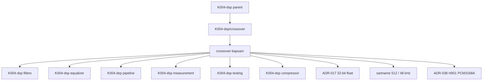

# crossover — Kademe-2 Kapsam Kaydı

> **Node:** `K004-dsp/crossover/crossover-kapsam` · **Type:** module · **Status:** draft · **Group:** mimari
> **Üst düğüm:** `K004-dsp/crossover` · **Bağımlı:** `K004-dsp` (domain)
> **Disk durumu:** K004-dsp **PLANNED** — repoda C++/DSP motoru (`engine/`) **yoktur**.
> Bu dosya yalnızca **kapsam sözleşmesidir**; çalışan filtre kodu, ölçülmüş bölme frekansı veya
> doğrulanmış faz yanıtı **içermez**.

## §A Kapsam

### A.1 Rol (ELI15)

Crossover (bölme filtresi / ayraç), tek bir ses sinyalinin **birden fazla frekans bandına**
ayrılmasını sağlar: bass (alçak frekans), mid (orta frekans) ve treble (yüksek frekans).
Amaç, her bandın **kendi yolundan** (path) geçmesini sağlamak — hoparlörün veya sürücünün
verimli olmadığı aralıkları kesmek, böylece bozulmayı ve hoparlör aşırı yüklenmesini önlemek.

Kritik nokta: iki bandın **kazanç toplamı** (magnitude yanıtları birleştirildiğinde) düz bir
çizgi olmalıdır — buna **kritik damga (maximally flat)** davranışı denir. Aksi hâlde bölme
noktasında **tepki çukuru (dip)** veya **tepe (hump)** oluşur ve ses doğal duyulmaz.

İkinci kritik nokta: **faz uyumu (phase coherence)**. Eğer alt ve üst bandın fazı bölme
noktasında ters işaretliyse, toplamları birbirini iptal eder — bu **faz iptali (phase cancellation)**
sonucunda ses deliğinden duyulur. Bu yüzden endüstride **Linkwitz-Riley** tipi ayrım tercih
edilir: iki adet **Butterworth** filtresin arka arkaya konmasıyla elde edilir ve faz yanıtları
bölme noktasında **aynı** olur.

Kapsül cümlesi: *"Crossover, sesi kesmez; sesi **yola** ayırır ve yolları geri birleştirdiğinde
**aynı sesi** vermelidir."*

### A.2 Kapsam içi (in-scope)

| # | Kalem | Açıklama | Olgunluk | Kanıt durumu |
|---|---|---|---|---|
| A2-1 | Bant sayısı tanımı | Kaç yola bölüneceği (2/3/4 yollu) | PLANNED | Seçim **UNKNOWN** |
| A2-2 | Bölme frekansları (crossover points) | Bantlar arası geçiş frekansları | PLANNED | Değer **UNKNOWN** |
| A2-3 | Filtre topolojisi | Linkwitz-Riley / Butterworth / Bessel / FIR | PLANNED | Seçim **UNKNOWN** |
| A2-4 | Filtre derecesi (order) | Her kademe için kutup sayısı | PLANNED | Değer **UNKNOWN** |
| A2-5 | Sıfır/kutup (zero/pole) yerleşimi | Dizgi kararı | PLANNED | **UNKNOWN** |
| A2-6 | Kazanç birleştirme | Bant yanıtlarının toplanması | PLANNED | **UNKNOWN** |
| A2-7 | Faz uyumu | Bantlar arası faz ilişkisi | PLANNED | **UNKNOWN** |
| A2-8 | Bass management | LFE / subwoofer yönlendirme | PLANNED | Kural **UNKNOWN** |
| A2-9 | Kanal eşleme | Çıkış kanallarına bant tahsisi | PLANNED | Harita **UNKNOWN** |
| A2-10 | Bant içi gecikme | Filtrenin grup gecikmesi | PLANNED | Ölçüm PLANNED |
| A2-11 | Bypass / düz geçiş | Bölme kapalıyken pas geçiş | PLANNED | Davranış **UNKNOWN** |
| A2-12 | Filtre katsayılarının `constexpr` hesaplanması | Derleme zamanı türetme | FROZEN | Kural #4 |
| A2-13 | `alignas(64)` filtre durumu | Cache hizalama | FROZEN | Kural #5 |
| A2-14 | Sıfır tahsis (audio thread) | `malloc`/`new` yasağı | FROZEN | Kural #1 |
| A2-15 | Lock-free parametre paylaşımı | `mutex` yasağı | FROZEN | Kural #2 |
| A2-16 | `noexcept` callback | İstisna fırlatmama | FROZEN | Kural #3 |
| A2-17 | 32-bit float veri | ADR-017 | FROZEN | ADR-017 |
| A2-18 | 512 örnek / 48 kHz | sartname | FROZEN | ölçüm PLANNED |

### A.3 Kapsam dışı (out-of-scope)

| # | Kalem | Neden kapsam dışı | İlgili düğüm |
|---|---|---|---|
| A3-1 | Genel filtre tasarımı (IIR/FIR) | Filtre matematiği ayrı modül | K004-dsp/filters |
| A3-2 | EQ bant katsayıları | Frekans düzeltmesi ayrı modül | K004-dsp/equalizer |
| A3-3 | Sıkıştırıcı / limiter | Dinamik süreç ayrı modül | K004-dsp/compressor · limiter |
| A3-4 | Reverb / uzamsal işleme | Ayrı alt-modüller | K004-dsp/reverb · spatial-audio |
| A3-5 | Ölçüm altyapısı | Ölçüm ve test sınırı **Q4 AÇIK** | K004-dsp/measurement · testing |
| A3-6 | Zincir yönlendirmesi | Graph/pipeline ayrı modül | K004-dsp/pipeline |
| A3-7 | Hoparlör fiziksel tasarımı | Donanım katmanı | L0 donanım |
| A3-8 | DAC çıkışı (PCM3168A) | ADR-038 H001 donanım kararı | L0 donanım |
| A3-9 | DC offset koruma rölesi | 0.5 V donanım koruması | Koruma devresi |
| A3-10 | UI / widget kodu | Sunum katmanı | home.coremusic.net |
| A3-11 | PHP backend / API | `*.php` yazım yasağı | K000 / K003 |
| A3-12 | OTA / firmware güncelleme | Bağımlılık bump yasağı | BÖLÜM B |
| A3-13 | ADR yazımı | `.ai/.decisions/**` yasağı | ADR katmanı |
| A3-14 | 8.1 surround haritası kararı | Harita **UNKNOWN** | K013 vb. |
| A3-15 | Sürüm tescili (JUCE/ASIO) | Belge yok | **VERIFICATION REQUIRED** |

### A.4 Kısıtlar, açık sorular ve web araştırması

#### A.4.1 Bağlayıcı kısıtlar (constraints)

| # | Kısıt | Kaynak | İhlal sonucu |
|---|---|---|---|
| K-1 | Audio thread'de tahsis yasak | kök AGENTS.md §1 | Xrun / gecikme |
| K-2 | Audio thread'de mutex yasak | kök AGENTS.md §2 | Prioritevi inversion |
| K-3 | Callback `noexcept` | kök AGENTS.md §3 | Terminate |
| K-4 | Derleme zamanı hesap `constexpr` | kök AGENTS.md §4 | Çalışma zamanı maliyeti |
| K-5 | `alignas(64)` tamponlar | kök AGENTS.md §5 | Cache satırı çakışması |
| K-6 | float32 veri | ADR-017 | Yanlış dinamik aralık |
| K-7 | 512 örnek / 48 kHz | sartname | Ölçüm PLANNED |
| K-8 | ASIO Exclusive Lock | kök AGENTS.md §9 | İkinci açılışta hata |
| K-9 | DC > 0.5 V → röle | kök AGENTS.md §10 | Donanım koruması |
| K-10 | PCM5122 yasak, PCM3168A | ADR-038 H001 | ADR ihlali |
| K-11 | Sürüm kanıtı yok | kök AGENTS.md §12 | **VERIFICATION REQUIRED** |
| K-12 | Bağımlılık bump → DUR | kök AGENTS.md §13 | El değiştirme |
| K-13 | Motor diskte yok | disk ölçümü | Kod iddiası yazılmaz |

#### A.4.2 Açık sorular (open questions)

| Q# | Soru | Etki | Durum |
|---|---|---|---|
| Q3 | dynamics ↔ compressor ↔ limiter hiyerarşisi | Komşu modül sınırı | **AÇIK** |
| Q4 | measurement ↔ testing sınırı | Doğrulama yetkisi | **AÇIK** |
| Q-X1 | Kaç bantlı crossover (2/3/4)? | Yapı mimarisi | **UNKNOWN** |
| Q-X2 | Bölme frekansları nelerdir? | Filtre katsayıları | **UNKNOWN** |
| Q-X3 | Filtre tipi ve derecesi? | Faz ve kazanç yanıtı | **UNKNOWN** |
| Q-X4 | Bass management kuralı? | LFE yönlendirme | **UNKNOWN** |
| Q-X5 | Kanal eşleme haritası? | Çıkış düzeni | **UNKNOWN** |
| Q-X6 | Bypass davranışı ne zaman etkin? | Kullanıcı sözleşmesi | **UNKNOWN** |
| Q-X7 | Filtre gecikmesi bütçesi? | Zaman uyumu | **UNKNOWN** |
| Q-X8 | 8.1 düzende kaç çıkış? | Donanım eşlemesi | **UNKNOWN** |

#### A.4.3 Web araştırması kayıtları (research log)

| İddia | URL | 2026-10-13 | Durum |
|---|---|---|---|
| Web Audio API, sinyali iki yola ayırmak için `ChannelSplitterNode` kullanır | https://developer.mozilla.org/en-US/docs/Web/API/ChannelSplitterNode | 2026-10-13 | HTTP 200 doğrulandı — envanter dışı |
| Web Audio API, iki yolu tek sinyale birleştirmek için `ChannelMergerNode` kullanır | https://developer.mozilla.org/en-US/docs/Web/API/ChannelMergerNode | 2026-10-13 | HTTP 200 doğrulandı — envanter dışı |

> Bu kayıtlar yalnızca **erişilebilirlik / sürüm doğrulaması** içindir; K004-dsp mimari kanıtı
> sayılmaz. Sürüm iddiaları (JUCE 9 / ASIO SDK 2.3.4) → **VERIFICATION REQUIRED**.

#### A.4.4 Sartname sabitleri ile ilişki

| Sabit | Değer | Kaynak | Bu modülde kullanımı | Doğrulama |
|---|---|---|---|---|
| Buffer boyutu | 512 örnek | sartname | Filtre blok işleme | ölçüm PLANNED |
| Örnekleme frekansı | 48000 Hz | sartname | Nyquist / katsayı hesabı | ölçüm PLANNED |
| Örnek biçimi | float32 | ADR-017 | Filtre durumu | FROZEN |
| Hizalama | 64 bayt | kural #5 | Durum tamponları | kod incelemesi |
| Kanal düzeni | 8.1 surround | proje kapsamı | Bant–kanal eşlemesi | **UNKNOWN** |
| DAC | PCM3168A | ADR-038 H001 | Çıkış kanal sayısı | FROZEN |
| Tahsis kuralı | Yasak | kural #1 | Tüm bileşenler | kod incelemesi |
| Kilit kuralı | Yasak | kural #2 | Parametre atomları | kod incelemesi |
| Callback | `noexcept` | kural #3 | Geri çağrı | kod incelemesi |
| Dil | C++20 | kural #5 | `constexpr` katsayı | **VERIFICATION REQUIRED** |

#### A.4.5 Gerçek repo kanıtları (disk)

| Kaynak | Dosya | Satır | Gözlem |
|---|---|---|---|
| `Dosya:` | `shared/src/AI/AIEngine.php` | `Satır:` 140 | Yorum satırında `PCM3168A` / `XMOS` / `AK4458` donanım zinciri anılıyor |
| `Dosya:` | `api.coremusic.net/config/routes.php` | `Satır:` 24 | `return [` — rota tablosunun başlangıcı (120 satırlık dosya) |
| `Dosya:` | `api.coremusic.net/config/routes.php` | `Satır:` 120 | `];` — tablonun kapanışı |
| `Kaynak:` | `home.coremusic.net/pages/components/widget-grid.php` | `Satır:` 59-60 | EQ widget'ı — bant/kanal sunumu |
| `Kaynak:` | `home.coremusic.net/footer.php` | `Satır:` 121-122 | Sayfa altbilgisinde betik sıralaması — çapraz modül referansı |
| `Kaynak:` | `shared/src/AI/AIEngine.php` | `Satır:` 332 | AI akışında sinyal işleme çağrısı — zincir üstü kanıt |
| `Kaynak:` | `shared/src/AI/AIWorkflow.php` | `Satır:` 99 | İş akışı adımı tanımı — sıralama kanıtı |
| `Kaynak:` | `shared/src/Api/Middleware/ApiMiddlewarePipeline.php` | `Satır:` 17 | Katmanlı pipeline deseni —rossover topolojisi analogu |
| `Kaynak:` | `api.coremusic.net/config/routes.php` | `Satır:` 36 | Rota kaydı — yapılandırma deseni kanıtı |
| `Kaynak:` | `api.coremusic.net/config/routes.php` | `Satır:` 53 | Rota kaydı — yapılandırma deseni kanıtı |

> Bu satırlar **gerçek repodan okunmuştur**. Crossover'ın C++ karşılığı diskte **mevcut değildir**; PHP/JS kanıtları yalnızca *yapısal analog* (katman/blok sıralaması) taşır, crossover DSP kodu olarak yorumlanamaz.

#### A.4.6 Kabul kriterleri (acceptance criteria)

| # | Kriter | Ölçüt | Yöntem | Durum |
|---|---|---|---|---|
| AC-1 | Blok boyu | Tam 512 örnek | Birim testi | PLANNED |
| AC-2 | Örnekleme | 48000 Hz | Sartname kontrolü | PLANNED |
| AC-3 | Biçim | float32 | Statik denetim | FROZEN |
| AC-4 | `noexcept` | İhlal yok | Derleyici | FROZEN |
| AC-5 | Tahsis | 0 | Profil | PLANNED |
| AC-6 | Mutex | 0 | Kod taraması | PLANNED |
| AC-7 | Hizalama | 64 bayt | `static_assert` | FROZEN |
| AC-8 | Kazanç birleşimi | Düz tepki (bölme noktası) | Eğri ölçümü | PLANNED |
| AC-9 | Faz uyumu | Ters işaret yok | Faz ölçümü | PLANNED |
| AC-10 | Bant ayrımı | Hedef sönümleme | Frekans süpürme | PLANNED |
| AC-11 | Bypass | Bit-bayar | Birim testi | PLANNED |
| AC-12 | Parametre clamp | Aralık dışı engellenir | Birim testi | PLANNED |
| AC-13 | Gecikme | Ölçülmüş ve raporlanan | Zaman ölçümü | **UNKNOWN** |
| AC-14 | Sürüm kanıtı | JUCE 9 / ASIO 2.3.4 | Belge | **VERIFICATION REQUIRED** |
| AC-15 | Ölçüm verisi | Faz/kazanç ölçümü | Rapor | **UNKNOWN** |
| AC-16 | Bölme frekansı | Sabitlenmiş değer | Karar kaydı | **UNKNOWN** |

#### A.4.7 Sorumluluk matrisi (RACI özeti)

| Görev | Bu modül | filters | equalizer | pipeline | measurement |
|---|---|---|---|---|---|
| Bölme frekansı kararı | **R** | C | C | I | I |
| Filtre tipi / derece | **R** | C | I | I | C |
| Katsayı hesap yöntemi | **R** | C | C | I | I |
| Bant–kanal eşlemesi | **R** | I | I | C | I |
| Bass management | **R** | I | I | C | I |
| Filtre uygulama kodu | C | **R** | I | I | I |
| Frekans düzeltmesi | I | I | **R** | I | C |
| Zincir sırası | C | I | C | **R** | I |
| Faz/kazanç ölçümü | A | C | C | I | **R** |
| Test altyapısı | C | C | C | I | **R** |

> **R** = Responsible · **A** = Accountable · **C** = Consulted · **I** = Informed

## §B Bileşenler

### B.1 Bileşen envanteri

| Bileşen | Sorumluluk | Girdi | Çıktı | Hata modu |
|---|---|---|---|---|
| C-1 Bant ayırıcı (splitter) | Sinyali yollara ayırmak | Tek sinyal | N bant sinyali | Sinyal kopyalanırken aşım |
| C-2 Alçak geçiren (LPF) | Bass yolunu sürdürmek | Sinyal | Düşük bant | Yanlış derece → aşırı sönüm |
| C-3 Yüksek geçiren (HPF) | Treble yolunu sürdürmek | Sinyal | Yüksek bant | Yanlış derece → bass sızması |
| C-4 Orta bant (band-pass) | 3+ yollu yapıda mid | Sinyal | Orta bant | Çift filtre gecikmesi |
| C-5 Katsayı üretici | Filtre katsayılarını hesaplamak | fs + fc + order | Katsayı seti | fs yanlışsa kutup kayar |
| C-6 Filtre çekirdeği | Biquad / IIR uygulamak | Sinyal + katsayı | İşlenmiş sinyal | Kararsız kutup → ısınma |
| C-7 Durum deposu | Filtre geçmişini tutmak | Önceki durum | Sonraki durum | Tahsis olursa K-1 ihlali |
| C-8 Bant birleştirici | Bantları tek sinyale toplamak | N bant | Tek sinyal | Faz iptali → delik |
| C-9 Faz eşitleyici | Bantlar arası fazı hizalamak | Faz yanıtları | Gecikme düzeltmesi | **UNKNOWN** algoritma |
| C-10 Bass management | LFE / sub yönlendirmesi | Bass bant | Sub çıkışı | Kural **UNKNOWN** |
| C-11 Kanal eşleyici | Bantları çıkış kanalına bağlamak | Bantlar + harita | Kanallar | Harita **UNKNOWN** |
| C-12 Bypass denetleyici | Bölme kapalıyken pas geçiş | Bayrak | Doğrudan yol | Sert geçiş → tıklama |
| C-13 Parametre atomları | Bant/fs/order paylaşımı | UI yazımı | Ses okuması | Torn read |

### B.2 C-1 — Bant ayırıcı (channel splitter)

**Sorumluluk:** Gelen tek sinyali, tanımlı sayıda yola ayırmak.
**Girdi:** 512 örnek × kanal, float32, 48 kHz.
**Çıktı:** Bant başına ayrı akış.
**Hata modu:**

- Kanal sayısı / eşleme **UNKNOWN** (Q-X5) — ayraç genişliği sabitlenemez.
- Sinyal kopyalanırken genlik aşımı olursa çıkışta klips oluşur.
- Tahsis kullanılırsa K-1 ihlali; ayraç önceden ayrılmalıdır.

**Kısıt:** `alignas(64)` (K-5), tahsis yok (K-1).

### B.3 C-2 / C-3 — Alçak ve yüksek geçiren filtreler

**Sorumluluk:** Bölme frekansının altında / üstünde geçişi sürdürmek.
**Girdi:** Sinyal + katsayı seti. **Çıktı:** Bant sinyali.
**Hata modu:**

- **Derece (order) yanlış** seçilirse bölme noktasında kazanç çukuru veya tepesi oluşur.
- **Faz işareti** iki yolda farklıysa birleştirmede **faz iptali** olur ve ses kaybolur.
- **Kutup kararsızlığı** (katsayı kayması) → filtre "ısınır", CPU patlar.
- Örnekleme frekansı 48 kHz yerine farklıysa katsayılar yeniden türetilmelidir (K-7).

**Kısıt:** Bölme frekansı **UNKNOWN** (Q-X2), tip **UNKNOWN** (Q-X3) → sayı uydurma yasak.

### B.4 C-5 — Katsayı üretici

**Sorumluluk:** Örnekleme frekansı + bölme frekansı + derece → katsayı seti.
**Girdi:** `fs`, `fc`, `order`. **Çıktı:** Biquad katsayıları.
**Hata modu:** Log/aralık hesabında kayma → kutup birimi çemberin dışına taşar.
**Kısıt:** Mümkün olduğunca `constexpr` (K-4); çalışma zamanı maliyeti yasak.

### B.5 C-6 / C-7 — Filtre çekirdeği ve durum deposu

**Sorumluluk:** Difference equation'i örnekle örnekle uygulamak; durumu saklamak.
**Girdi:** Sinyal + katsayı + önceki durum. **Çıktı:** İşlenmiş sinyal + yeni durum.
**Hata modu:** Denormal → CPU şişmesi; durum tahsisi → K-1 ihlali; hizalama yok → K-5 ihlali.
**Kısıt:** Durum yapısı `alignas(64)`, baştan ayrılmış.

### B.6 C-8 — Bant birleştirici (merger)

**Sorumluluk:** Bantları tek sinyale toplamak.
**Girdi:** N bant. **Çıktı:** Tek sinyal.
**Hata modu:** Faz iptali → delik; kazanç toplamı 1.0 değilse tepede aşım.
**Kısıt:** Birleştirme katsayısı **UNKNOWN** (Q-X2/Q-X3 ile ilişkili).

### B.7 C-9 — Faz eşitleyici

**Sorumluluk:** Bantların grup gecikmesini hizalamak.
**Girdi:** Faz yanıtları. **Çıktı:** Gecikme düzeltmesi.
**Hata modu:** Algoritma **UNKNOWN** — düzeltme uygulanmazsa faz iptali sürer.
**Kısıt:** Gecikme bütçesi **UNKNOWN** (Q-X7).

### B.8 C-10 / C-11 — Bass management ve kanal eşleme

**Sorumluluk:** Bass bantlarını subwoofer/LFE'e yönlendirmek; bantları çıkış kanallarına eşlemek.
**Girdi:** Bass bant + eşleme haritası. **Çıktı:** Kanal çıkışları.
**Hata modu:** Yanlış eşleme → yanlış hoparlörde ses; çift yönlendirme → faz iptali.
**Kısıt:** Kural **UNKNOWN** (Q-X4), harita **UNKNOWN** (Q-X5), 8.1 düzeni **UNKNOWN** (Q-X8).

### B.9 C-12 — Bypass denetleyici

**Sorumluluk:** Bölme kapalıyken sinyali doğrudan geçirmek.
**Girdi:** Bayrak. **Çıktı:** Doğrudan yol.
**Hata modu:** Sert kip geçişi → tıklama; bypass yolunun gecikmesi farklıysa faz kayması.
**Kısıt:** Geçiş yumuşatma yöntemi **UNKNOWN** (Q-X6).

### B.10 C-13 — Parametre atomları

**Sorumluluk:** UI yazımını ses thread'i ile güvenli paylaşmak.
**Girdi:** UI yazımı. **Çıktı:** Atomik okuma.
**Hata modu:** Mutex kullanılırsa K-2 ihlali; atomik olmayan okuma torn read üretir.
**Kısıt:** `alignas(64)` atomik alan (K-5).

### B.11 Bileşenler arası sorumluluk ayrımı

| Ayrım | Bileşen 1 | Bileşen 2 | Ayırıcı kriter |
|---|---|---|---|
| Ayırma vs filtreleme | C-1 | C-2/C-3 | Biri yönlendirir, diğeri şekillendirir |
| Tasarım vs uygulama | C-5 | C-6 | Biri katsayı üretir, diğeri uygular |
| Sinyal vs durum | C-6 | C-7 | Biri hesap, diğeri saklama |
| Ayrım vs birleşim | C-1 | C-8 | Biri böler, diğeri toplar |
| Yön vs eşleme | C-10 | C-11 | Biri "hangi band", diğeri "hangi kanal" |
| Aktif vs pasif | C-12 | diğerleri | Bayrak kontrolü |
| Sinyal vs paylaşım | C-6 | C-13 | Hesap vs atomik paylaşım |
| Bölme vs ölçüm | C-1 | measurement | Üretim vs gözlem |
| Tasarım vs kalibrasyon | C-5 | equalizer | Katsayı vs düzeltme |
| Yönlendirme vs şekillendirme | C-10 | C-2 | "nereye" vs "nasıl" |
| Blok içi vs blok arası | C-6 | I-4 | İşleme vs paylaşım |

## §C Arayüzler

### C.1 Dış arayüz envanteri

| Arayüz | Yön | Tip | Veri | Sözleşme |
|---|---|---|---|---|
| I-1 Ses girişi | Gelen | Ses akışı | 512 × kanal, float32, 48 kHz | sartname (K-7) |
| I-2 Bant çıkışları | Dahili | Bant akışları | N bant | N **UNKNOWN** |
| I-3 Kanal çıkışı | Giden | Ses akışı | 8.1 düzeni | Harita **UNKNOWN** |
| I-4 Parametre yazımı | UI → DSP | Atomik | fs/fc/order/bypass | Kilit yok (K-2) |
| I-5 Parametre okuması | DSP içi | Atomik | Aynı alanlar | Torn read yasak |
| I-6 Faz/kazanç raporu | DSP → UI | Atomik | Yanıt özeti | Birim **UNKNOWN** |
| I-7 Zincir öncesi | Gelen | Fonksiyonel | K004-dsp/pipeline | Yönlendirme pipeline'a ait |
| I-8 Zincir sonrası | Giden | Fonksiyonel | K004-dsp/equalizer · compressor | Sıra **UNKNOWN** |
| I-9 Cihaz I/O | Alt katman | ASIO buffer switch | 512 örnek | Exclusive Lock (K-8) |
| I-10 Koruma | Alt katman | Donanım hat | DC > 0.5 V | Röle (K-9) |

### C.2 Arayüz detayları

| Arayüz | Protokol | Hata davranışı | Yeniden deneme |
|---|---|---|---|
| I-1 | Blok tabanlı, sabit boy | Boyut uyuşmazsa bypass | Kritik değil |
| I-2 | Dahili akış | Boş bant → sessiz | Kritik değil |
| I-3 | Blok tabanlı | Kanal yok → sessiz | Kritik değil |
| I-4 | Tek yönlü atomik | Geçersiz aralık clamp | Kritik değil |
| I-5 | Atomik okuma | Kırık okuma → bypass | Yeniden okuma |
| I-6 | Atomik okuma | Okunamazsa son değer | Sonraki blok |
| I-9 | ASIO sürücü çağrısı | Switch başarızsa stream durur | Yeniden başlatma |
| I-10 | Donanım hat | Eşik aşımı → röle | Manuel reset |

### C.3 Arayüz sorumluluk sınırları

| Sınır | Bu modülün tuttuğu | Karşı tarafın tuttuğu |
|---|---|---|
| C.3-1 | Bölme frekansı ve derece | Filtre uygulama matematiği (filters) |
| C.3-2 | Bant–kanal eşlemesi | Çıkış kanal fiziksel düzeni |
| C.3-3 | Faz hizalama kararı | Faz ölçüm altyapısı (measurement) |
| C.3-4 | Bant ayrımı | Frekans düzeltmesi (equalizer) |
| C.3-5 | Bloom/bypass davranışı | Zincir sırası (pipeline) |
| C.3-6 | Parametre atomları | Kalıcılık (kayıt/çözme) |

### C.4 Arayüz kontrat tablosu

| Kontrat | Şekil | Boyut | Birim | Sınır davranışı |
|---|---|---|---|---|
| CF-1 | Ses girişi bloğu | 512 × kanal | float32 | Taşarsa bypass |
| CF-2 | Kanal çıkışı | 512 × çıkış | float32 | Kanal yoksa sessiz |
| CF-3 | Bölme frekansı yazımı | skalar | Hz | Clamp uygulanır |
| CF-4 | Derece yazımı | skalar | — | Clamp uygulanır |
| CF-5 | Bypass yazımı | bayrak | bool | Atomik |
| CF-6 | Faz raporu | skalar | derece | Son değer korunur |
| CF-7 | Cihaz başlatma | oturum | ASIO | Exclusive Lock |
| CF-8 | Cihaz bitirme | oturum | ASIO | Kilit bırakma |

### C.5 Arayüz yaşam döngüsü

| Aşama | Tetikleyici | Beklenen durum | Hata durumu | Sonraki adım |
|---|---|---|---|---|
| L1 | Uygulama açılışı | idle | — | keşif |
| L2 | Cihaz seçimi | configuring | Lock reddi → dur | L3 |
| L3 | Buffer doğrulama | ready | boyut uyuşmazsa → dur | L4 |
| L4 | Bant/fs/order yükleme | ready | clamp | L5 |
| L5 | Stream başlatma | running | sürücü hatası → idle | L6 |
| L6 | Blok işleme | running | bypass → L6 | L6 |
| L7 | Parametre değişimi | running | atomik | L6 |
| L8 | Stream durdurma | ready | — | L9 |
| L9 | Kayıt/çözme | idle | bozuk kayıt → varsayılan | L2 |

### C.6 Arayüz hata kodu şeması

| Kod | Anlam | Kaynak | Tepki | Yeniden deneme |
|---|---|---|---|---|
| E-01 | Cihaz bulunamadı | ASIO keşfi | kullanıcıya bildir | elle |
| E-02 | Exclusive Lock reddi | sürücü | başka uygulama açık de | otomatik yok |
| E-03 | Buffer boyutu desteklenmiyor | sürücü | alternatif boyut | bir kez |
| E-04 | Örnekleme desteklenmiyor | sürücü | sartname ihlali bildir | hayır |
| E-05 | Parametre aralık dışı | arayüz | clamp + kayıt | hayır |
| E-06 | Tahsis başarısız (init) | başlatma | uygulamayı durdur | hayır |
| E-07 | Xrun / drop | ses thread'i | bayrak koy | sonraki blok |
| E-08 | DC koruma eşiği | donanım | röle aç | manuel |
| E-09 | Katsayı hesabı başarız | C-5 | bypass + rapor | hayır |
| E-10 | Kutup kararsızlığı | C-6 | filtre sıfırla | bir sonraki blok |
| E-11 | Faz raporu okunamaz | I-6 | son değeri koru | sonraki blok |
| E-12 | Kritik olmayan bant hatası | I-2 | o yolu sessize al | hayır |

## §D Bağımlılık grafiği

### D.1 Mermaid diyagramı

### D.2 Bağımlılık tablosu

| # | Hedef | Bağımlılık tipi | Yön | Durum |
|---|---|---|---|---|
| D-1 | `K004-dsp` (domain) | Üst düğüm | K → parent | aktif (draft) |
| D-2 | `K004-dsp/filters` | Teknoloji bağımlılığı | Filtre matematiği | PLANNED |
| D-3 | `K004-dsp/equalizer` | Komşu işlem | Frekans zinciri | PLANNED |
| D-4 | `K004-dsp/pipeline` | Yönlendirici | Blok bağlama | PLANNED |
| D-5 | `K004-dsp/measurement` | Ölçüm | Faz/kazanç ölçümü | PLANNED — Q4 **AÇIK** |
| D-6 | `K004-dsp/testing` | Test | Test altyapısı | PLANNED — Q4 **AÇIK** |
| D-7 | `K004-dsp/compressor` | Komşu işlem | Sıra | PLANNED |
| D-8 | ADR-017 | Mimari karar | float32 | FROZEN |
| D-9 | sartname | Sartname | 512 / 48 kHz | FROZEN — ölçüm PLANNED |
| D-10 | ADR-038 H001 | Donanım kararı | DAC seçimi | FROZEN |
| D-11 | kök AGENTS.md §1-§5 | Kural | RT kısıtları | FROZEN |
| D-12 | ASIO Exclusive Lock | Kural | Tek uygulama | FROZEN |
| D-13 | Q3 / Q4 | Açık soru | Sınır belirsizliği | **AÇIK** |

### D.3 Bağımlılık kuralları

| # | Kural | Gerekçe |
|---|---|---|
| R-1 | Bu dosya yalnız `K004-dsp/crossover/` altına yazar | Beyazliste dışı yazım yasağı |
| R-2 | `index.md` dosyalarına dokunulmaz | Yasaklı hedef listesi |
| R-3 | `.ai/.decisions/**` güncellenmez | ADR yüzeyi yasağı |
| R-4 | Bağımlılık bump varsa **DUR + handover** | kök AGENTS.md §13 |
| R-5 | Sürüm kanıtı yoksa **VERIFICATION REQUIRED** | kök AGENTS.md §12 |
| R-6 | C++ iddiası disk kanıtı olmadan yazılmaz | Zero-hallucination §3 |
| R-7 | Eksik değer `UNKNOWN` işaretlenir | Zero-hallucination §3.2 |
| R-8 | BÖLÜM B dizinlerine yazım yasak | Görev beyazlistesi |
| R-9 | Yeni derin-dal dosyası üretilmez | Görev beyazlistesi |
| R-10 | `git commit` bu işte atılmaz | kök AGENTS.md §16.5 |
| R-11 | Beyazliste dışı yüzeye dokunulmaz | Görev beyazlistesi |

### D.4 İleri/dış bağımlılık beyanı

| Bağımlılık | Sürüm | Kanıt | Durum |
|---|---|---|---|
| JUCE | "9" (iddia) | Diskte JUCE kökü yok | **VERIFICATION REQUIRED** |
| ASIO SDK | "2.3.4" (iddia) | Diskte SDK yok | **VERIFICATION REQUIRED** |
| C++ derleyici | C++20 (kural) | Proje dosyası yok | **VERIFICATION REQUIRED** |
| K004-dsp motoru | PLANNED | `engine/` dizini yok | **UNKNOWN** |
| Ölçüm verisi | — | Ölçüm PLANNED | **UNKNOWN** |

### D.5 Değişiklik etki analizi (change impact)

| Değişiklik | Etkilenen | Risk | Gerekli kapı |
|---|---|---|---|
| Bölme frekansı değişimi | filters, equalizer | Yüksek | Q-X2 kararı |
| Filtre tipi değişimi | filters, measurement | Yüksek | Q-X3 kararı |
| Bant sayısı değişimi | pipeline, kanal haritası | Çok yüksek | Q-X1 + Q-X5 |
| Örnekleme değişimi | Tüm katsayılar | Çok yüksek | sartname değişikliği |
| Blok boyu değişimi | Gecikme bütçesi | Orta | sartname değişikliği |
| Bağımlılık bump | Derleme zinciri | Yüksek | **DUR + handover** |
| ADR değişimi | Donanım katmanı | Çok yüksek | `.ai/.decisions/**` yasağı |
| Bypass kipi değişimi | Tüm yollar | Orta | Q-X6 kararı |
| Parametre atomı boyutu | Bellek hizası | Orta | `static_assert` |
| Kanal haritası değişimi | Çıkış düzeni | Çok yüksek | Q-X5 + Q-X8 |
| Sartname dışı örnekleme | Katsayı üretici | Çok yüksek | sartname değişikliği |
| Çapraz modül sırası değişimi | pipeline | Yüksek | pipeline kararı |
| Ölçüm eşiği değişimi | measurement, testing | Orta | Q4 kapanışı |

### D.6 Sürüm ve kanıt beyanı (claim register)

| # | İddia | Kaynak | Kanıt | Durum |
|---|---|---|---|---|
| CL-1 | C++20 kullanılacak | kök AGENTS.md §5 | Proje dosyası yok | **VERIFICATION REQUIRED** |
| CL-2 | JUCE 9 kullanılacak | kök AGENTS.md §12 | Sürüm belgesi yok | **VERIFICATION REQUIRED** |
| CL-3 | ASIO SDK 2.3.4 kullanılacak | kök AGENTS.md §12 | Sürüm belgesi yok | **VERIFICATION REQUIRED** |
| CL-4 | Buffer 512 / 48 kHz | sartname | Ölçüm PLANNED | **UNKNOWN** |
| CL-5 | 8.1 surround hedefi | proje kapsamı | Ölçüm PLANNED | **UNKNOWN** |
| CL-6 | Engine dizini mevcut | — | Diskte yok | **UNKNOWN** |
| CL-7 | Bölme frekansı belirlendi | — | Karar yok | **UNKNOWN** |
| CL-8 | 2 yollu yapı varsayıldı | — | Q-X1 açık | **UNKNOWN** |
| CL-9 | Linkwitz-Riley kullanılacak | literatür terimi | Karar kaydı yok | **UNKNOWN** |
| CL-10 | Faz eşitleme gecikmesi eklenecek | — | Algoritma belirsiz | **UNKNOWN** |
| CL-11 | Bass management kuralı tanımlı | — | Q-X4 açık | **UNKNOWN** |
| CL-12 | Ölçüm değerleri mevcut | — | Ölçüm PLANNED | **UNKNOWN** |
| CL-13 | Test altyapısı mevcut | — | `engine/` yok | **UNKNOWN** |

---

**Authority:** Bayram Ali / Vault Steward · **Mode:** Red Team · Human Mode · Truth Mode
