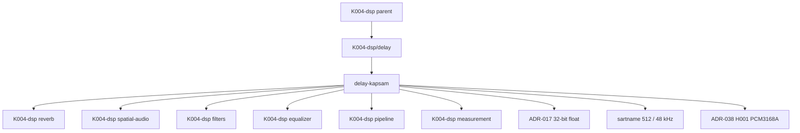

# delay — Kademe-2 Kapsam Kaydı

> **Node:** `K004-dsp/delay/delay-kapsam` · **Type:** module · **Status:** draft · **Group:** mimari
> **Üst düğüm:** `K004-dsp/delay` · **Bağımlı:** `K004-dsp` (domain)
> **Disk durumu:** K004-dsp düğümü **PLANNED** — repoda C++/DSP motoru (`engine/` dizini) yoktur.
> Bu dosya yalnızca **kapsam sözleşmesidir**; çalışan DSP kodu, ölçüm sonucu veya doğrulanmış
> gecikme süresi değeri içermez.

## §A Kapsam

### A.1 Rol (ELI15)

Delay (gecikme), ses sinyalini **belirli bir süre sonra** tekrar üretmek için kullanılan en basit
zaman-uzay işlemidir: gelen örnekler bir **tampona (buffer)** yazılır, belirli bir **gecikme
süresi (delay time)** kadar sonra okunur ve çıkışa verilir. Girdi ile çıkış arasındaki fark yalnızca
**zamandır**; genlik ve frekans karakteri olduğu gibi korunmak istenir.

Gecikme süresi, sesin **yalnızca tek bir kopyasını** ekleyen basit bir yapı olabileceği gibi
**(tap)**, geri beslemeli (**feedback**) bir yapıyla yankı/zaman serisi de oluşturabilir. Geri
besleme çarpanı 1.0'ın üstüne çıkarsa sistem **kararsızlaşır**; altındaysa sönümü gecikir.

Kullanım alanları: efekt (echo/delay), faz-kaydırma tabanlı düzeltme, kanal gecikme hizalama ve
**grup gecikmesi telafisi** (crossover/measurement ile ilişkili). Kapsül cümlesi: *"Delay,
sinyali değiştirmez; sinyali **zaman ekseninde kaydırır**."*

### A.2 Kapsam içi (in-scope)

| # | Kalem | Açıklama | Olgunluk | Kanıt durumu |
|---|---|---|---|---|
| A2-1 | Gecikme tamponu | Önceden ayrılmış, sabit boyutlu örnek deposu | PLANNED | Boyut hesabı **UNKNOWN** |
| A2-2 | Gecikme süresi parametresi | Milisaniye / örnek cinsinden gecikme | PLANNED | Değer **UNKNOWN** |
| A2-3 | Yazma-okuma başparmağı (write/read head) | Ring buffer üzerinde kayan başlıklar | PLANNED | Algoritma **UNKNOWN** |
| A2-4 | Kesirli gecikme (fractional delay) | Örnekle arası interpolasyon | PLANNED | Yöntem **UNKNOWN** (lineer/allpass) |
| A2-5 | Geri besleme (feedback) | Çıkışın girdiye geri beslenmesi | PLANNED | Çarpan **UNKNOWN** |
| A2-6 | Kurutma/wet karışımı (mix) | Girdi ile gecikmiş sinyalin dengesi | PLANNED | Değer **UNKNOWN** |
| A2-7 | Tap çıkışları | Birden fazla gecikme noktası okuma | PLANNED | Tap sayısı **UNKNOWN** |
| A2-8 | Modülasyon (LFO) | Gecikme süresinin zamanla değişimi | PLANNED | Kapsam **UNKNOWN** — soru Q-D8 |
| A2-9 | Zaman içi gecikme değişimi | Süre değiştirilirken kopma (click) yokluğu | PLANNED | Yöntem **UNKNOWN** |
| A2-10 | Maksimum gecikme sınırı | Tampon boyunu aşmayan üst sınır | PLANNED | Sınır **UNKNOWN** |
| A2-11 | Sıfır tahsis (zero-allocation) | Audio callback içinde malloc/new yasağı | FROZEN | Kural kök AGENTS.md §1 |
| A2-12 | Lock-free durum geçişi | Audio thread üzerinde mutex yasağı | FROZEN | Kural kök AGENTS.md §2 |
| A2-13 | `noexcept` callback | Ses geri çağrılarının istisna fırlatmaması | FROZEN | Kural kök AGENTS.md §3 |
| A2-14 | `alignas(64)` tamponlar | Cache-line hizalama (64 bayt) | FROZEN | Kural kök AGENTS.md §5 |
| A2-15 | 32-bit float veri | Ses verisinin temsil biçimi | FROZEN | ADR-017 |
| A2-16 | 512 örnek / 48 kHz | Buffer boyutu ve örneklem frekansı | FROZEN | sartname — ölçüm PLANNED |
| A2-17 | ASIO Exclusive Lock | Cihaz üzerinde tek uygulama hakkı | FROZEN | Kural kök AGENTS.md §9 |
| A2-18 | Bypass | Gecikme devre dışıyken bit-bayar geçiş | PLANNED | Kip **UNKNOWN** |

### A.3 Kapsam dışı (out-of-scope)

| # | Kalem | Neden kapsam dışı | İlgili düğüm |
|---|---|---|---|
| A3-1 | Reverb (oda simülasyonu) | Ayrı alt-modül; yoğun yansıma modeli | K004-dsp/reverb |
| A3-2 | Uzamsal gecikme (pan başına) | Uzamsal işleme ayrı modüldür | K004-dsp/spatial-audio |
| A3-3 | Filtre tasarımı (IIR/FIR) | Katsayı üretimi filters modülündedir | K004-dsp/filters |
| A3-4 | Crossover bölme filtreleri | Frekans ayrımı crossover modülündedir | K004-dsp/crossover |
| A3-5 | Equalizer bant düzeltmesi | Frekans düzeltmesi EQ modülündedir | K004-dsp/equalizer |
| A3-6 | Sıkıştırma / dinamik kontrol | Ayrı dinamik süreçtir | K004-dsp/compressor · K004-dsp/limiter |
| A3-7 | Ölçüm altyapısı (gecikme ölçümü) | Ölçüm sorumluluğu Q4 ile **AÇIK** | K004-dsp/measurement |
| A3-8 | Test harness'ı | Test stratejisi ayrı modüldür | K004-dsp/testing |
| A3-9 | DSP zinciri yönlendirmesi | Sıra/bağlantı pipeline modülündedir | K004-dsp/pipeline |
| A3-10 | Donanım DAC çıkışı | PCM3168A donanım tarafıdır; ADR-038 H001 | L0 donanım katmanı |
| A3-11 | DC offset koruma rölesi | Donanım koruması (0.5 V), DSP modülü değil | Koruma devresi |
| A3-12 | UI / efekt kontrol ekranı | Sunum katmanı | home.coremusic.net |
| A3-13 | OTA / firmware güncelleme | Bağımlılık bump yasağı kapsamındadır | BÖLÜM B yasak listesi |
| A3-14 | PHP backend servisleri | `*.php` dosyalarına dokunma yasağı | K000/K003 vb. |
| A3-15 | ADR yazımı / kararı | ADR yüzeyi `.ai/.decisions/**` yasağı altındadır | ADR kayıt katmanı |

### A.4 Kısıtlar, açık sorular ve web araştırması

#### A.4.1 Bağlayıcı kısıtlar (constraints)

| # | Kısıt | Kaynak | İhlal sonucu |
|---|---|---|---|
| K-1 | Audio thread üzerinde heap tahsisi yasak | kök AGENTS.md §1 | Xrun / öncüllü tahsis gecikmesi |
| K-2 | Audio thread üzerinde mutex yasağı | kök AGENTS.md §2 | Prioritevi inversion, drop |
| K-3 | Callback `noexcept` olmalı | kök AGENTS.md §3 | Terminate, cihaz kopması |
| K-4 | Derleme zamanı hesap `constexpr` | kök AGENTS.md §4 | Çalışma zamanı maliyeti |
| K-5 | Buffer `alignas(64)` | kök AGENTS.md §5 | Cache satırı çakışması |
| K-6 | Ses verisi 32-bit float | ADR-017 | Yanlış dinamik aralık temsili |
| K-7 | Buffer 512 örnek / 48 kHz | sartname | Ölçüm PLANNED — değer doğrulanmadı |
| K-8 | ASIO Exclusive Lock tek uygulama | kök AGENTS.md §9 | İkinci açılışta başarısız connect |
| K-9 | DC offset > 0.5 V → koruma rölesi | kök AGENTS.md §10 | Donanım koruması devrede |
| K-10 | PCM5122 mutlak yasak, yalnız PCM3168A | ADR-038 H001 | ADR ihlali |
| K-11 | Sürüm kanıtı yok: "JUCE 9" / "ASIO SDK 2.3.4" | kök AGENTS.md §12 | **VERIFICATION REQUIRED** |
| K-12 | Bağımlılık bump → DUR + handover | kök AGENTS.md §13 | El değiştirme zorunlu |
| K-13 | Repoda C++ motoru yok | disk ölçümü | Kod iddiası yazılmaz, **UNKNOWN** |

#### A.4.2 Açık sorular (open questions)

| Q# | Soru | Etki | Durum |
|---|---|---|---|
| Q3 | dynamics ↔ compressor ↔ limiter hiyerarşisi nedir? | Zincir sırası | **AÇIK** — üst karar bekliyor |
| Q4 | measurement ↔ testing sınırı nasıl çizilir? | Gecikme ölçümü kimin? | **AÇIK** — üst karar bekliyor |
| Q-D1 | Varsayılan gecikme süresi nedir (ms / örnek)? | Sartname sabiti | **UNKNOWN** — uydurma yasak |
| Q-D2 | Maksimum gecikme süresi / tampon boyu nedir? | Bellek bütçesi | **UNKNOWN** |
| Q-D3 | Geri besleme (feedback) çarpanı aralığı nedir? | Kararlılık sınırı | **UNKNOWN** |
| Q-D4 | Kesirli gecikme interpolasyon yöntemi nedir? | Ses kalitesi (nyquist üstü sızıntı) | **UNKNOWN** |
| Q-D5 | Wet/dry mix varsayılanı nedir? | Kullanıcı sözleşmesi | **UNKNOWN** |
| Q-D6 | Zaman içi süre değişimi hangi yumuşatma ile yapılır? | Click riski | **UNKNOWN** |
| Q-D7 | Modülasyon (LFO) kapsam içinde mi? | Kapsam sınırı | **UNKNOWN** |
| Q-D8 | Tap sayısı ve tap aralıkları nedir? | Arayüz şekli | **UNKNOWN** |
| Q-D9 | Gecikme bypass kipinde tampon korunur mu? | Kip geçişi davranışı | **UNKNOWN** |

#### A.4.3 Web araştırması kayıtları (research log)

| İddia | URL | 2026-10-13 | Durum |
|---|---|---|---|
| Web Audio API `DelayNode`, girdiyi tanımlı `delayTime` kadar erteleyen geçiş düğümüdür | https://developer.mozilla.org/en-US/docs/Web/API/DelayNode | 2026-10-13 | HTTP 200 doğrulandı — envanter dışı |
| `DelayNode.delayTime` bir `AudioParam`'dır ve saniye cinsinden gecikme süresini belirler | https://developer.mozilla.org/en-US/docs/Web/API/DelayNode/delayTime | 2026-10-13 | HTTP 200 doğrulandı — envanter dışı |

> **Not:** Bu tablo yalnızca **erişilebilirlik ve sürüm doğrulaması** kaydıdır; içeriği K004-dsp
> mimari kararı olarak **kanıtlamaz**. Sürüm iddiaları (JUCE 9 / ASIO SDK 2.3.4) için
> **VERIFICATION REQUIRED** işaretlenmiştir.

#### A.4.4 Sartname sabitleri ile ilişki

| Sabit | Değer | Kaynak | Bu modülde kullanımı | Doğrulama |
|---|---|---|---|---|
| Buffer boyutu | 512 örnek | sartname | Blok işleme birimi | ölçüm PLANNED |
| Örnekleme frekansı | 48000 Hz | sartname | ms → örnek dönüşümü | ölçüm PLANNED |
| Örnek biçimi | 32-bit float | ADR-017 | Tampon elemanı | FROZEN |
| Hizalama | 64 bayt | kök AGENTS.md §5 | Tampon & atomik alanlar | kod incelemesi |
| Kanal düzeni | 8.1 surround | proje kapsamı | Kanal başına gecikme | **UNKNOWN** |
| DAC | PCM3168A | ADR-038 H001 | Çıkış aşaması | FROZEN |
| DC koruma eşiği | 0.5 V | kök AGENTS.md §10 | Donanım katmanı | FROZEN |
| Tahsis kuralı | Yasak (audio thread) | kök AGENTS.md §1 | Tampon önceden ayrılmalı | kod incelemesi |
| Kilit kuralı | Yasak (audio thread) | kök AGENTS.md §2 | Parametre paylaşımı | kod incelemesi |
| Callback | `noexcept` | kök AGENTS.md §3 | Tüm geri çağrılar | kod incelemesi |

#### A.4.5 Gerçek repo kanıtları (disk)

| Kaynak | Dosya | Satır | Gözlem |
|---|---|---|---|
| `Kaynak:` | `assets.coremusic.net/js/coreplayer/coreplayer.volume.js` | `Satır:` 54 | `clamp` tanımı: `Math.min(1, Math.max(0, value))` — parametre sınırlama deseni |
| `Kaynak:` | `assets.coremusic.net/js/coreplayer/coreplayer.volume.js` | `Satır:` 57-59 | `edgeSnap` eşiği 0.98 / 0.02 — sınır davranışı |
| `Kaynak:` | `shared/src/Api/Middleware/ApiMiddlewarePipeline.php` | `Satır:` 33 | `process(array $request, callable $handler): array` — sıralı zincir yürütme |
| `Kaynak:` | `api.coremusic.net/config/routes.php` | `Satır:` 24 | `return [` — yapılandırma tablosu başlangıcı |
| `Kaynak:` | `home.coremusic.net/footer.php` | `Satır:` 121-122 | Sayfa altbilgisinde betik sıralaması |

> Bu satırlar **gerçek repodan okunmuştur**; delay'ın C++ karşılığı diskte **mevcut değildir**.

#### A.4.6 Kabul kriterleri (acceptance criteria)

| # | Kriter | Ölçüt | Yöntem | Durum |
|---|---|---|---|---|
| AC-1 | Blok işleme boyutu | Her çağrıda tam 512 örnek | Birim testi | PLANNED |
| AC-2 | Örnekleme frekansı | 48000 Hz sabit | Sartname kontrolü | PLANNED |
| AC-3 | Örnek biçimi | float32 | Statik tip denetimi | FROZEN |
| AC-4 | Callback imzası | `noexcept` | Derleyici denetimi | FROZEN |
| AC-5 | Tahsis denetimi | Audio thread içinde 0 tahsis | Profil ölçümü | PLANNED |
| AC-6 | Kilit denetimi | Audio thread içinde 0 mutex | Kod taraması | PLANNED |
| AC-7 | Hizalama | `alignas(64)` doğrulaması | Statik `static_assert` | FROZEN |
| AC-8 | Gecikme doğruluğu | Ölçülen gecikme = hedef (örnek) | Impuls ölçümü | **UNKNOWN** (hedef yok) |
| AC-9 | Tıklama yokluğu | Süre değişimi duyulabilir pop üretmez | Dinleme + ölçüm | PLANNED |
| AC-10 | Kararlılık | Geri besleme ≤ 1.0 sınırı korunur | Sınır testi | **UNKNOWN** (çarpan yok) |
| AC-11 | Frekans düzgünlüğü | Girdi/çıkış spektrumu eş | Spektrum ölçümü | PLANNED |
| AC-12 | bypass | Parametre geçersizken pas geç | Birim testi | PLANNED |
| AC-13 | Parametre aralığı | Geçersiz süre clamp'lenir | Birim testi | PLANNED |
| AC-14 | Atomik paylaşım | Torn read gözlenmez | Stres testi | PLANNED |
| AC-15 | Denormal | FLUSH_TO_ZERO etkin | Profil ölçümü | PLANNED |
| AC-16 | Exclusive Lock | İkinci uygulama başarısız olur | Bütünleşik test | PLANNED |
| AC-17 | DC koruma | 0.5 V eşiğinde röle | Donanım testi | PLANNED |
| AC-18 | Sürüm kanıtı | JUCE / ASIO sürüm belgesi | Belge araması | **VERIFICATION REQUIRED** |
| AC-19 | Ölçüm verisi | Gecikme ölçümü mevcut | Ölçüm raporu | **UNKNOWN** |
| AC-20 | Tampon boyu | Maksimum gecikme sığar | Bellek hesabı | **UNKNOWN** |

#### A.4.7 Sorumluluk matrisi (RACI özeti)

| Görev | Bu modül | reverb | spatial | pipeline | measurement |
|---|---|---|---|---|---|
| Gecikme tamponu tasarımı | **R** | C | C | I | I |
| Gecikme süresi kararı | **R** | C | C | I | C |
| Geri besleme sınırı | **R** | C | I | I | I |
| Kesirli interpolasyon | **R** | C | I | I | C |
| Zincir sırası | C | C | C | **R** | I |
| Uzamsal gecikme dağıtımı | C | I | **R** | C | I |
| Gecikme ölçümü | C | C | C | I | **R** (Q4 **AÇIK**) |
| Test altyapısı | C | C | C | I | **R** (Q4 **AÇIK**) |

> **R** = Responsible · **A** = Accountable · **C** = Consulted · **I** = Informed

## §B Bileşenler

### B.1 Bileşen envanteri

| Bileşen | Sorumluluk | Girdi | Çıktı | Hata modu |
|---|---|---|---|---|
| D-1 Parametre atomları | Süre/mix/feedback paylaşımı | UI yazımı | Ses okuması | Torn read |
| D-2 Tampon yöneticisi | Önceden ayrılmış örnek deposu | Boyut + kanal | Bellek bölgesi | Tahsis olursa K-1 ihlali |
| D-3 Yazma başlığı | Giriş örneklerini yazmak | Blok | Yeni konum | Taşarsa okuma-yazma çakışması |
| D-4 Okuma başlığı | Gecikmiş örnekleri okumak | Süre | Örnek akışı | Yanlış konum → kayma hatası |
| D-5 Kesirli okuyucu | Örnekle arası interpolasyon | Komşu örnekler | Ara değer | Yöntem **UNKNOWN** (Q-D4) |
| D-6 Geri besleme yolu | Çıkışın girdiye geri beslenmesi | Çıkış + çarpan | Beslenmiş girdi | Çarpan > 1.0 → kararsızlık |
| D-7 Sönümleme (damping) | Geri besleme yolunun frekans davranışı | Besleme sinyali | Sönümlü besleme | Filtre **UNKNOWN** |
| D-8 Wet/dry karıştırıcı | Girdi ile gecikmiş sinyalin dengesi | İki yol | Karışık çıkış | Mix clamp **UNKNOWN** |
| D-9 Süre yumuşatıcı | Zaman içi süre değişiminde tıklama önleme | Yeni süre | Yumuşatılmış süre | Yöntem **UNKNOWN** (Q-D6) |
| D-10 Tap okuyucu | Çoklu gecikme noktası | Konum listesi | Tap akışları | Tap sayısı **UNKNOWN** (Q-D8) |
| D-11 Modülasyon kaynağı | Sürenin zamanla değişimi | LFO parametresi | Süre sapması | Kapsam **UNKNOWN** (Q-D7) |
| D-12 Bypass denetleyici | Gecikme kapalıyken pas geçiş | Bayrak | Doğrudan yol | Sert geçiş → tıklama |

### B.2 D-2 / D-3 / D-4 — Tampon, yazma ve okuma başlıkları

**Sorumluluk:** Girdi örneklerini halka tampona (ring buffer) yazmak ve gecikme süresi kadar
geriden okumak.
**Girdi:** 512 örnek × kanal, float32, 48 kHz.
**Çıktı:** Gecikmiş örnek akışı.
**Hata modu:**

- Tampon **önceden ayrılmazsa** K-1 ihlali oluşur; boyut `constexpr` hesaplanmalıdır.
- Yazma ile okuma aynı noktaya çarpışırsa **çakışma (overlap)** olur → bozuk okuma.
- Gecikme süresi tampon boyunu aşarsa okuma başlığı yazma başlığını geçer → **UNKNOWN** sınır (Q-D2).
- Kanal başına ayrı tampon yoksa kanallar birbirine karışır.

**Kısıt:** `alignas(64)` (K-5), tahsis yok (K-1).

### B.3 D-5 — Kesirli okuyucu (fractional delay)

**Sorumluluk:** Gecikme süresi tam örnek sayısına denk gelmediğinde ara değeri üretmek.
**Girdi:** Komşu iki örnek + kesir. **Çıktı:** Ara örnek.
**Hata modu:**

- **Lineer interpolasyon** yüksek frekanslarda yumuşamaya (HF loss) neden olur.
- **Allpass** tabanlı yöntem faz tepkisini düzeltir ama ek gecikme getirir.
- Yöntem seçimi **UNKNOWN** (Q-D4) → sayı uydurma yasak.

**Kısıt:** Çalışma zamanı maliyeti düşük tutulmalı (K-4 ile uyum).

### B.4 D-6 / D-7 — Geri besleme ve sönümleme

**Sorumluluk:** Çıkışın bir bölümünü girdiye geri vererek zaman serisi (echo) oluşturmak.
**Girdi:** Çıkış + çarpan. **Çıktı:** Beslenmiş girdi.
**Hata modu:**

- Çarpan **≥ 1.0** olursa sistem **kararsızlaşır**; genlik sınırsız büyür → klips.
- Çarpan negatifse **ters faz** besleme olur → frekans tepkisinde çukurlar.
- Sönümleme filtresi yoksa yüksek frekanslar birikir → "cıvık" yankı.
- Çarpan aralığı **UNKNOWN** (Q-D3).

### B.5 D-8 — Wet/dry karıştırıcı

**Sorumluluk:** Ham girdi ile gecikmiş sinyali dengeli biçimde birleştirmek.
**Girdi:** İki sinyal + mix değeri. **Çıktı:** Karışık sinyal.
**Hata modu:** Mix 1.0 üstüne çıkarsa **genlik aşımı** olur; toplam kazanç 1.0'a normalize
edilmediyse bölgede seviye sıçraması duyulur.
**Kısıt:** Mix değeri **UNKNOWN** (Q-D5); clamp deseni JS kanıtıyla analog (`coreplayer.volume.js`
`Satır:` 54).

### B.6 D-9 — Süre yumuşatıcı

**Sorumluluk:** Kullanıcı süre değiştirdiğinde okuma başlığını ani atlamak yerine yumuşak geçişle
taşımak.
**Girdi:** Yeni süre. **Çıktı:** Yumuşatılmış süre.
**Hata modu:** Ani atlama → **tıkırtı (click)**; çok yavaş yumuşama → işitilir gecikme "sürüngen"
(delays drift).
**Kısıt:** Yöntem **UNKNOWN** (Q-D6).

### B.7 D-10 / D-11 — Tap okuyucu ve modülasyon

**Sorumluluk:** Tek tampondan birden fazla gecikme noktası okumak; istenirse süreyi zamanla
değiştirmek.
**Girdi:** Konum listesi / LFO. **Çıktı:** Tap akışları / süre sapması.
**Hata modu:** Tap sayısı artarsa okuma sayısı artar → CPU yükü; modülasyon kapsamı **UNKNOWN**
(Q-D7) — kapsam dışı olabilir.
**Kısıt:** Tahsis yok (K-1) — tap listesi baştan ayrılmalıdır.

### B.8 D-12 — Bypass denetleyici

**Sorumluluk:** Gecikme kapalıyken sinyali doğrudan geçirmek.
**Girdi:** Bayrak. **Çıktı:** Doğrudan yol.
**Hata modu:** Sert kip geçişi → tıklama; bypass yolunun gecikmesi farklıysa faz kayması.
**Kısıt:** Geçiş yumuşatma yöntemi **UNKNOWN** (Q-D9).

### B.9 D-1 — Parametre atomları

**Sorumluluk:** UI yazımını ses thread'i ile güvenli paylaşmak.
**Girdi:** UI yazımı. **Çıktı:** Atomik okuma.
**Hata modu:** Mutex kullanılırsa K-2 ihlali; atomik olmayan okuma torn read üretir.
**Kısıt:** `alignas(64)` atomik alan (K-5).

### B.10 Bileşenler arası sorumluluk ayrımı

| Ayrım | Bileşen 1 | Bileşen 2 | Ayırıcı kriter |
|---|---|---|---|
| Saklama vs okuma | D-2 tampon | D-4 başlık | Biri bellek, diğeri konum |
| Tam örnek vs ara örnek | D-4 | D-5 | Biri doğrudan, diğeri interpolasyon |
| Doğrudan gecikme vs geri besleme | D-4 | D-6 | Biri tek geçiş, diğeri döngü |
| Besleme vs sönümleme | D-6 | D-7 | Biri kazanç, diğeri şekillendirme |
| Karışım vs süzme | D-8 | D-7 | Biri seviye, diğeri frekans |
| Değişim vs yumuşatma | D-11 | D-9 | Biri hedef, diğeri geçiş |
| Aktif vs pasif | D-12 | diğerleri | Bayrak kontrolü |
| Hesap vs paylaşım | D-5 | D-1 | Interpolasyon vs atomik paylaşım |

### B.11 Parametre envanteri (tümü UNKNOWN)

| Parametre | Birim | Aralık | Varsayılan | Otomatik mi | Sahip |
|---|---|---|---|---|---|
| delay_time | ms / örnek | **UNKNOWN** | **UNKNOWN** | hayır | Bu modül |
| max_delay | ms / örnek | **UNKNOWN** | **UNKNOWN** | hayır (sabit) | Bu modül |
| feedback | oran | **UNKNOWN** | **UNKNOWN** | hayır | Bu modül |
| mix (wet/dry) | oran | **UNKNOWN** | **UNKNOWN** | hayır | Bu modül |
| interpolation | enum | lineer/allpass | **UNKNOWN** | — | Bu modül |
| tap_count | adet | **UNKNOWN** | **UNKNOWN** | hayır | Bu modül |
| modulation | bool + derinlik | **UNKNOWN** | **UNKNOWN** | olası | Bu modül (Q-D7) |
| damping | dB / Hz | **UNKNOWN** | **UNKNOWN** | hayır | Bu modül |
| bypass | bool | true/false | false | hayır | Pipeline |

### B.12 Bileşen olgunluk matrisi

| Bileşen | Tasarım | Kod | Ölçüm | Test | Engelli sebep |
|---|---|---|---|---|---|
| Parametre atomları (D-1) | PLANNED | YOK | PLANNED | PLANNED | atom tipi **UNKNOWN** |
| Tampon yöneticisi (D-2) | PLANNED | YOK | PLANNED | PLANNED | boyut **UNKNOWN** (Q-D2) |
| Yazma başlığı (D-3) | PLANNED | YOK | PLANNED | PLANNED | algoritma **UNKNOWN** |
| Okuma başlığı (D-4) | PLANNED | YOK | PLANNED | PLANNED | süre **UNKNOWN** (Q-D1) |
| Kesirli okuyucu (D-5) | PLANNED | YOK | PLANNED | PLANNED | yöntem **UNKNOWN** (Q-D4) |
| Geri besleme (D-6) | PLANNED | YOK | PLANNED | PLANNED | çarpan **UNKNOWN** (Q-D3) |
| Sönümleme (D-7) | PLANNED | YOK | PLANNED | PLANNED | filtre **UNKNOWN** |
| Wet/dry (D-8) | PLANNED | YOK | PLANNED | PLANNED | mix **UNKNOWN** (Q-D5) |
| Süre yumuşatıcı (D-9) | PLANNED | YOK | PLANNED | PLANNED | yöntem **UNKNOWN** (Q-D6) |
| Tap okuyucu (D-10) | PLANNED | YOK | PLANNED | PLANNED | tap sayısı **UNKNOWN** (Q-D8) |
| Modülasyon (D-11) | PLANNED | YOK | PLANNED | PLANNED | kapsam **UNKNOWN** (Q-D7) |
| Bypass (D-12) | PLANNED | YOK | PLANNED | PLANNED | kip **UNKNOWN** (Q-D9) |

> **YOK** ifadesi, diskte bu bileşenin C++ karşılığının bulunmadığını belirtir; kod yoktur.

### B.13 Hata modu özeti (FMEA)

| Hata modu | Etki | Olasılık | Algılama | Önlem | Öncelik |
|---|---|---|---|---|---|
| Tahsis audio thread'de | Xrun, drop | orta | profil | önceden ayırma | yüksek |
| Mutex audio thread'de | Prioritevi inversion | düşük | kod incelemesi | atomik alan | yüksek |
| `noexcept` ihlali | Terminate | düşük | derleyici | imza denetimi | yüksek |
| Denormal | CPU şişmesi | orta | profil | FLUSH_TO_ZERO | orta |
| Kararsız geri besleme | Klips / ısınma | orta | sınır testi | çarpan sınırı | yüksek |
| Ani süre değişimi | Tıklama (click) | yüksek | dinleme | yumuşatma | yüksek |
| Tampon çakışması | Bozuk okuma | düşük | birim testi | boyut hesabı | yüksek |
| Kesirli interpolasyon kaybı | HF yumuşama | orta | spektrum ölçümü | yöntem seçimi | orta |
| Torn read | Yarım parametre | düşük | stres testi | atomik | orta |
| Exclusive Lock ihlali | İkinci açılışta hata | orta | bütünleşik test | tek süreç | yüksek |

## §C Arayüzler

### C.1 Dış arayüz envanteri

| Arayüz | Yön | Tip | Veri | Sözleşme |
|---|---|---|---|---|
| I-1 Ses girişi | Gelen | Ses akışı | 512 örnek × kanal, float32, 48 kHz | Sartname (K-7) — ölçüm PLANNED |
| I-2 Ses çıkışı | Giden | Ses akışı | Aynı boyut ve biçim | Girdi ile birebir boyut |
| I-3 Parametre yazımı | UI → DSP | Atomik yazma | delay_time / feedback / mix / bypass | Kilit yok (K-2) |
| I-4 Parametre okuması | DSP içi | Atomik okuma | Aynı alanlar | Torn read yasak |
| I-5 Tap çıkışı | DSP → DSP | Dahili akış | Gecikmiş kopyalar | Tap sayısı **UNKNOWN** (Q-D8) |
| I-6 Durum bilgisi | DSP → UI | Atomik okuma | Aktif/pasif bayrağı | Burst yazma yasak |
| I-7 Zincir öncesi | Gelen | Fonksiyonel çağrı | K004-dsp/pipeline | Yönlendirme pipeline'a ait |
| I-8 Zincir sonrası | Giden | Fonksiyonel çağrı | K004-dsp/reverb · spatial-audio | Sıra **UNKNOWN** |
| I-9 Cihaz I/O | Alt katman | ASIO buffer switch | 512 örnek | Exclusive Lock (K-8) |
| I-10 Koruma | Alt katman | Donanım sinyali | DC offset > 0.5 V | Röle tetiklenir (K-9) |

### C.2 Arayüz detayları

| Arayüz | Protokol | Hata davranışı | Yeniden deneme |
|---|---|---|---|
| I-1 | Blok tabanlı, sabit boy | Boyut uyuşmazsa pas geç (bypass) | Kritik değil |
| I-2 | Blok tabanlı, sabit boy | Boyut uyuşmazsa sıfırla | Kritik değil |
| I-3 | Tek yönlü atomik | Geçersiz aralıkta değer clamp'lenir | Kritik değil |
| I-4 | Atomik okuma | Kırık okuma gözlemlenirse blok bypass | Yeniden okuma |
| I-5 | Dahili akış | Tap yoksa sessiz | Kritik değil |
| I-6 | Atomik bayrak | Teksat (glitch) tolere edilir | Kritik değil |
| I-9 | ASIO sürücü çağrısı | Buffer switch başarısızsa stream durur | Uygulama yeniden başlatır |
| I-10 | Donanım hat | Eşik aşılırsa röle açılır | Manuel reset |

### C.3 Arayüz sorumluluk sınırları

| Sınır | Bu modülün tuttuğu | Karşı tarafın tuttuğu |
|---|---|---|
| C.3-1 | Gecikme tamponu ve süresi | Çıkış kanal fiziksel düzeni |
| C.3-2 | Geri besleme ve mix davranışı | Efekt UI kontrolü |
| C.3-3 | Kesirli interpolasyon yöntemi | Filtre tasarımı (filters) |
| C.3-4 | Parametre atomları | Kalıcılık (kayıt/çözme) |
| C.3-5 | Doğrusal gecikme mantığı | Uzamsal dağıtım (spatial-audio) |
| C.3-6 | Blok işlenmesi | Akış yönlendirmesi (pipeline) |

### C.4 Arayüz kontrat tablosu (giriş/çıkış şekilleri)

| Kontrat | Şekil | Boyut | Birim | Sınır davranışı |
|---|---|---|---|---|
| CF-1 | Ses girişi bloğu | 512 × kanal | float32 | taşarsa bypass |
| CF-2 | Ses çıkışı bloğu | 512 × kanal | float32 | boyut eşitliği |
| CF-3 | delay_time yazımı | skalar | ms | clamp uygulanır |
| CF-4 | feedback yazımı | skalar | oran | clamp uygulanır |
| CF-5 | mix yazımı | skalar | oran | clamp uygulanır |
| CF-6 | bypass yazımı | bayrak | bool | atomik |
| CF-7 | Tap okuması | dizi | örnek | tap sayısı sınırı **UNKNOWN** |
| CF-8 | Cihaz başlatma | oturum | ASIO | Exclusive Lock |
| CF-9 | Cihaz bitirme | oturum | ASIO | kilit bırakma |

### C.5 Arayüz yaşam döngüsü

| Aşama | Tetikleyici | Beklenen durum | Hata durumu | Sonraki adım |
|---|---|---|---|---|
| L1 | Uygulama açılışı | idle | — | keşif |
| L2 | Cihaz seçimi | configuring | Lock reddi → dur | L3 |
| L3 | Buffer doğrulama | ready | boyut uyuşmazsa → dur | L4 |
| L4 | Gecikme tamponu ayırma | ready | tahsis başarız → dur | L5 |
| L5 | Stream başlatma | running | sürücü hatası → idle | L6 |
| L6 | Blok işleme | running | bypass → L6 | L6 |
| L7 | Süre değişimi | running | yumuşatma | L6 |
| L8 | Stream durdurma | ready | — | L9 |
| L9 | Kayıt/çözme | idle | bozuk kayıt → varsayılan | L2 |

### C.6 Arayüz hata kodu şeması

| Kod | Anlam | Kaynak | Tepki | Yeniden deneme |
|---|---|---|---|---|
| E-01 | Cihaz bulunamadı | ASIO keşfi | kullanıcıya bildir | elle |
| E-02 | Exclusive Lock reddi | sürücü | başka uygulama açık de | otomatik yok |
| E-03 | Buffer boyutu desteklenmiyor | sürücü | alternatif boyut dene | bir kez |
| E-04 | Örnekleme frekansı desteklenmiyor | sürücü | sartname ihlali bildir | hayır |
| E-05 | Parametre aralık dışı | arayüz | clamp + kayıt | hayır |
| E-06 | Gecikme tamponu tahsisi başarız | başlatma | uygulamayı durdur | hayır |
| E-07 | Xrun / drop | ses thread'i | bayrak koy | sonraki blok |
| E-08 | DC koruma eşiği aşıldı | donanım | röle aç | manuel |
| E-09 | Kararlılık ihlali (feedback) | geri besleme yolu | çarpanı sıfırla | sonraki blok |

## §D Bağımlılık grafiği

### D.1 Mermaid diyagramı

### D.2 Bağımlılık tablosu

| # | Hedef | Bağımlılık tipi | Yön | Durum |
|---|---|---|---|---|
| D-1 | `K004-dsp` (domain) | Üst düğüm | K → parent | aktif (draft) |
| D-2 | `K004-dsp/reverb` | Komşu işlem | Yankı/yankılanma ilişkisi | PLANNED |
| D-3 | `K004-dsp/spatial-audio` | Komşu işlem | Uzamsal gecikme dağıtımı | PLANNED |
| D-4 | `K004-dsp/filters` | Alt teknoloji | Sönümleme filtresi | PLANNED |
| D-5 | `K004-dsp/equalizer` | Komşu işlem | Frekans zinciri | PLANNED |
| D-6 | `K004-dsp/pipeline` | Yönlendirici | Blok bağlama | PLANNED |
| D-7 | `K004-dsp/measurement` | Ölçüm | Gecikme ölçümü | PLANNED — Q4 **AÇIK** |
| D-8 | `K004-dsp/testing` | Test | Test altyapısı | PLANNED — Q4 **AÇIK** |
| D-9 | ADR-017 | Mimari karar | float32 temsil | FROZEN |
| D-10 | sartname (512 / 48 kHz) | Sartname | Buffer & fs | FROZEN — ölçüm PLANNED |
| D-11 | ADR-038 H001 | Donanım kararı | DAC seçimi | FROZEN |
| D-12 | kök AGENTS.md §1-§5 | Kural | RT kısıtları | FROZEN |
| D-13 | ASIO Exclusive Lock | Kural | Tek uygulama | FROZEN |
| D-14 | Q3 / Q4 | Açık soru | Sınır belirsizliği | **AÇIK** |

### D.3 Bağımlılık kuralları

| # | Kural | Gerekçe |
|---|---|---|
| R-1 | Bu dosya yalnız `K004-dsp/delay/` altına yazar | Beyazliste dışı yazım yasağı |
| R-2 | `index.md` dosyalarına dokunulmaz | Yasaklı hedef listesi |
| R-3 | `.ai/.decisions/**` güncellenmez | ADR yüzeyi yasağı |
| R-4 | Bağımlılık bump varsa **DUR + handover** | kök AGENTS.md §13 |
| R-5 | Sürüm kanıtı yoksa **VERIFICATION REQUIRED** | kök AGENTS.md §12 |
| R-6 | C++ iddiası disk kanıtı olmadan yazılmaz | Zero-hallucination §3 |
| R-7 | Eksik değer `UNKNOWN` olarak işaretlenir | Zero-hallucination §3.2 |
| R-8 | BÖLÜM B dizinlerine yazım yasak | Görev beyazlistesi |
| R-9 | Yeni derin-dal dosyası üretilmez | Görev beyazlistesi |
| R-10 | `git commit` bu işte atılmaz | kök AGENTS.md §16.5 |

### D.4 İleri/dış bağımlılık beyanı

| Bağımlılık | Sürüm | Kanıt | Durum |
|---|---|---|---|
| JUCE | "9" (iddia) | Diskte JUCE kökü yok | **VERIFICATION REQUIRED** |
| ASIO SDK | "2.3.4" (iddia) | Diskte SDK yok | **VERIFICATION REQUIRED** |
| C++ derleyici | C++20 (kural) | Proje dosyası yok | **VERIFICATION REQUIRED** |
| K004-dsp motoru | PLANNED | `engine/` dizini yok | **UNKNOWN** |
| Ölçüm verisi | — | Ölçüm PLANNED | **UNKNOWN** |

### D.5 Değişiklik etki analizi (change impact)

| Değişiklik | Etkilenen | Risk | Gerekli kapı |
|---|---|---|---|
| Gecikme süresi değişimi | reverb, spatial, measurement | Yüksek | Q-D1 kararı |
| Maksimum tampon boyu değişimi | Bellek bütçesi, pipeline | Çok yüksek | Q-D2 + sartname |
| Geri besleme sınırı değişimi | Kararlılık | Yüksek | Q-D3 kararı |
| Interpolasyon yöntemi değişimi | Ses kalitesi, ölçüm | Orta | Q-D4 kararı |
| Örnekleme değişimi | Tüm süre dönüşümleri | Çok yüksek | sartname değişikliği |
| Blok boyu değişimi | Gecikme doğruluğu | Orta | sartname değişikliği |
| Bağımlılık bump | Derleme zinciri | Yüksek | **DUR + handover** |
| ADR değişimi | Donanım katmanı | Çok yüksek | `.ai/.decisions/**` yasağı |

### D.6 Sürüm ve kanıt beyanı (claim register)

| # | İddia | Kaynak | Kanıt | Durum |
|---|---|---|---|---|
| CL-1 | C++20 kullanılacak | kök AGENTS.md §5 | Proje dosyası yok | **VERIFICATION REQUIRED** |
| CL-2 | JUCE 9 kullanılacak | kök AGENTS.md §12 | Sürüm belgesi yok | **VERIFICATION REQUIRED** |
| CL-3 | ASIO SDK 2.3.4 kullanılacak | kök AGENTS.md §12 | Sürüm belgesi yok | **VERIFICATION REQUIRED** |
| CL-4 | Buffer 512 örnek / 48 kHz | sartname | Ölçüm PLANNED | **UNKNOWN** |
| CL-5 | 8.1 surround hedefi | proje kapsamı | Ölçüm PLANNED | **UNKNOWN** |
| CL-6 | Engine dizini mevcut | — | Diskte yok | **UNKNOWN** |
| CL-7 | Gecikme süresi belirlendi | — | Karar yok | **UNKNOWN** |
| CL-8 | Geri besleme aralığı belirlendi | — | Karar yok | **UNKNOWN** |
| CL-9 | Modülasyon kapsam içinde | — | Q-D7 açık | **UNKNOWN** |

---

**Authority:** Bayram Ali / Vault Steward · **Mode:** Red Team · Human Mode · Truth Mode
