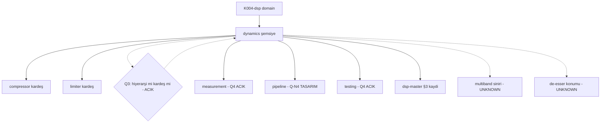

# dynamics — Kademe-2 Kapsam Kaydı

> **Node:** `K004-dsp/dynamics/dynamics-kapsam` · **Type:** module · **Status:** draft · **Group:** mimari
> **Üst düğüm:** `K004-dsp/dynamics` · **Bağımlı:** `K004-dsp` (domain)
> **Disk durumu:** K004-dsp **PLANNED** — repoda C++/DSP motoru (`engine/`) **yoktur**.
> Bu dosya yalnızca **kapsam sözleşmesidir**; çalışan dinamik işlem kodu, ölçülmüş kazanç
> azaltması veya doğrulanmış zarf davranışı **içermez**. Q3 (hiyerarşi↔kardeş) **AÇIK**'tır.

## §A Kapsam

### A.1 Rol (ELI15)

`dsp-master.md` §3 satır 4 bu dalı **"Dinamik işlemin şemsiye tanımı"** olarak yazar.
Basitçe: sesin yüksek-alçak davranışıyla ilgili tüm işlemlerin ailesi — ölçmek (envelope),
kırpıp uzatmak (compressor/gate), sınırlamak (limiter). `index.md` bunu "ailenin tanımı,
tek tek üyelerin kendisi değil" diye netleştirir: dynamics bir **kategori/şemsiye**'dir;
somut compressor ve limiter ayrı kardeş düğümlerdir (dsp-master §3, satır 5 · 6).

Dinamik işlemin özü: ses sinyalinin **seviyesini zaman içinde takip etmek** (ölçüm) ve bu
takibi bir **kazanç çarpanına** dönüştürmek (uygulama). Ölçüm tarafına *detector* (tepe/RMS),
uygulama tarafına *gain stage* denir. Ailenin tüm üyeleri aynı iki aşamayı paylaşır;
fark, kazanç eğrisinin **şeklindedir**: compressor yumuşak kırpma, gate tam geçiş,
limiter sert tavan, expander ters eğim.

Kritik kavram: **eşik (threshold)**. Sinyal eşiğin altındayken sistem şeffaf kalmalı;
üstündeyken tanımlı oranda davranmalıdır. Eşiğin etrafında **chattering** (aşırı hızlı
açma-kapama) olursa tıklama duyulur — bu yüzden endüstride eşik etrafına **deadband**
veya **hysteresis** konur.

İkinci kritik kavram: **zaman sabitleri (attack/release)**. Çok hızlı attack transiyentleri
öldürür, çok yavaş bırakır tepeyi geçirir; release çok kısa olursa **pompa (pumping)**
duyulur. Bu değerlerin tamamı bu modülde **UNKNOWN**'dur — uydurma sayı yazılmaz.

Kapsül cümlesi: *"Dynamics, sesin **ne kadar yüksek** olduğunu ölçer ve buna göre
**kazancı** yönetir; ama hangi üyenin hangi eğriyi kullandığını **kardeş modüller** belirler."*

Dikkat edilmesi gereken üçüncü nokta **makeup gain**'dir (kazanç geri kazanımı):
sıkıştırma ortalama seviyeyi düşürdüğü için çıkış kulağa "daha sessiz" gelir; makeup bu
kaybı telafi eder. Makeup uygulanmadan yapılan A/B karşılaştırması **yanıltıcıdır**
(önce seviye eşitlenir, sonra dinlenir). Bu modülde makeup'ın üye modüllerin (compressor)
sorumluluğunda mı yoksa aile ortak sözleşmesinde mi olduğu **UNKNOWN**'dur — Q-N3 kapsamı.

Dördüncü nokta: **program bağımlılığı (program dependency)**. Serbest bırakma (release)
sabit tutulduğunda, hızlı müzikte sistem sürekli sıkışır (pompa), yavaş müzikte hiç
sıkışmaz. Bu yüzden birçok sistemde **otomatik/aralık release** (auto release) vardır.
Nasıl seçildiği bu şemsiye dosyada değil, üye algoritmanın içinde tanımlanır.

Beşinci nokta: **çok bantlı (multiband) ayrımı**. Ayni zarf takibi birden fazla frekans
bandına ayrı ayrı uygulanabilir — bu durumda dynamics ile crossover'ın sınırları kesişir.
Sınırın nerede olduğu (multiband compressor kendi düğümü mü, yoksa dynamics + crossover
birleşimi mi) **UNKNOWN**'dur; tahmin yazılmaz.

Altıncı nokta: **ölçüm birimi sözleşmesi**. Tüm aile üyeleri aynı birimde konuşmalıdır:
seviye **dBFS** (float32 için 0 dBFS = 1.0), kazanç **çarpan** veya **dB** — seçim aile
sözleşmesinde (Q-N3) kararlaştırılacaktır. Birim karışıklığı (çarpan yerine dB yazmak)
100× ölçek hatası üretir; bu yüzden birim sütunları her tabloda açıkça belirtilmiştir.

Yedinci nokta: **çıkış güvenliği**. Dinamik işleme sonrası sinyal **0 dBFS'yi** aşarsa
DAC (PCM3168A) tarafında klips oluşur. Limiter bunun son savunma hattıdır; ancak
"kim önce sıralanır" sorusu ölçüme bağlıdır ve **Q4 kapısı kapalıyken** kesin değildir
(sıra kararı: ⚠️ TASARIM — measurement · pipeline düğümleriyle birlikte çözülür).

### A.2 Kapsam içi (in-scope)

| # | Kalem | Açıklama | Olgunluk | Kanıt durumu |
|---|---|---|---|---|
| A2-1 | Dinamik ailesinin ortak tanımı | envelope, eşik, ratio kavramları | PLANNED | Kavramsal |
| A2-2 | Aile sınıflandırması | compressor · gate/expander · limiter | PLANNED | dsp-master §3 |
| A2-3 | Ortak ölçüm birimi | dB, seviye takibi | PLANNED | ADR-017 (float32) |
| A2-4 | Detector kavramı sözleşmesi | tepe/RMS/hybrid ayrımı | PLANNED | Seçim **UNKNOWN** |
| A2-5 | Gain stage kavramı sözleşmesi | kazanç eğrisi uygulaması | PLANNED | Eğim **UNKNOWN** |
| A2-6 | Eşik davranışı (threshold) | deadband/hysteresis tartışması | PLANNED | Değer **UNKNOWN** |
| A2-7 | Zaman sabitleri (attack/release) | zarf süzgeçleri | PLANNED | Değer **UNKNOWN** |
| A2-8 | dynamics ↔ compressor/limiter ilişkisi | hiyerarşi mi kardeş mi (Q3) | **AÇIK** | ⚠️ VERIFICATION REQUIRED |
| A2-9 | gate/expander/de-esser konumu | bu dalda mı ayrı düğüm mü | PLANNED | **UNKNOWN** |
| A2-10 | Aile ortak parametre sözleşmesi | eşik/ratio birimleri | PLANNED | **UNKNOWN** |
| A2-11 | Sıfır tahsis (audio thread) | `malloc`/`new` yasağı | FROZEN | Kural #1 |
| A2-12 | Lock-free parametre paylaşımı | `mutex` yasağı | FROZEN | Kural #2 |
| A2-13 | `noexcept` callback | İstisna fırlatmama | FROZEN | Kural #3 |
| A2-14 | `constexpr` hesap | Derleme zamanı türetme | FROZEN | Kural #4 |
| A2-15 | `alignas(64)` tamponlar | Cache hizalama | FROZEN | Kural #5 |
| A2-16 | 32-bit float veri | ADR-017 | FROZEN | ADR-017 |
| A2-17 | 512 örnek / 48 kHz | sartname | FROZEN | ölçüm PLANNED |
| A2-18 | Makeup gain tartışması | Üye mi aile ortak mı | PLANNED | **UNKNOWN** (Q-N3) |
| A2-19 | Look-ahead tartışması | Gecikme öncesi tepe görme | PLANNED | **UNKNOWN** |
| A2-20 | Program bağımlı release (auto) | Sabit vs otomatik bırakma | PLANNED | **UNKNOWN** |
| A2-21 | Soft/hard knee kavramı | Eşik geçişinin yumuşaklığı | PLANNED | **UNKNOWN** |
| A2-22 | Multiband sınırı | dynamics + crossover kesişimi | PLANNED | **UNKNOWN** |
| A2-23 | De-esser konumu | Üyesi mi ayrı düğüm mü | PLANNED | **UNKNOWN** (Q-N2) |
| A2-24 | Birim sözleşmesi (dBFS vs çarpan) | Ölçüm birliği | PLANNED | Q-N3 |
| A2-25 | Sıralama tartışması (kim önce) | Ölçüme bağlı | TASARIM | ⚠️ Q4 AÇIK |

### A.3 Kapsam dışı (out-of-scope)

| # | Kalem | Neden kapsam dışı | İlgili düğüm |
|---|---|---|---|
| A3-1 | Sıkıştırma algoritması kendisi | Üye algoritması ayrı düğüm | K004-dsp/compressor |
| A3-2 | Limiter tavan/güvenlik davranışı | Üye algoritması ayrı düğüm | K004-dsp/limiter |
| A3-3 | Ölçüm zinciri/raporu | Ölçüm sınırı **Q4 AÇIK** | K004-dsp/measurement |
| A3-4 | Test altyapısı | Test sınırı **Q4 AÇIK** | K004-dsp/testing |
| A3-5 | Filtre/EQ işleme | Ayrı modüller | K004-dsp/filters · equalizer |
| A3-6 | Gecikme/reverb/spatial | Ayrı alt-modüller | K004-dsp/delay · reverb · spatial-audio |
| A3-7 | Zincir yönlendirmesi | Graph/pipeline ayrı modül | K004-dsp/pipeline |
| A3-8 | DAC çıkışı (PCM3168A) | ADR-038 H001 donanım kararı | L0 donanım |
| A3-9 | DC offset koruma rölesi | 0.5 V donanım koruması | Koruma devresi |
| A3-10 | UI / widget kodu | Sunum katmanı | home.coremusic.net |
| A3-11 | PHP backend / API | `*.php` yazım yasağı | K000 / K003 |
| A3-12 | OTA / firmware güncelleme | Bağımlılık bump yasağı | BÖLÜM B |
| A3-13 | ADR yazımı | `.ai/.decisions/**` yasağı | ADR katmanı |
| A3-14 | Sürüm tescili (JUCE/ASIO) | Belge yok | **VERIFICATION REQUIRED** |
| A3-15 | Gain zarfı ölçüm metrikleri | Ölçüm altyapısı | K004-dsp/measurement |
| A3-16 | Faz/grup gecikmesi hesabı | Filtre teorisi | K004-dsp/filters |

### A.4 Kısıtlar, açık sorular ve web araştırması

#### A.4.1 Bağlayıcı kısıtlar (constraints)

| # | Kısıt | Kaynak | İhlal sonucu |
|---|---|---|---|
| K-1 | Audio thread'de tahsis yasak | kök AGENTS.md §1 | Xrun / gecikme |
| K-2 | Audio thread'de mutex yasak | kök AGENTS.md §2 | Prioritevi inversion |
| K-3 | Callback `noexcept` | kök AGENTS.md §3 | Terminate |
| K-4 | Derleme zamanı hesap `constexpr` | kök AGENTS.md §4 | Çalışma zamanı maliyeti |
| K-5 | `alignas(64)` tamponlar | kök AGENTS.md §5 | Cache satırı çakışması |
| K-6 | float32 veri | ADR-017 | Yanlış dinamik aralık |
| K-7 | 512 örnek / 48 kHz | sartname | Ölçüm PLANNED |
| K-8 | PCM5122 yasağı | ADR-038 H001 | Yanlış DAC seçimi |
| K-9 | Sürüm iddiaları doğrulanmadı | kök AGENTS.md §12 | Yanlış sürüm varsayımı |
| K-10 | ASIO Exclusive Lock tek uygulama | kök AGENTS.md §9 | Çakışan cihaz erişimi |
| K-11 | DC offset >0.5 V → röle | kök AGENTS.md §10 | Donanım koruması |
| K-12 | Ölçüm PLANNED | sartname okuması | Doğrulanmamış değer |

#### A.4.2 Açık sorular (open questions)

| # | Soru | İşaret | Kaynak |
|---|---|---|---|
| Q-N1 | dynamics ↔ compressor/limiter: hiyerarşi mi kardeş mi? (Q3) | ⚠️ VERIFICATION REQUIRED | dsp-master §7 Q3 |
| Q-N2 | gate/expander/de-esser bu dalda mı ayrı düğüm mü? | **UNKNOWN** | dsp-master §3 yalnız compressor/limiter sayar |
| Q-N3 | Aile ortak parametre sözleşmesi (eşik/ratio birimleri)? | **UNKNOWN** | index open_questions |
| Q-N4 | dynamics'in pipeline'daki yeri? | ⚠️ [TASARIM] | dsp-bagimliliklar §3 |
| Q-N5 | Detector varsayılanı (tepe/RMS/hybrid)? | **UNKNOWN** | compressor Q-C2 ile kesişir |
| Q-N6 | Aile geneli zarf (envelope) tanımı ortak mı? | **UNKNOWN** | — |
| Q-N7 | Ölçüm/Q4 kapısı ne zaman açılır? | **AÇIK** | measurement · testing |

#### A.4.3 Web araştırması (research log)

| İddia | URL | 2026-10-13 | Durum |
|---|---|---|---|
| Web Audio API, ses işlemeyi kaynaklar, düğümler (nodes) ve bir yol (routing) düzeni üzerinden modeller | https://developer.mozilla.org/en-US/docs/Web/API/Web_Audio_API | 2026-10-13 | HTTP 200 doğrulandı — envanter dışı |
| `GainNode`, `gain` `AudioParam`'ı üzerinden ses sinyaline çarpan (kazanç) uygular | https://developer.mozilla.org/en-US/docs/Web/API/GainNode | 2026-10-13 | HTTP 200 doğrulandı — envanter dışı |

> Bu kayıtlar yalnızca **erişilebilirlik / sürüm doğrulaması** içindir; K004-dsp mimari
> kanıtı sayılmaz. Web Audio `DynamicsCompressorNode` ayrı kardeş kanıtıdır
> (compressor-kapsam A.4.3'e bak).

#### A.4.4 Sartname (şartname / spec taahhütleri)

| # | Taahhüt | Değer | Kaynak |
|---|---|---|---|
| S-1 | Örnek oranı | 48000 Hz | sartname |
| S-2 | Blok boyu | 512 örnek | sartname |
| S-3 | Örnek formatı | 32-bit float | ADR-017 |
| S-4 | DAC | PCM3168A (PCM5122 YASAK) | ADR-038 H001 |
| S-5 | DC koruma eşiği | 0.5 V → röle | kök AGENTS.md §10 |
| S-6 | ASIO Exclusive Lock | tek uygulama | kök AGENTS.md §9 |
| S-7 | Ölçüm | PLANNED (doğrulanmadı) | sartname okuması |

#### A.4.5 Repo kanıtları (disk evidence)

| # | İddia | Gerçek dosya | Kanıt |
|---|---|---|---|
| E-1 | Çocuk rolü = "Dinamik işlemin şemsiye tanımı" | `.ai/architecture/K004-dsp/dsp-master.md` §3 satır 4 | dosya okundu |
| E-2 | Q3 açık soru = hiyerarşi↔kardeş | `dsp-master.md` §7 · `dynamics/index.md` open_questions | dosya okundu |
| E-3 | v2 §2.4 mini-ağaçta dynamics · compressor · limiter **kardeş** | `dsp-master.md` §3 (üç satır ayrı) | dosya okundu — Q3'ü besler |
| E-4 | Repoda C++ dinamik işlem kodu **yok** (negatif) | `shared/src/` grep — `RateLimiter`=HTTP, alakasız | 2026-10-12 doğrulandı |
| E-5 | Kazanç clamp deseni JS'te mevcut | `assets.coremusic.net/js/coreplayer/coreplayer.volume.js` `Satır:` 54 | dosya okundu |
| E-6 | `VolumeCalculator` sınıfı JS'te mevcut | aynı dosya `Satır:` 52 | dosya okundu |
| E-7 | Varsayılan ses `0.5` (varsayılan deseni) | aynı dosya `Satır:` 31 | dosya okundu |
| E-8 | Zincir yürütme deseni PHP'te mevcut | `shared/src/Api/Middleware/ApiMiddlewarePipeline.php` `Satır:` 33 | dosya okundu |

> E-4 notu: repo'daki `RateLimiter`/`CacheRateLimiter` **HTTP** rate limiting'dir, ses
> dinamiği değildir; yanıltıcı eşleşmedir — kanıt sayılmaz.

#### A.4.6 Kabul kriterleri (acceptance criteria)

| # | Kriter | Ölçüt | Durum |
|---|---|---|---|
| AC-1 | Kapsam sınırı yazılı | A.2 / A.3 tabloları eksiksiz | bu dosyada |
| AC-2 | Q3 açık işareti korunuyor | hiçbir yerde "hiyerarşi" iddiası yok | bu dosyada |
| AC-3 | Sıfır tahsis kuralı metinde | A2-11 | FROZEN |
| AC-4 | Uydurma sayı yok | tüm sayısal parametreler UNKNOWN | bu dosyada |
| AC-5 | Disk kanıtı dosya yollu | E-1..E-8 | tamamlandı |
| AC-6 | Web URL kesişimi = 0 | envanter dışı 2 URL | A.4.3 |
| AC-7 | Üye kodu içermez | §B'de yalnız kavram/sözleşme | bu dosyada |
| AC-8 | Eski kayıt bilgisi korundu | R1/R2/R3 → Q-N1..Q-N7 taşındı | tamamlandı |
| AC-9 | `RateLimiter` yanıltıcılığı not edildi | E-4 notu | tamamlandı |

#### A.4.7 RACI

| Rol | Kim | Sorumluluk |
|---|---|---|
| Responsible | Embedded Engineer (L0) | Kapsam sözleşmesi yazımı |
| Accountable | Vault Steward | Onay ve Authority |
| Consulted | architect · qa-engineer | Sınır ve kabul kriteri |
| Informed | master-orchestrator | Faz takibi |
| Informed | dsp-firmware-engineer | DSP chain entegrasyonu (PLANNED) |

## §B Bileşenler

### B.1 Bileşen envanteri

| # | Bileşen | Sorumluluk | Durum |
|---|---|---|---|
| C-1 | Tanım/sınıflandırma katmanı | Aile üyelerinin adlandırılması | PLANNED |
| C-2 | Envelope follower (zarf takipçisi) | Seviye takibi (kavram) | PLANNED |
| C-3 | Detector sözleşmesi | Tepe/RMS/hybrid ayrımı | PLANNED |
| C-4 | Eşik karşılaştırıcı (kavram) | Deadband/hysteresis | PLANNED |
| C-5 | Gain stage sözleşmesi | Kazanç eğrisi | PLANNED |
| C-6 | Zaman sabiti yönetimi | Attack/release kavramı | PLANNED |
| C-7 | Parametre atomları | Lock-free paylaşım | PLANNED |
| C-8 | Bypass denetleyici | Şeffaf geçiş | PLANNED |

### B.2 C-1 — Tanım/sınıflandırma katmanı

| Alan | İçerik |
|---|---|
| Sorumluluk | Aile üyelerini adlandırır: compressor · gate/expander · limiter |
| Girdi | Mimari kayıt (dsp-master §3) |
| Çıktı | Sınıflandırma tablosu |
| Hata modu | Yanlış hiyerarşi iddiası → Q3 ihlali |
| Sınır | Koda dokunmaz; yalnız kavram katmanı |

### B.3 C-2 — Envelope follower (kavram)

| Alan | İçerik |
|---|---|
| Sorumluluk | Sinyal seviyesinin zaman içinde takibi |
| Girdi | Blok örnekleri (512) |
| Çıktı | Seviye eğrisi (dB) |
| Hata modu | Aşırı yavaş → gecikmiş tepki; aşırı hızlı → gürültü takibi |
| Sınır | Algoritma seçimi (peak/RMS) UNKNOWN — Q-N5 |

### B.4 C-3 — Detector sözleşmesi

| Alan | İçerik |
|---|---|
| Sorumluluk | Ölçüm yöntemini soyutlar (tepe / RMS / hibrit) |
| Girdi | Blok + önceki durum |
| Çıktı | Anlık seviye |
| Hata modu | Karışık metodlar → tutarsız GR |
| Sınır | Seçim UNKNOWN — compressor Q-C2 ile kesişir |

### B.5 C-4 — Eşik karşılaştırıcı (kavram)

| Alan | İçerik |
|---|---|
| Sorumluluk | Seviye ile eşiği karşılaştırır; deadband uygular |
| Girdi | Seviye + eşik |
| Çıktı | Aşım bayrağı |
| Hata modu | Chattering → tıklama |
| Sınır | Eşik değeri UNKNOWN — Q-N3 |

### B.6 C-5 — Gain stage sözleşmesi

| Alan | İçerik |
|---|---|
| Sorumluluk | Aşım ve orandan kazanç eğrisi türetir |
| Girdi | Aşım + ratio (üye modülden) |
| Çıktı | Kazanç çarpanı |
| Hata modu | Eğim hatası → aşırı sıkıştırma / eksik |
| Sınır | Eğri şekli üyeye göre değişir (compressor/limiter) |

### B.7 C-6 — Zaman sabiti yönetimi (kavram)

| Alan | İçerik |
|---|---|
| Sorumluluk | Attack/release sürelerini zarf katsayısına çevirir |
| Girdi | ms + örnek oranı |
| Çıktı | Süzgeç katsayısı (`constexpr` hesap potansiyeli) |
| Hata modu | Yanlış katsayı → pompa veya transiyent kaybı |
| Sınır | ms değerleri UNKNOWN |

### B.8 C-7 — Parametre atomları

| Alan | İçerik |
|---|---|
| Sorumluluk | UI/tek iş parçacığı → audio thread güvenli yayın |
| Girdi | Parametre yazımı (non-audio) |
| Çıktı | Atomik okuma (audio) |
| Hata modu | Mutex kullanılırsa kural #2 ihlali |
| Sınır | `std::atomic` SPSC; tahsis yok |

### B.9 C-8 — Bypass denetleyici

| Alan | İçerik |
|---|---|
| Sorumluluk | Şeffaf geçiş (giriş = çıkış) |
| Girdi | Karar bayrağı |
| Çıktı | Yönlendirme |
| Hata modu | Anlık geçiş → tıklama (crossfade gerekli) |
| Sınır | Crossfade süresi UNKNOWN |

### B.10 Üye modül sözleşmeleri (member contracts)

| Üye | Aldığı kavram | Kendi tanımladığı | dynamics'in yazmadığı |
|---|---|---|---|
| compressor | envelope · eşik · gain stage | ratio · attack · release · makeup | Algoritma gövdesi |
| limiter | eşik · gain stage | ceiling · look-ahead · release | Tavan davranışı |
| gate/expander | envelope · eşik | ters eğim · hysteresis | Geçiş karakteri |
| measurement | ortak ölçüm birimi (dB) | Ölçüm zinciri | Rapor/analiz |
| pipeline | sıralama tartışması | Zincirdeki yer | Yön kodu |

> Bu tablo **kavramsal**dir; hiçbir üye için çalışan kod iddiası içermez.

### B.11 Bileşenler arası sorumluluk ayrımı

| Soru | C-2 (envelope) | C-4 (eşik) | C-5 (gain) | Üye (compressor vb.) |
|---|---|---|---|---|
| Seviyeyi kim ölçer? | Evet | hayır | hayır | hayır |
| Eşiği kim uygular? | hayır | Evet | hayır | hayır |
| Eğriyi kim çizer? | hayır | hayır | Evet | Üye eğriyi tanımlar |
| Zaman sabiti kimde? | hayır | hayır | hayır | Evet (tanım) |
| Koda kim sahip? | PLANNED | PLANNED | PLANNED | Ayrı düğüm |

## §C Arayüzler

### C.1 Dış arayüz envanteri

| # | Arayüz | Yön | Tür |
|---|---|---|---|
| I-1 | Kavramsal tanım API | iç → kardeş düğümler | doküman |
| I-2 | Parametre atomları | UI → audio | lock-free |
| I-3 | Bypass bayrağı | kontrol → zincir | atomik |
| I-4 | Pipeline bağlantısı | pipeline ← dynamics | **TASARIM AÇIK (Q-N4)** |
| I-5 | Ölçüm okuması | measurement → dynamics | **Q4 AÇIK** |
| I-6 | Sınıflandırma okuması | diğer vault dosyaları → dynamics | salt-okunur doküman |
| I-7 | Sıra tartışması | pipeline ↔ dynamics | **TASARIM AÇIK (Q-N4)** |
| I-8 | Bileşik efekt girişi | de-esser/dynamic-EQ → dynamics | **UNKNOWN (Q-N2)** |

### C.2 Arayüz detayları

| Arayüz | Sözleşme | Durum |
|---|---|---|
| I-1 | Sınıflandırma tablosu (B.1) | PLANNED |
| I-2 | `std::atomic<float>` yayını, `memory_order_relaxed` | kural |
| I-3 | `std::atomic<bool>` | kural |
| I-4 | Sıra (order) bilinmiyor | ⚠️ TASARIM |
| I-5 | Ortak ölçüm birimi dB | birim sözleşmesi |
| I-6 | Sınıflandırma salt-okunur | doküman, yazma yok |
| I-7 | Sıra kararı ölçüme bağlı | ⚠️ TASARIM |
| I-8 | De-esser/dynamic-EQ girişi | konum UNKNOWN |

### C.3 Arayüz sorumluluk sınırları

| Sınır | Sorumlu | Sorumlu değil |
|---|---|---|
| Kavram tanımı | dynamics | compressor/limiter (kullanır) |
| Algoritma | compressor/limiter | dynamics |
| Ölçüm altyapısı | measurement | dynamics |
| Kazanç uygulama kodu | Üye modül | dynamics (yalnız sözleşme) |

### C.4 Arayüz kontrat tablosu

| Kontrat | Girdi | Çıktı | İhlal |
|---|---|---|---|
| CNT-1 | Tanım kaydı | Sınıflandırma | Yanlış aile |
| CNT-2 | Parametre değeri | Atomik yayın | Kilit (kural #2) |
| CNT-3 | Bypass karar | Şeffaf çıkış | Tıklama |
| CNT-4 | dB seviyesi | Ortak birim | Birim karışıklığı |

### C.5 Arayüz yaşam döngüsü

| Aşama | Olay | Sonuç |
|---|---|---|
| 1 | prepare | Atomikler başlangıç değeri |
| 2 | Parametre değişimi | Non-audio yazı, audio oku |
| 3 | Blok işleme | Kavram katmanı koda girmez |
| 4 | Bypass | Crossfade (süre UNKNOWN) |
| 5 | Kapanış | DC/klips kontrolü |

### C.6 Arayüz hata kodu şeması

| Kod | Anlam | Tepki |
|---|---|---|
| DYN-01 | Q3 çözülmedi | Hiyerarşi çizme (bu dosyada korunur) |
| DYN-02 | Ölçüm birimi eksik | dB sözleşmesi beklenir |
| DYN-03 | Parametre kilit ihlali | Red (kural #2) |
| DYN-04 | Tahsis ihlali | Red (kural #1) |
| DYN-05 | Ölçüm kapısı kapalı | Değer doğrulanamaz → UNKNOWN |
| DYN-06 | Birim karışıklığı (çarpan/dB) | 100× ölçek hatası riski |
| DYN-07 | Üye kodu şemsiyeye sızdı | Layer violation → revert |
| DYN-08 | Ölçüm kipi doğrulanmadan sıra iddiası | ⚠️ TASARIM işareti korunur |

## §D Bağımlılık grafiği

### D.1 Mermaid diyagramı

### D.2 Bağımlılık tablosu

| # | Bağımlı | Hedef | Tür | Durum |
|---|---|---|---|---|
| 1 | dynamics | K004-dsp | domain | sabit |
| 2 | dynamics | dsp-master.md §3/§7 | kayıt | okundu |
| 3 | compressor | dynamics (tanım) | kavram | PLANNED |
| 4 | limiter | dynamics (tanım) | kavram | PLANNED |
| 5 | dynamics | measurement | ölçüm | Q4 AÇIK |
| 6 | dynamics | pipeline | sıra | Q-N4 TASARIM |
| 7 | dynamics | testing | doğrulama | Q4 AÇIK |
| 8 | dynamics | kök AGENTS.md §1-§5 | kurallar | FROZEN |
| 9 | dynamics | ADR-017 · ADR-038 H001 | veri/DAC | FROZEN |
| 10 | dynamics | coreplayer.volume.js (JS clamp) | analoji kanıtı | okundu |
| 11 | dynamics | index.md (v2 §4.2 şema) | frontmatter şeması | okundu |
| 12 | compressor · limiter | dynamics (tanım) | kavram tersi | Q3 AÇIK |

### D.3 Bağımlılık kuralları

| # | Kural |
|---|---|
| R-1 | dynamics, compressor/limiter'ın içine kod koymaz; yalnız kavram katmanıdır. |
| R-2 | İlişki türü (hiyerarşi↔kardeş) çözülmeden **hiyerarşi çizilmez** (Q3). |
| R-3 | Ölçüm/Q4 kapısı açılmadan hiçbir sayısal değer "doğrulandı" sayılmaz. |
| R-4 | Üye modül kodu ayrı düğümde yaşar; dynamics dosyasında algoritma gövdesi bulunmaz. |
| R-5 | `RateLimiter` (HTTP) eşleşmesi ses kanıtı sayılmaz (E-4 notu). |
| R-6 | Üyeler arası **sıra** iddiası yazılmaz — sıra kararı ölçüme bağlıdır (A2-25). |
| R-7 | Birim her tabloda açık yazılır: seviye dBFS, kazanç çarpan/dB ayrımı (Q-N3). |
| R-8 | Bu dosyadaki tüm sayısal parametreler UNKNOWN'dur; ölçüm gelmeden değer sabitlenmez. |

### D.4 İleri/dış bağımlılık beyanı

| Dış bağımlılık | Beyan |
|---|---|
| JUCE 9 | sürüm kanıtı yok — **VERIFICATION REQUIRED** |
| ASIO SDK 2.3.4 | sürüm kanıtı yok — **VERIFICATION REQUIRED** |
| C++20 | kök AGENTS.md §5 — sabit |
| ADR-017 | float32 — sabit |
| ADR-038 H001 | PCM3168A — sabit |

### D.5 Değişiklik etki analizi (change impact)

| Değişiklik | Etki |
|---|---|
| Q3 çözümü (hiyerarşi) | A.2-8, B.1, D.1, D.3 R-2 yeniden yazılır |
| Q3 çözümü (kardeş) | Mevcut ağaç korunur; R-2 sadeleşir |
| Q4 kapısı açılması | Ölçüm değerleri D claim'e taşınabilir |
| gate/expander ayrı düğüm | A.2-9, B.1, D.1 güncellenir |
| Pipeline yeri netleşmesi | Q-N4 kapanır, I-4 sözleşmesi yazılır |
| gate/expander ayrı düğüm (çözüm) | B.11 üye sözleşmesi güncellenir |
| Birim kararı (çarpan vs dB) | R-7 sabitlenir, Q-N3 kapanır |
| makeup aile ortağı ilan edilirse | A2-18 → FROZEN, üye sözleşmesine satır eklenir |
| Ölçüm 512/48 kHz doğrulanırsa | A2-17 → IMPLEMENTED'a döner |

### D.6 Sürüm ve kanıt beyanı (claim register)

| # | İddia | Kaynak | Durum |
|---|---|---|---|
| 1 | Rol = şemsiye tanımı | `dsp-master.md` §3 satır 4 | ✅ okundu |
| 2 | Q3 açık soru | `dsp-master.md` §7 · `dynamics/index.md` | ✅ okudu — **AÇIK** |
| 3 | v2 mini-ağaç kardeş düzlem | `dsp-master.md` §3 | ✅ okundu |
| 4 | Repoda C++ dinamik kod yok | `shared/src/` grep (2026-10-12) | ✅ negatif doğrulandı |
| 5 | Signalsmith basics `Dynamics` başlığı (compressor/expander/gate) | envanter üyesi kayıt — tam URL bu dosyada taşınmadı (kesişim kuralı) | ✅ 2026-10-12 doğrulandı |
| 6 | DSPark aile başlıkları: Compressor · Limiter · NoiseGate · Expander · DynamicEQ · MultibandCompressor · DeEsser | 2026-10-12 README kaydı | ✅ doğrulandı |
| 7 | Web Audio API düğüm modeli | MDN (A.4.3) | ✅ HTTP 200 — envanter dışı |
| 8 | `GainNode` kazanç çarpanı | MDN (A.4.3) | ✅ HTTP 200 — envanter dışı |
| 9 | Ölçüm 512 / 48 kHz | sartname | ölçüm PLANNED — doğrulanmadı |
| 10 | JUCE 9 / ASIO SDK 2.3.4 | kök AGENTS.md §12 | **VERIFICATION REQUIRED** |
| 11 | JS `clamp` deseni diskte (analoji) | `coreplayer.volume.js` `Satır:` 54 | ✅ okundu |
| 12 | JS `VolumeCalculator` sınıfı diskte | aynı dosya `Satır:` 52 | ✅ okundu |
| 13 | Varsayılan `0.5` deseni diskte | aynı dosya `Satır:` 31 | ✅ okundu |
| 14 | Zincir yürütme deseni PHP'te | `ApiMiddlewarePipeline.php` `Satır:` 33 | ✅ okundu |

**Authority:** Bayram Ali / Vault Steward · **Mode:** Red Team · Human Mode · Truth Mode
