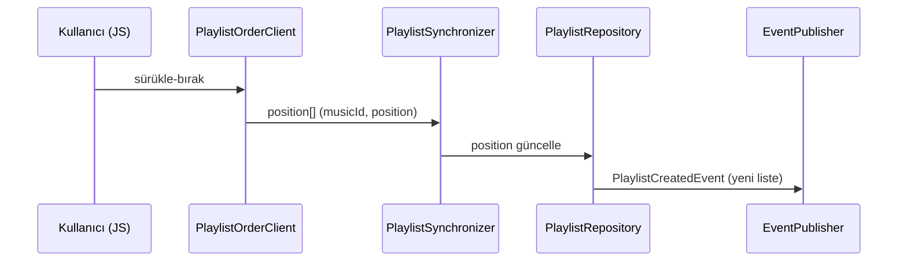

# playlist — Bileşenler (K008)

> **Authority:** Bayram Ali / Vault Steward · 2026-10-15

## §1 MEVCUT BİLEŞEN KADREMİ (kanıt)

| # | Bileşen | Katman | Kanıt |
|---|---|---|---|
| 1 | 5 tablo: `playlist_collaborators` · `playlist_followers` · `playlist_stats` · `playlist_tracks` · `playlists` | Infrastructure (MySQL) | `coremusic_playlist.sql satır 18-35, 37-46, 48-65, 67-82, 84-107` |
| 2 | `PlaylistCreatedEvent` | Domain (event) | `shared/src/Events/Domain/PlaylistCreatedEvent.php satır 20 (implements DomainEventInterface), 53-61 (payload)` |
| 3 | `EventDispatcher` (`dispatch` + `addListener` mekanizması) | Infrastructure | `shared/src/Events/EventDispatcher.php satır 28 (dispatch), satır 50 (addListener)` — 9 domain event `shared/src/Events/Domain/` (9 dosya) |
| 4 | SPA route `playlist` (client girişi) | Presentation (client) | `shared/config/routes.php satır 128-131 (page:'playlist', title:'Playlist')` |
| 5 | Kenar çubuğu playlists bölümü | Presentation (client) | `assets.coremusic.net/js/managers/SidebarManager.js satır 992-996 (id:'playlists')` |
| 6 | API route kaydı `/api/v1/playlist` | Application (routing) | `shared/src/Api/Routing/RouteTable.php satır 99 (handler:'playlistController')` — sınıf OQ-P1 |

## §2 KADEME-3 BİLEŞEN PLANI

| # | Bileşen | Görev | Bağımlılık | Kanıt |
|---|---|---|---|---|
| P1 | `PlaylistRepository` (PHP) | `playlists` + `playlist_tracks` CRUD; `user_id` scoped sorgu | DB | `satır 86` (user_id NOT NULL) |
| P2 | `PlaylistCollaborationService` | rol matrisi: admin=her şey, editor=ekle/sırala, viewer=oku | P1 | `satır 22` (role ENUM viewer/editor/admin) |
| P3 | `PlaylistSynchronizer` | `position` yazımı ↔ API `position` senkronu | P1 | `PlaylistAddTrackRequest.php satır 22, 44-47` |
| P4 | `PlaylistOrderClient` (JS) | yerel sıra + sunucu senkronu (hatayı yutar — R12) | — | `shared/config/routes.php satır 128-131` (SPA playlist route) |
| P5 | `SystemPlaylistGenerator` | `ai` / `auto_generated` / `radio` otomatik listeler | user, media | `satır 91` ENUM playlist_type |
| P6 | `PlaylistCacheWarmer` | `total_tracks`/`total_duration_sec` yeniden hesabı | P1 | `satır 93-94` |
| P7 | `PlaylistEventPublisher` | `PlaylistCreatedEvent` → `EventDispatcher` (R1: bugün yayınlayan yok) | context-mapping | `EventDispatcher.php satır 28 (dispatch)` |

## §3 AKIŞ

**Kardeş dosyalar:** [[index]] · [[playlist-kapsam]] · [[playlist-dogrulama]] · [[playlist-web-arastirma]] · [[playlist-ornekler]]

**Authority:** Bayram Ali / Vault Steward · 2026-10-15
