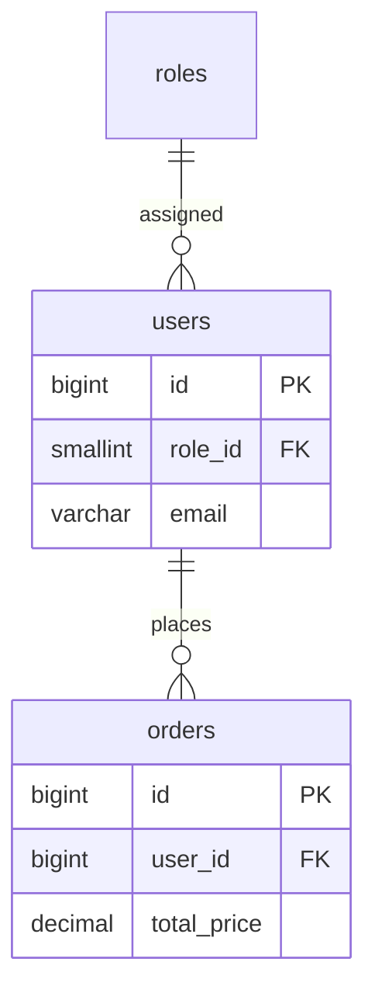

# 08 — Uçtan Uca Örnekler

> Gereksinim → normalize şema → migration → diyagram → doğrulama zinciri.
> Örnekler MySQL 8.0 / InnoDB / utf8mb4. Gerçek PII yok (seed için bkz. templates/seed-template.sql).

## Örnek 1 — Kullanıcı & Rol (1:M, BCNF)

Gereksinim: kullanıcılar; her kullanıcının tek bir rolü; rol adı tekrar etmesin.

```sql
CREATE TABLE roles (
    id SMALLINT UNSIGNED NOT NULL AUTO_INCREMENT,
    code VARCHAR(20) NOT NULL,
    label VARCHAR(50) NOT NULL,
    PRIMARY KEY (id),
    UNIQUE KEY uk_roles_code (code)
) ENGINE=InnoDB DEFAULT CHARSET=utf8mb4 COLLATE=utf8mb4_0900_ai_ci;

CREATE TABLE users (
    id BIGINT UNSIGNED NOT NULL AUTO_INCREMENT,
    role_id SMALLINT UNSIGNED NOT NULL,
    email VARCHAR(255) NOT NULL,
    password_hash VARCHAR(255) NOT NULL,
    is_active TINYINT(1) NOT NULL DEFAULT 1,
    created_at TIMESTAMP NULL DEFAULT CURRENT_TIMESTAMP,
    updated_at TIMESTAMP NULL DEFAULT CURRENT_TIMESTAMP ON UPDATE CURRENT_TIMESTAMP,
    deleted_at TIMESTAMP NULL DEFAULT NULL,
    PRIMARY KEY (id),
    UNIQUE KEY uk_users_email_deleted (email, deleted_at),
    KEY idx_users_role (role_id),
    CONSTRAINT fk_users_roles FOREIGN KEY (role_id) REFERENCES roles (id) ON DELETE RESTRICT
) ENGINE=InnoDB DEFAULT CHARSET=utf8mb4 COLLATE=utf8mb4_0900_ai_ci;
```

Analiz: `role_id → role.code/label` transitive değil çünkü roller ayrı tabloda (3NF/BCNF uyumlu).
`email` unique + soft delete → `(email, deleted_at)` composite unique.

## Örnek 2 — Playlist ↔ Track (M:M junction)

```sql
CREATE TABLE playlist_track (
    playlist_id BIGINT UNSIGNED NOT NULL,
    track_id BIGINT UNSIGNED NOT NULL,
    position INT UNSIGNED NOT NULL DEFAULT 0,
    added_at TIMESTAMP NULL DEFAULT CURRENT_TIMESTAMP,
    PRIMARY KEY (playlist_id, track_id),
    KEY idx_playlist_track_track (track_id),
    CONSTRAINT fk_pt_playlist FOREIGN KEY (playlist_id) REFERENCES playlists (id) ON DELETE CASCADE,
    CONSTRAINT fk_pt_track FOREIGN KEY (track_id) REFERENCES tracks (id) ON DELETE CASCADE
) ENGINE=InnoDB DEFAULT CHARSET=utf8mb4 COLLATE=utf8mb4_0900_ai_ci;
```

Analiz: PK `(playlist_id, track_id)` → 2NF uyumlu (position/sadece ikiliye bağımlı, kısmi yok).

## Örnek 3 — BCNF ihlali → çözüm (özet)

`enrollments(student_id, course_id, instructor_id, room)` + `instructor_id → room`
→ instructor_id determinant ama superkey değil → `instructors` tablosuna ayrılmalı.
Tam çözüm: [02-normalization-rules.md](02-normalization-rules.md).

## Örnek 4 — Migration (kolon yeniden adlandırma, expand-contract)

```sql
-- FAZ 1
ALTER TABLE users ADD COLUMN email_canonical VARCHAR(255) NULL;
-- FAZ 2 (chunk backfill)
-- UPDATE users SET email_canonical = LOWER(email) WHERE id BETWEEN ? AND ?;
-- FAZ 3 (root onayı sonrası)
-- ALTER TABLE users DROP COLUMN email, CHANGE email_canonical email VARCHAR(255) NOT NULL;
```

## Örnek 5 — ER diyagramı (Mermaid)



Üretim: `scripts/schema-to-diagram.php` (canlı çalıştırma `VERIFICATION REQUIRED`).

## Örnek 6 — Seed veri (PII yok)

`templates/seed-template.sql` gerçekçi ama sahte veriyle `INSERT` kalıbı verir.

## Doğrulama

Her örnek [checklist.md](checklist.md) PASS maddelerinden geçmeli: PK var, FK index'li,
`SELECT *` yok, hard delete yok, `FLOAT` para yok.
